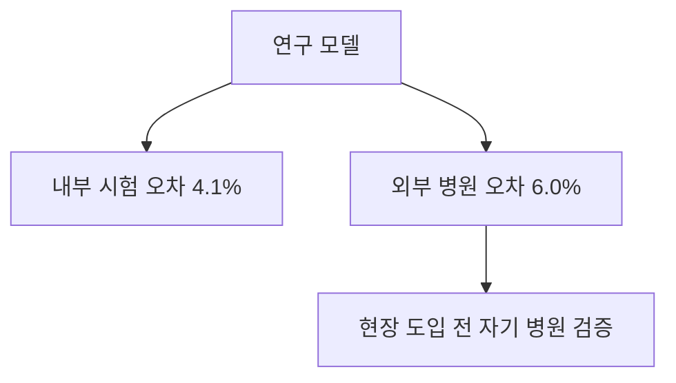

# 심초음파 AI

> 심장 초음파(심초음파, echocardiography) 영상에서 좌심실 박출률(EF, 심장이 한 번 뛸 때 짜내는 피의 비율) 같은 수치를 자동으로 재거나 질환 신호를 찾는 AI. 연구에서는 사람 전문가 수준 이상의 재현성이 보고됐고, 휴대용 초음파 앱에 들어간 상용 기능도 나오고 있다.

## 쉽게 말하면
의사는 초음파 영상에서 심장 벽 모양을 손으로 그려 박출률을 계산한다. 같은 영상을 두 의사가 재도 값이 약간 다르다. AI는 같은 영상이면 모든 박동을 보고 매번 같은 값을 내므로 "재는 사람에 따라 달라지는" 문제를 줄인다. 다만 영상을 제대로 찍는 일은 여전히 숙련이 필요한데, 이를 돕는 AI와 휴대용 장비가 등장했다.

## 자세히
출처: Ouyang 외 Nature 2020 "Video-based AI for beat-to-beat assessment of cardiac function" 초록(IDEAS/RePEc 서지 페이지로 직접 읽음. Nature 본문은 접근 못 함), Clarius EF AI 보도(Diagnostic Imaging, 2026-06-02, 직접 읽음), 그 밖 허가 제품은 검색 결과 요약.
- **연구용 대표 사례(EchoNet-Dynamic)**: 영상 기반 딥러닝이 좌심실 분할, 박출률 추정, 심근병증 평가에서 사람 전문가를 능가한다고 저자들이 주장. 내부 시험 결과: 분할 Dice 0.92, 박출률 평균 절대 오차 4.1%, 박출률 감소형 심부전 분류 AUC 0.97. **다른 병원 시스템의 외부 자료에서는 오차 6.0%, AUC 0.96**으로 성능이 다소 떨어졌다. 반복 측정 전향 시험에서 모델 변동은 사람과 같거나 낮았다. 저자들은 주석된 심초음파 영상 10,030개를 공개했다.
- **왜 영상(비디오) 기반인가**: 사람은 소수의 심박동만 재서 관찰자 간 차이가 크다. 모델은 여러 박동 정보를 써서 미세한 변화를 볼 수 있다고 주장.
- **상용 사례**: Clarius Mobile Health의 Ejection Fraction AI가 FDA 510(k) 허가를 받았다고 2026-06-02 보도. 휴대용 초음파 앱에서 박출률을 실시간·수 초 안에 계산한다. 제조사 주장: "수천 개 심장 초음파 뷰로 훈련", "화질·체형 변화에도 매우 정확". **정확도 수치는 보도에 없었고** 사용자 대상도 명시되지 않았다.
- **기타 허가 제품(검색 요약)**: Bay Labs EchoMD AutoEF(2018, 영상 선택과 박출률 계산 자동화), Ultromics EchoGo Heart Failure(2022, 박출률 보존 심부전 탐지), Us2.ai(측정 23종·질환 지표, FDA 허가·CE 마크로 등록 정보에 기재). 세부 허가 내용은 이번에 확인하지 못했다.
- **심전도로 박출률 추정**: 초음파 없이 ECG에서 낮은 박출률 신호를 찾는 소프트웨어도 있다(Tempus ECG-Low EF 등, 검색 요약) — [ECG AI](#ecg-ai)와 이어진다.
- **현장 쟁점(이 글의 정리)**: ① 영상 획득 품질 ② 외부 병원에서의 성능 하락 ③ 측정치 보조와 진단 결정의 경계 ④ 소프트웨어가 기기 안에 들어갈 때의 분류([내장형 AI](#embedded-ai)).

## 그림으로 보기

## 예시
- 지방 병원에서 휴대용 초음파로 박출률을 빠르게 확인해 전원이 필요한지 판단하는 보조 도구(제조사 설명 방향, 효과는 별도 검증 필요).
- 항암치료 중 심독성 감시: 정기 초음파의 박출률 변화를 AI로 일관되게 추적(연구 초록이 언급한 용도).

## 헷갈리는 것과 비교
| 개념 | 차이 |
|---|---|
| 심초음파 AI | 초음파 영상에서 수치·질환 신호 추출 |
| [ECG AI](#ecg-ai) | 전기 신호 파형 분석 |
| 박출률(EF) | 한 번 박동으로 내보내는 혈액 비율 |
| [심혈관 AI 기기](#cardiology-ai-devices) | 심장 분야 허가 AI 전체 |

## 더 읽을거리
- [Video-based AI for beat-to-beat assessment of cardiac function (Nature 2020) — 초록 서지](https://ideas.repec.org/a/nat/nature/v580y2020i7802d10.1038_s41586-020-2145-8.html) — 4.1%·6.0%·AUC 수치(직접 읽음)
- [FDA Clears AI Ultrasound Software for Automated LVEF Calculation (Diagnostic Imaging, 2026-06-02)](https://www.diagnosticimaging.com/view/fda-ai-ultrasound-software-automated-lvef-calculation) — Clarius 사례(직접 읽음)
- [Nature 원문](https://www.nature.com/articles/s41586-020-2145-8) — 이번에 열지 못함
