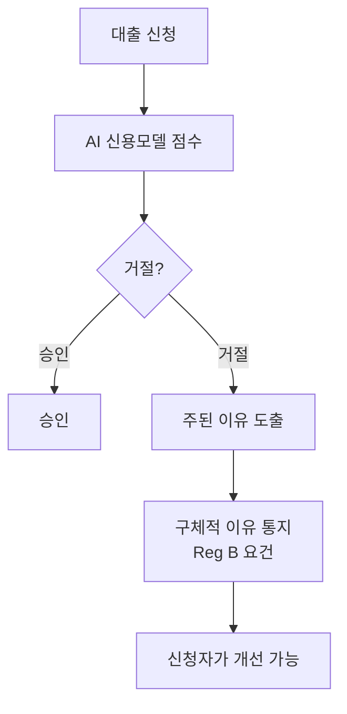

# ECOA·Reg B

> 미국 평등신용기회법(ECOA)과 그 시행 규칙 Regulation B. 대출을 거절할 때 구체적인 이유를 통지하도록 요구하며, AI 모델을 써도 마찬가지다.

## 쉽게 말하면
은행이 "AI가 거절했어요"라고만 말할 수 없다. 거절당한 사람이 무엇을 고치면 되는지 알 수 있게 주된 이유를 적어 줘야 한다. 모델이 복잡해져도 이 설명 의무는 줄지 않는다.

## 자세히
- ECOA는 인종·성별·연령 등으로 신용 차별을 금지하고, Reg B는 거절·불리한 조치 시 **불리한 조치 통지(adverse action notice)**에 구체적 이유를 담게 한다.
- CFPB는 2022년 5월(회람 2022-03)과 2023년 9월 19일(회람 2023-03)에 AI·복잡한 신용모델에도 같은 의무가 있다고 밝혔다. 양식의 체크 항목은 실제 주된 이유를 반영할 때만 인정.
- 예: 직업을 이유로 AI가 거절했는데 '소득 부족'만 적으면 부족할 수 있다. 행동 데이터 기반 한도 인하에 "구매 이력"만 적는 것도 모호할 수 있다.
- 현황 주장: 한 블로그는 CFPB가 2025년 두 회람을 철회했으나 구체적 이유 요건은 유지된다고 한다. 공식 확인 필요.
- AI 영향: 블랙박스 모델은 [설명 가능성](#adverse-action-explainability) 기법으로 이유를 도출해야 한다.

## 그림으로 보기

## 예시
- AI가 "최근 계좌 잔액 변동성"을 핵심 요인으로 썼다면 통지문에 그 취지의 이유를 적어야 하고, "신용 점수 낮음"만 적으면 부족할 수 있다.
- 교육 활용: 금융권 AI 도입 사례에서 "설명서 자동 생성 프로세스"를 요구사항으로 포함.

## 헷갈리는 것과 비교
| 개념 | 차이 |
| --- | --- |
| ECOA | 차별 금지 법 |
| Reg B | ECOA 시행 규칙, 통지 규정 포함 |
| [설명 가능성](#explainability) | 이유 도출 기술 |
| [EU AI Act](#eu-ai-act-gpai) | 유럽 규제, 신용평가는 고위험으로 분류됨(이 글에서 미확인) |

## 더 읽을거리
- [Skadden: CFPB Applies Adverse Action Notification Requirement to AI](https://www.skadden.com/insights/publications/2024/01/cfpb-applies-adverse-action-notification-requirement) — 2023-03 회람 해설
- [Venable: CFPB Weighs in on Credit Denials](https://www.venable.com/insights/publications/2023/09/cfpb-weighs-in-on-credit-denials-by-lenders) — 체크리스트 양식 한계
- [Governome: CFPB and AI-Driven Credit Decisions](https://governome.com/regulations/cfpb-and-ai-driven-credit-decisions-what-adverse-action-notices-require) — 철회 주장(미확인)
