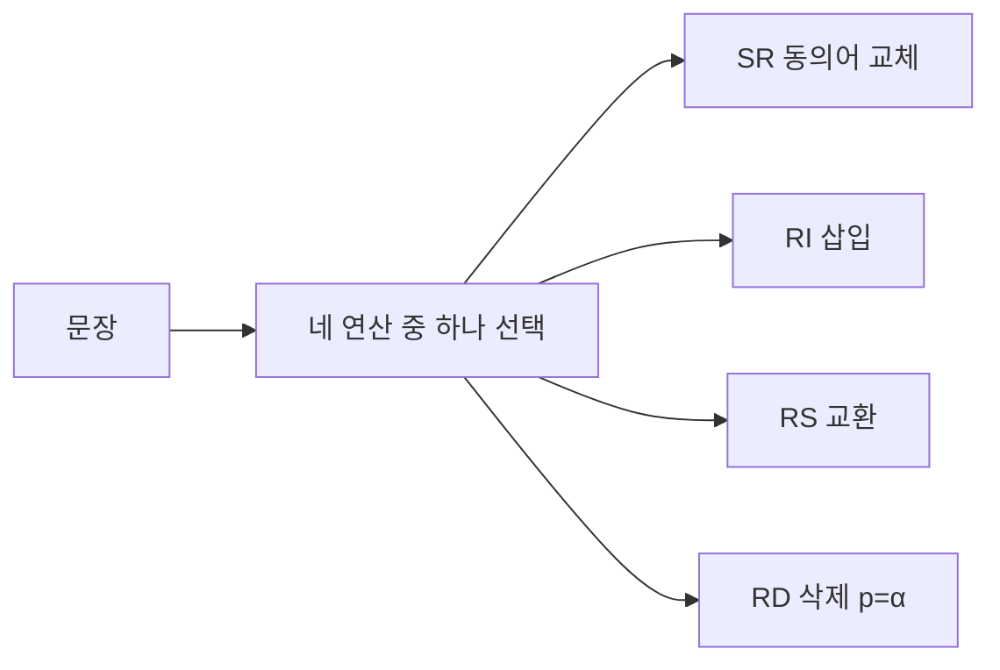
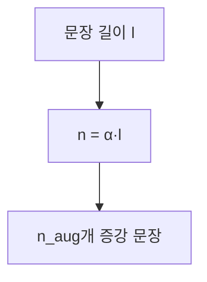

# EDA 네 가지 연산

> EDA(Easy Data Augmentation)는 텍스트 분류용 증강으로, **동의어 교체(SR)·무작위 삽입(RI)·무작위 교환(RS)·무작위 삭제(RD)** 네 가지 단순 연산만 쓴다. 바꾸는 단어 수는 문장 길이에 비례하는 α로 정한다.

## 쉽게 말하면
문장의 단어 몇 개를 비슷한 말로 바꾸거나, 단어 하나를 끼워 넣거나, 두 단어 자리를 맞바꾸거나, 몇 개를 빼먹는다. "사람이 슬쩍 오타 낸 정도"의 변형을 만들어 모델이 한 문장 표현에 지나치게 매달리지 않게 한다.

## 자세히
- 출처: Wei & Zou, *EDA: Easy Data Augmentation Techniques for Boosting Performance on Text Classification Tasks*(arXiv 1901.11196)을 PDF로 읽었다.
- 네 연산(논문 3장; 주어진 문장에서 **네 가지 중 하나를 무작위로 골라** 적용):
  1. **SR**: 불용어가 아닌 단어 n개를 골라 각각 무작위 동의어로 교체.
  2. **RI**: 불용어가 아닌 무작위 단어의 무작위 동의어를 문장의 임의 위치에 삽입, n번 반복.
  3. **RS**: 두 단어를 무작위로 골라 자리 교환, n번 반복.
  4. **RD**: 각 단어를 확률 p로 삭제.
- **α의 의미**: 긴 문장은 잡음을 더 잘 흡수하므로 n = α·l(l은 문장 길이)로 바꿀 단어 수를 정하고, RD는 p=α를 쓴다. 문장마다 n_aug개의 증강 문장을 만든다.
- 논문 결과(5개 텍스트 분류 과제, CNN·RNN, 5개 시드 평균): 평균 개선은 전체 데이터에서 0.8%p, 학습 500개에서 3.0%p. 요약에 따르면 EDA와 **학습 데이터의 50%만 써도 전체 데이터로 일반 학습한 것과 같은 정확도**가 나왔다. 평균 정확도 예(Table 2, %): 학습 500개 76.9 → 79.9, 전체 87.8 → 88.6.
- 권장 값(논문 Table 3): 학습 500개 α=0.05·n_aug=16, 2,000개 α=0.05·n_aug=8, 5,000개 α=0.1·n_aug=4, 더 많으면 α=0.1·n_aug=4. 데이터가 적을수록 많이 만든다.
- 직접 구현해 본 예(내 간이 코드, 사전 5단어만 사용한 동의어; 17단어 문장, 시드 3): 원문 `the new phone has a great camera but the battery life is very short for heavy users`
  - SR: …for **intensive** users, RI: the new **intensive** phone…, RS: …but **heavy** battery life is very short for **the** users, RD: …battery life very short for users(is 삭제, 2개 단어 삭제).
  - α=0.05·0.1이면 17단어 문장에서 n이 1(내림 후 최소 1로 보정한 내 구현), α=0.2면 3. 즉 **짧은 문장에서는 α가 작아도 최소 한 단어는 바뀐다**.
- 한계: 부정어(not)를 삭제하거나 교환하면 뜻이 뒤집힐 수 있다([보호 단어 목록](#protected-keywords)). 작은 데이터와 단순 모델(CNN·RNN) 기준이며, 사전학습 언어모델에서는 이득이 줄어든다는 보고가 있다(일반적 지적, 이 지도에서 확인하지 않음).

## 그림으로 보기

## 예시
- 데이터 500개 감성 분류: α=0.05, n_aug=16으로 증강 → 학습 데이터가 17배.
- 교육: "아주 단순한 규칙으로도 데이터를 늘릴 수 있다"는 입문 사례 + "의미를 바꾸는 증강 주의".

## 헷갈리는 것과 비교
| 개념 | 차이 |
|---|---|
| EDA | 단어 단위의 단순 규칙 연산 |
| [역번역](#back-translation-augmentation) | 번역을 거쳐 문장 전체를 재구성 |
| [TF-IDF 단어 치환](#tfidf-word-replacement) | 정보량 낮은 단어만 교체 |
| [텍스트 증강의 라벨 보존](#text-augmentation-label-preservation) | 증강 후에도 라벨이 맞는지 |

## 더 읽을거리
- [EDA: Easy Data Augmentation Techniques (arXiv 1901.11196)](https://arxiv.org/abs/1901.11196) — 3~4장·Table 2·3(읽음).
- 직접 구현: 파이썬 30줄로 네 연산 시험.
