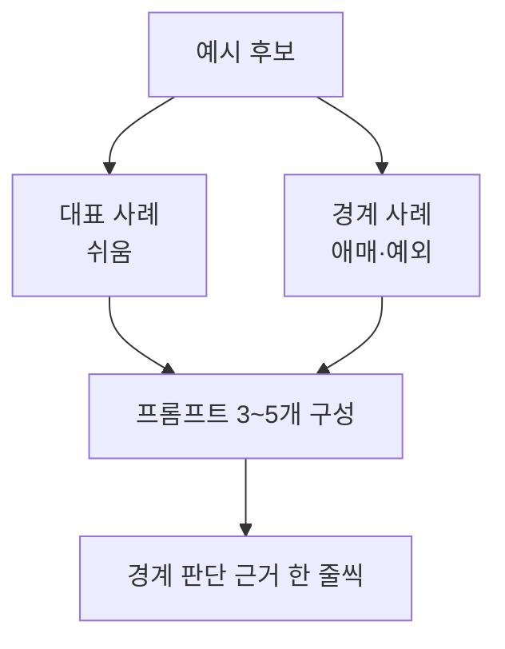
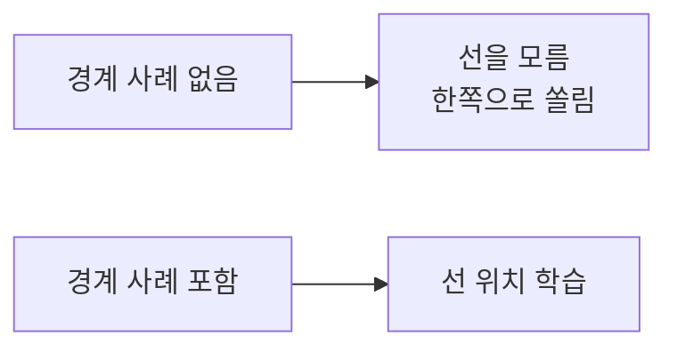

# 경계 사례 예시

> 경계 사례 예시는 few-shot 프롬프트에 쉬운 대표 사례만이 아니라 판단이 갈리는 애매한 사례(분류 경계, 예외, 오타, 빈 입력 등)를 일부 넣는 것이다. 모델이 규칙의 경계를 어디에 그어야 하는지 배우게 한다.

## 쉽게 말하면
신입에게 "환불 가능 사례"만 다섯 개 보여 주면 모든 요청을 환불해 준다. "기한이 하루 지난 경우", "사용 흔적이 있는 경우" 같은 애매한 사례와 그 판단을 같이 보여 줘야 선을 안다.

## 자세히
- **공식 권고(Anthropic Prompting best practices, 2026-11 열람)**: 예시는 실제 사용 사례를 닮은 **관련성**, 경계 사례를 포함하고 모델이 의도하지 않은 패턴을 배우지 않도록 충분히 다른 **다양성**, 지시와 구분되도록 `<example>`(여러 개는 `<examples>`) 태그로 감싼 **구조화**를 갖추라고 한다. 3~5개를 권하고, 예시의 관련성·다양성을 Claude에게 평가시키거나 추가 예시를 생성하게 할 수도 있다고 안내한다. 사고(thinking)를 쓰는 모델에서도 예시가 사고 방식을 안내한다고 한다.
- **실무 휴리스틱(2차 자료, 검색 요약)**: 쉬움·보통·복잡 단계로 나눠 복잡한 쪽에 예외·오류 처리를 넣는다. 마지막 예시가 영향력이 크다는 주장에 따라 가장 전형적인 예를 마지막에 두라는 조언도 있으나 비공식이므로 직접 실험해 확인한다.
- **위험**: 예시에 이상한 경계 사례나 실수가 있으면 모델이 그대로 따라 한다(2차 자료). 경계 사례는 정답 판단 근거를 한 줄 붙여 일관되게 쓴다.
- **개수와 균형**: 경계 사례만 많이 넣으면 모든 입력을 예외로 취급할 수 있다(해석). 대표 사례를 중심으로 하고 경계 사례를 일부 섞는다.
- **어떻게 찾나**: 평가에서 자주 틀리는 입력, 담당자가 헷갈려 하는 사례, 로그의 사람 번복 건에서 고른다. 고른 사례는 [보류 평가 세트](#held-out-eval-set)와 겹치지 않게 한다.
- 경계 사례를 넣으면 성능이 얼마나 오르는지 직접 시험한 논문은 이번 조사에서 찾지 못했다. [예시 고르기](#example-selection) 글의 관련성·다양성 연구가 간접 근거다.

## 그림으로 보기

## 예시
- 문의 분류: "배송 지연이라고 했지만 사실 주소 오류"처럼 두 분류에 걸친 사례를 하나 넣고 "주소 오류로 분류, 이유: 원인이 고객 입력"이라고 적는다.
- 프롬프트 예: `<examples><example>입력: ... 출력: ... 이유: 기한 하루 초과이므로 불가</example></examples>`

## 헷갈리는 것과 비교
| 개념 | 차이 |
| --- | --- |
| [예시 고르기](#example-selection) | 상위 주제. 경계 사례는 선택 기준의 하나 |
| 대표 사례 | 전형적이고 쉬운 입력. 기본 골격을 만듦 |
| 적대적 사례(red team) | 일부러 속이려는 입력. 경계 사례는 정상 범위 안의 애매함 |

## 더 읽을거리
- [Anthropic: Prompting best practices — Use examples effectively](https://platform.claude.com/docs/en/build-with-claude/prompt-engineering/multishot-prompting) — 관련·다양·구조화, 3~5개 권고
