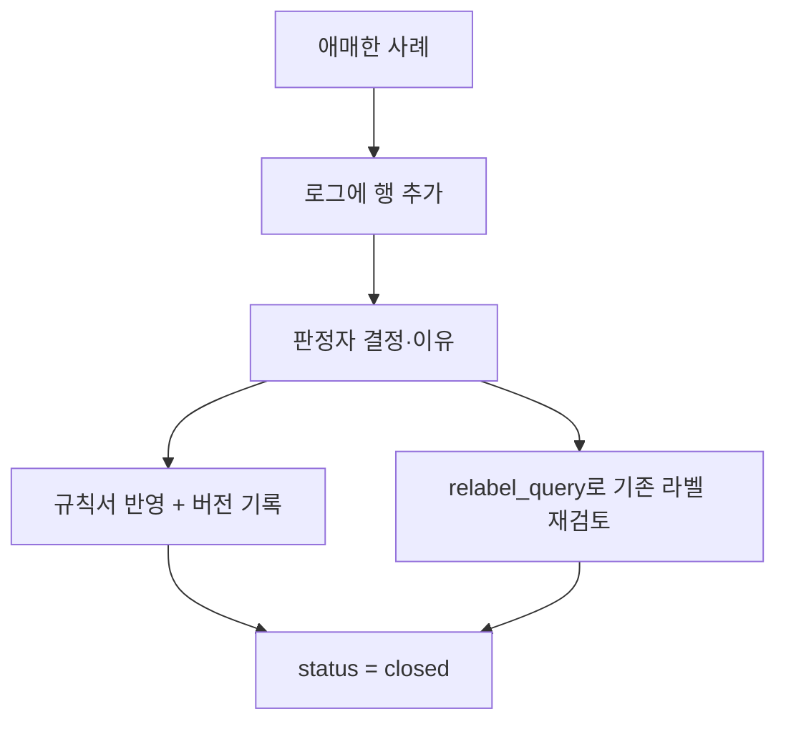
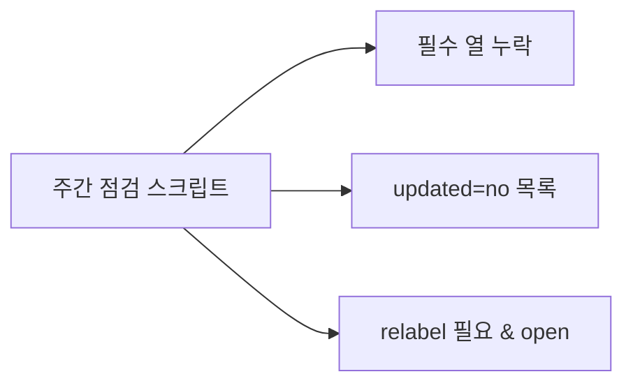

# 경계 사례 로그 양식

> 라벨링 중 나온 애매한 사례를 **일정한 열(ID·결정·이유·반영 여부·재검토 여부)**로 기록하는 표 양식이다. 열을 고정하면 규칙서에 아직 안 들어간 결정과 다시 손봐야 할 기존 라벨을 쿼리로 찾을 수 있다.

## 쉽게 말하면
병원 접수대의 "예외 처리 장부"다. 예외가 생길 때마다 같은 칸에 적어 두면, 나중에 "아직 규정에 반영 안 된 예외가 뭐지?"를 장부만 보고 알 수 있다.

## 자세히
- 이 노드의 양식은 [경계 사례 기록](#guideline-edge-case-log)이 제안한 항목을 **실제 표(CSV) 열로 구체화한 제안**이다(공식 표준이 아니다).
- **권장 열**
  | 열 | 의미 | 필수 |
  |---|---|---|
  | `id` | E-001처럼 증가 번호 | ✔ |
  | `date` | 발견·결정 날짜 | ✔ |
  | `case_text` | 사례 원문(개인정보는 마스킹) | ✔ |
  | `candidates` | 후보 라벨(`환불|불만`) | |
  | `decision` | 결정한 라벨·처리 | ✔ |
  | `reason` | 결정 이유 한 줄 | ✔ |
  | `decided_by` | 결정자(판정자·작성자) | ✔ |
  | `guideline_version_added` | 반영된 가이드 버전(v0.3) | 반영 시 ✔ |
  | `guideline_updated` | 규칙서에 반영했나(yes/no) | ✔ |
  | `relabel_needed` | 기존 라벨 재검토 필요(yes/no) | ✔ |
  | `relabel_query` | 재검토 대상을 찾는 검색식 | 필요 시 ✔ |
  | `status` | open/closed | ✔ |
- **직접 검증(샘플 4건짜리 CSV를 파이썬으로 점검)**: ① 필수 열 누락 0건 ② `guideline_updated=no`인 결정 → `E-016`(규칙서 미반영) ③ `relabel_needed=yes`이면서 `open` → `E-016`, `E-017`과 각각의 검색식 ④ `updated=yes`인데 버전이 비어 있는 행 없음. 이런 점검을 정기 회의 전에 자동으로 돌리면 놓치는 결정이 줄어든다.
- **운영 규칙(제안)**
  1. 결정은 **판정자 한 명**이 확정하고 사유를 반드시 적는다([판정자 역할](#adjudicator-role)).
  2. 주 1회 `guideline_updated=no`를 규칙서에 반영하고 버전을 올린다([가이드 버전 관리](#guideline-versioning)).
  3. `relabel_needed=yes`는 재검토 대상 쿼리를 돌려 담당자를 배정하고 `closed`로 바꾼다.
  4. 개인정보·기밀은 마스킹해서 `case_text`에 넣는다.
  5. 한 줄 사례를 가이드 예시로 승격할 땐 대표 사례만 고른다(너무 많은 예시는 가독성 저하).
- LLM 라벨러에는 이 로그의 사례를 few-shot 예시로 쓸 수 있다.

## 그림으로 보기



## 예시
```csv
id,date,case_text,decision,reason,decided_by,guideline_version_added,guideline_updated,relabel_needed,relabel_query,status
E-016,2026-11-09,카드 결제는 됐는데 배송 안 와요,배송,결제는 성공했고 문제는 배송,박검수,,no,yes,"text contains 결제 AND 배송",open
```
- 이 로그를 스프레드시트에 두고 `guideline_updated=no` 필터를 주간 회의 안건으로 삼는다.

## 헷갈리는 것과 비교
| 개념 | 차이 |
|---|---|
| 경계 사례 로그 양식 | 기록 열의 구조 |
| [경계 사례 기록](#guideline-edge-case-log) | 기록하는 행위·목적 |
| [가이드 버전 관리](#guideline-versioning) | 반영 후 버전 추적 |
| 이슈 트래커 | 코드 버그용(양식 개념은 유사) |

## 더 읽을거리
- [Overview of Annotation Creation (arXiv 1602.05753)](https://arxiv.org/abs/1602.05753) — 가이드 버전 추적과 주석 오류 점검을 프로젝트 과제로 제시.
