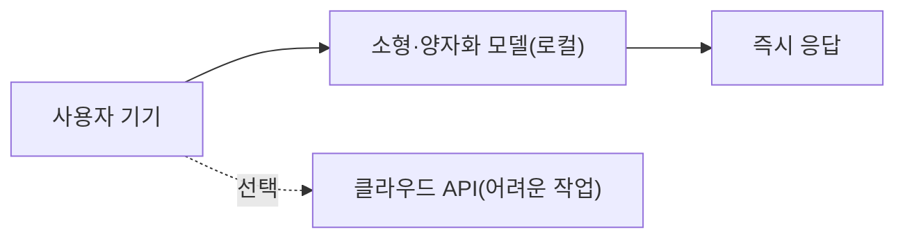
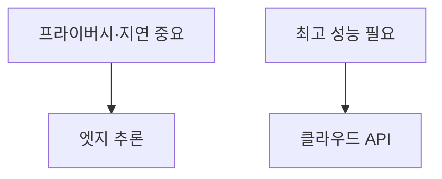

# 엣지 추론

> **엣지 추론**은 모델을 클라우드가 아니라 **내 기기(노트북·휴대폰·현장 장비) 안에서** 돌리는 것이다. 지연·데이터 전송·프라이버시 부담을 줄이는 대신 작은 모델과 양자화가 필요하다.

## 쉽게 말하면
번역을 멀리 있는 통역 센터에 전화해서 받느냐, 주머니 속 통역기로 바로 하느냐의 차이다. 통역기는 즉각적이고 내용이 밖으로 나가지 않지만, 센터만큼 똑똑하지는 않다.

## 자세히
- **llama.cpp**(GitHub 확인): "LLM 추론을 C/C++로". 목표는 **최소한의 설정으로 폭넓은 하드웨어에서 높은 성능**의 LLM(및 멀티모달) 추론을 로컬·클라우드에서 가능하게 하는 것. MIT 라이선스. 설치는 스크립트·Docker·릴리스 바이너리·소스 빌드. 시작 예: `llama cli -hf <HF 모델>`(허깅페이스에서 받아 실행), `llama serve -hf <모델>`(OpenAI 호환 API 서버). 지원 하드웨어·양자화 비트 폭의 구체 목록은 README에 없어 확인하지 않았다.
- **Ollama**(GitHub 확인): 오픈 모델을 로컬/클라우드에서 쓰는 도구로, 백엔드로 llama.cpp를 쓴다고 명시. 설치 `curl -fsSL https://ollama.com/install.sh | sh`(macOS·Linux), `ollama run gemma4` 같은 한 줄 실행, REST API(`localhost:11434`)와 Python·JS 클라이언트 제공.
- **장단점**(일반 지식): 장점은 낮은 지연, 네트워크 불필요, 데이터가 기기에 머무름. 단점은 모델 크기·정확도 한계, 기기 사양 의존, 업데이트·관리 부담.
- 선택은 [모델 호스팅 옵션](#model-hosting-options)과 [로컬+API 혼합](#hybrid-local-api)에서 이어서 본다.

## 그림으로 보기



## 예시
```bash
curl -fsSL https://ollama.com/install.sh | sh
ollama run gemma4        # 로컬에서 대화
```
- 인터넷이 불안정한 공장 현장에서 점검 보고서 요약을 기기 안에서 처리.

## 헷갈리는 것과 비교
| 방식 | 특징 |
|---|---|
| 엣지(로컬) 추론 | 기기 안 실행, 사양 제약 |
| 클라우드 API | 고성능, 데이터 전송 |
| 셀프호스팅 서버 | 내 서버에서 운영(예: vLLM) |
| [로컬+API 혼합](#hybrid-local-api) | 쉬운 일은 로컬, 어려운 일은 API |

## 더 읽을거리
- [llama.cpp](https://github.com/ggml-org/llama.cpp)
- [Ollama](https://github.com/ollama/ollama)
