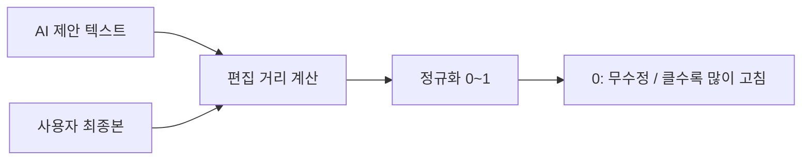

# 편집 거리 지표

> AI 제안과 사용자의 최종본이 얼마나 다른지를 글자(또는 단어) 수정 횟수로 재는 지표. 레벤슈타인(Levenshtein) 거리가 대표적이다.

## 쉽게 말하면
초안을 최종본으로 만들려면 몇 글자를 지우고 넣고 바꿔야 하는지 센 것이다. 숫자가 작으면 AI 초안이 거의 그대로 쓰였다는 뜻이다.

## 자세히
- **레벤슈타인 거리**: 한 문자열을 다른 문자열로 바꾸는 데 필요한 삽입·삭제·치환의 최소 횟수. 고전 예시 "kitten" → "sitting" = 3(직접 계산해 확인).
- **정규화**: 길이가 다른 문서를 비교하려면 거리를 더 긴 문자열 길이로 나눈 비율(0~1)을 쓴다. 한국어 예시(직접 계산): "환불은 7일 이내 가능합니다" → "환불은 14일 이내에 가능합니다"는 거리 3, 긴 쪽 길이 17이라 약 0.18.
- **쓰임**: 제안과 최종본의 차이를 재서 AI가 실제로 얼마나 쓰이는지 파악. 수락률([제안 수락률](#suggestion-acceptance-rate))이 "받아들였나"만 본다면 편집 거리는 "얼마나 고쳤나"를 본다. 무수정 여부는 거리 0인지로 판정([무수정 수락률](#accept-without-edit-rate)).
- **한계**: 글자 수가 같아도 의미 변화는 다르다(숫자 하나가 바뀌면 거리는 작지만 의미는 크게 달라짐). 문단 순서 이동은 큰 거리로 계산된다. 의미 수준 차이는 임베딩 유사도나 사람 평가와 함께 본다.
- **단위 선택**: 글자·단어·토큰 기준에 따라 값이 달라지므로 기준을 고정한다. 코드에서는 AST 차이나 줄 단위 차이가 쓰이기도 한다(일반 설명).

## 그림으로 보기


## 예시
```python
def lev(a, b):
    d = list(range(len(b)+1))
    for i, ca in enumerate(a, 1):
        p, d[0] = d[0], i
        for j, cb in enumerate(b, 1):
            p, d[j] = d[j], min(d[j]+1, d[j-1]+1, p+(ca != cb))
    return d[-1]
print(lev("kitten", "sitting"))  # 3
```

## 헷갈리는 것과 비교
| 개념 | 차이 |
|---|---|
| 편집 거리 | 표면 문자 차이 |
| 의미 유사도 | 의미 차이 |
| 수락률 | 수락 여부만 |

## 더 읽을거리
- [Productivity Assessment of Neural Code Completion](https://arxiv.org/abs/2205.06537) — 수락·지속성 지표 비교(초록 확인)
