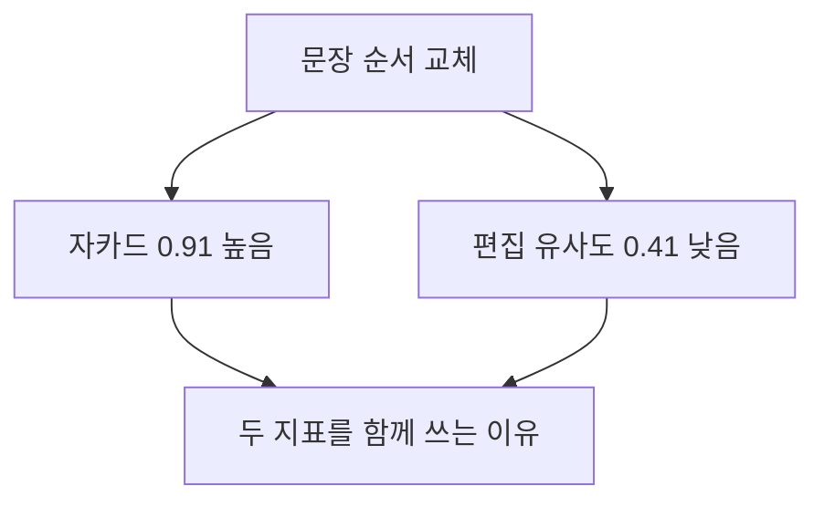

# 편집 유사도

> 한 문자열을 다른 문자열로 바꾸는 데 필요한 **최소 편집 횟수(삽입·삭제·치환)**를 길이로 나눠 1에서 뺀 값이다. MinHash가 뽑은 후보 쌍이 정말 비슷한지 확정하는 2차 검증에 쓴다.

## 쉽게 말하면
두 문장을 나란히 놓고 "글자를 몇 번 고치면 같아지나"를 센다. 오타 하나는 한 번이면 되니 거의 같은 글이고, 문장 순서를 통째로 뒤집으면 여러 번 고쳐야 하니 다른 글로 본다. 자카드가 "같은 조각이 얼마나 많나"를 본다면 편집 유사도는 "같은 순서로 얼마나 맞나"를 본다.

## 자세히
- **정의**: 레벤슈타인 거리는 삽입·삭제·치환을 각각 1로 센 최소 편집 수이고, 표준 동적계획법은 시간·공간 Θ(mn)이다(Wikipedia 확인). 편집 유사도 = 1 − 거리/max(길이). 비교 단위(바이트·코드포인트·토큰)와 유니코드 정규화를 정해야 값이 일관된다.
- **중복 제거에서의 역할**: Lee 외(2021)의 NearDup은 MinHash(서명 9,000, b=20, r=450)로 후보를 만든 뒤, 실제 자카드 0.8 초과·**편집 유사도 0.8 초과**인 쌍만 중복으로 확정했다(ar5iv 본문 확인). 후보는 싸게, 확정은 정밀하게 하는 2단계다.
- **직접 계산**(글자 5-그램 자카드 vs 글자 단위 편집 유사도, 문장 한 쌍씩 1회):

| 변형 | 자카드 | 편집 유사도 |
|---|---|---|
| 주문번호·요일만 바꾼 양식 | 0.74 | 0.93 |
| 오타 2개 | 0.85 | 0.98 |
| 앞뒤 문장 순서 교체 | 0.91 | **0.41** |
| 의역(다른 단어) | 0.12 | 0.45 |
| 무관한 문장 | 0.00 | 0.23 |

- 해석: 순서를 바꾸면 자카드는 높고 편집 유사도는 낮다(순서 무시 vs 순서 민감). 양식형·오타 변형은 둘 다 높다. 의역은 둘 다 낮아 못 잡는다([패러프레이즈 한계](#paraphrase-dedup-limit)). 이는 소수 예시이며 임계값 권고가 아니다.
- **비용**: Θ(mn)이라 긴 문서에 전부 적용하기 비싸다. 그래서 후보 쌍에만 적용한다.

## 그림으로 보기

## 예시
- 고객 응대 로그: 템플릿 문장이 주문번호만 다른 수십만 건을 NearDup으로 묶고 편집 유사도로 확정.
- 교육: 같은 문장 쌍에 자카드와 편집 유사도를 모두 계산해 두 지표가 갈리는 사례를 찾아보게 한다.

## 헷갈리는 것과 비교
| 개념 | 차이 |
|---|---|
| [자카드](#jaccard-threshold-tuning) | 조각 집합의 겹침, 순서 무시 |
| 편집 유사도 | 순서를 지킨 최소 편집 횟수 |
| [MinHash](#minhash) | 자카드를 싸게 근사하는 서명 |
| [ExactSubstr vs NearDup](#exactsubstr-vs-neardup) | 편집 유사도는 NearDup 확정에 사용 |

## 더 읽을거리
- [Levenshtein distance — Wikipedia](https://en.wikipedia.org/wiki/Levenshtein_distance) — 정의, Θ(mn), 정규화 주의(열어 확인).
- [Deduplicating Training Data Makes Language Models Better](https://ar5iv.labs.arxiv.org/html/2107.06499) — NearDup의 편집 유사도 확정 단계(열어 확인).
