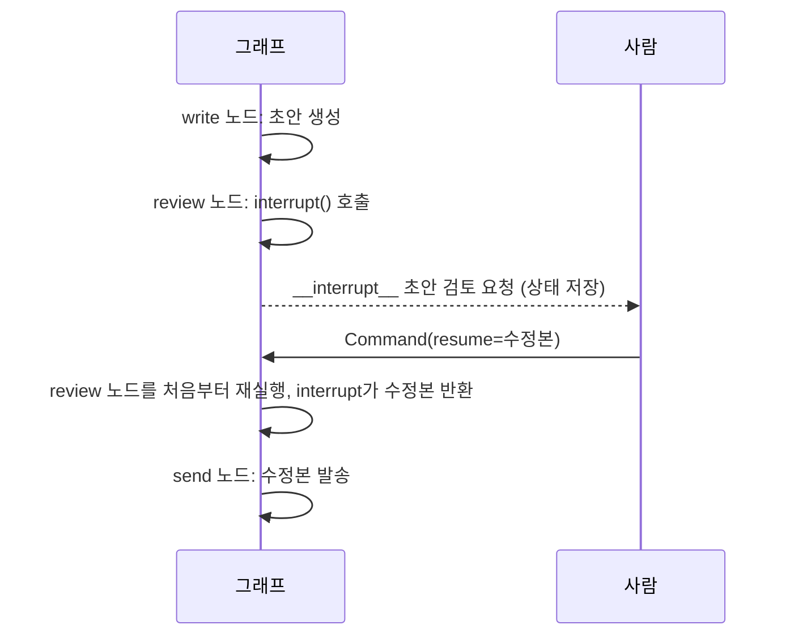

# 상태 수정 후 재개

> LangGraph에서 그래프가 **`interrupt()`로 사람의 검토를 기다리며 멈췄을 때, 사람이 값을 고치거나 승인해 `Command(resume=값)`으로 이어 실행**하는 방식. 에이전트 초안·도구 호출 인자를 **사람이 확인·수정한 뒤 진행**하게 하는 사람 개입(human-in-the-loop)의 핵심이다.

## 쉽게 말하면
직원이 쓴 메일 초안이 발송 직전에 "검토 대기" 서랍에 들어가고, 상사가 문구를 고쳐 "승인"하면 고친 내용으로 발송되는 흐름이다. 서랍에 들어간 동안 업무 상태는 그대로 저장된다.

## 자세히
(LangGraph 공식 문서 Interrupts + 직접 실행, langgraph 1.2.24)
- **멈추기**: 노드 안에서 `interrupt()`를 호출하면 그래프가 그 지점에서 **일시 중지**된다. **체크포인터가 상태를 저장**하고, 전달한 내용(페이로드)이 호출자에게 반환되며(`invoke()`는 `__interrupt__`), 그래프는 **무기한 대기**한다.
- **재개**: 같은 설정(`thread_id`)으로 다시 `invoke(Command(resume=값))`를 호출하면 그 **값이 `interrupt()` 호출의 반환값**이 된다. 필수 조건은 **체크포인터(운영에서는 영속형)와 `thread_id`**이며, 같은 `thread_id`를 쓰면 같은 실행을 이어 가고 새 ID면 새 스레드가 시작된다.
- **직접 실행**(노드 `write` → `review`(interrupt) → `send`):

| 단계 | 결과 |
|---|---|
| 1) 첫 실행 | **중단**: `__interrupt__`에 `{'검토 요청': '[초안] 환불 승인 메일'}`, 저장된 상태 `draft='[초안] 환불 승인 메일', sent=''`, **다음 노드 `('review',)`** |
| 2) `Command(resume="[수정본] 환불 승인 메일 — 금액 3만원 확인")`로 재개 | `draft`가 수정본으로 바뀌고 `sent='발송됨: [수정본] 환불 승인 메일 — 금액 3만원 확인'` — **사람이 고친 값으로 발송** |

- **꼭 지킬 규칙**(문서):
  1. **재실행 주의**: 재개하면 노드가 **`interrupt()` 줄이 아니라 노드 처음부터** 다시 실행된다. interrupt **앞의 코드는 다시 실행**되므로 그곳의 부작용(메일 발송·결제)은 **멱등**이어야 하며, 부작용은 **interrupt 뒤**에 두는 편이 안전하다([멱등성](#idempotency)).
  2. **bare `try/except` 금지**: `interrupt()`는 특수 예외로 멈추므로 넓은 `except`가 삼켜 버린다. 구체적 예외만 잡거나 interrupt를 `try` 밖에 둔다.
  3. **호출 순서 고정**: 재개 값은 interrupt를 **위치로** 대응시키므로 순서를 바꾸거나 비결정적 데이터로 반복하지 않는다.
  4. **재시도는 조건부 간선으로**: 한 노드 안에서 `while True`로 묻지 말고 interrupt를 한 번 호출하고 값이 유효하지 않으면 조건부 엣지로 같은 노드로 되돌린다.
  5. **직렬화 가능한 값만** interrupt에 전달(문자열·숫자·딕셔너리·리스트).
- **쓰임새**: 승인(예/아니오), 초안 수정, 도구 호출 인자 확인, 모호한 질문에 사람이 답하기.
- 한계: 대기 중 상태는 체크포인터 저장소에 있으므로 인메모리는 프로세스 종료 시 사라진다([상태와 장기 메모리](#state-vs-memory)).

## 그림으로 보기


## 예시
```python
from langgraph.types import interrupt, Command

def review(state):
    edited = interrupt({"검토 요청": state["draft"]})   # 멈춤, 사람 입력 대기
    return {"draft": edited}

r = app.invoke(inputs, cfg)                               # r["__interrupt__"] 확인
app.invoke(Command(resume="[수정본] ..."), cfg)           # 같은 thread_id로 재개
```
- 업무 예: 고객 환불 메일 자동 작성 → 담당자가 금액·문구를 확인·수정 → 발송.

## 헷갈리는 것과 비교
| 개념 | 차이 |
|---|---|
| 상태 수정 후 재개 | interrupt로 멈춘 뒤 사람 입력으로 이어 감 |
| [타임 트래블](#time-travel) | 과거 체크포인트로 돌아가 다시 실행·포크 |
| [사람 관문 설계](#human-gates) | 어디에 사람 승인을 둘지의 설계 |
| [멱등성](#idempotency) | 재실행에도 안전하게 만드는 성질 |

## 더 읽을거리
- [LangGraph: Interrupts](https://docs.langchain.com/oss/python/langgraph/interrupts) — interrupt와 resume 규칙.
