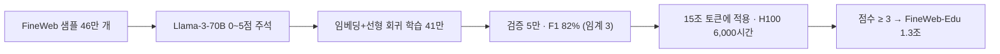
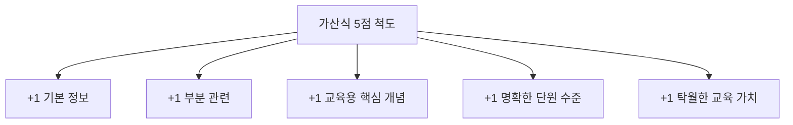

# 교육 품질 분류기

> 웹 문서가 "학습에 도움이 되는 교육적 내용인가"를 0~5점으로 매기는 작은 분류기(회귀 모델)다. FineWeb-Edu는 LLM이 일부 문서에 매긴 점수를 임베딩 위의 선형 회귀로 학습시키고, 15조 토큰 전체에 적용해 점수 3 이상만 남겨 만들었다.

## 쉽게 말하면
교사가 샘플 45만 장의 학습지에 점수를 매겨 주면, 그 채점 기준을 배운 조교(작은 모델)가 나머지 수억 장을 빠르게 채점한다. 비싼 채점자(큰 LLM)의 판단을 싼 채점자(작은 모델)로 복제하는 방식이다.

## 자세히
(FineWeb 논문 arXiv 2406.17557의 PDF 본문 4절과 부록 F.1·F.2를 직접 내려받아 확인.)
- **1단계 — LLM 주석**: Llama-3-70B-Instruct가 FineWeb의 CC-MAIN-2024-10 스냅샷에서 무작위 **46만 개** 웹 페이지의 교육적 가치를 **0~5점**으로 평가. 여러 프롬프트 형식을 시험해 선행 연구의 **가산식 척도**가 가장 좋았다. 각 기준을 만족하면 1점씩 더하는 단계적 평가라 단일 등급 방식보다 낫다고 한다. 기술 논문(arXiv 초록 등)만 높게 주지 않도록 **초·중등 수준 지식**에 초점을 맞추라고 지시했다.
- **2단계 — 분류기 학습**: 임베딩 모델 **Snowflake-arctic-embed-m** 위에 **선형 회귀** 헤드를 얹고(임베딩·인코더 층은 동결), 41만 개 주석으로 20에폭, 학습률 3e-4로 미세조정. 남은 5만 개를 검증 세트로 Llama 3 주석을 정답으로 삼아 F1이 가장 높은 체크포인트를 골랐다. 출력은 0~5 정수로 반올림.
- **임계값**: 여러 임계값을 비교해 **최소 3점**을 선택 — 지식·추론 벤치마크 성능과 HellaSwag 같은 다른 벤치마크 사이 최적 균형. 임계값 3에서 검증 F1은 82%. 부록 실험(1.71B 모델, 280억 토큰)에서도 3이 평균 성능이 가장 높았다.
- **규모**: 분류기를 FineWeb 15조 토큰에 적용하는 데 **H100 6,000 GPU 시간**. 결과 FineWeb-Edu는 **1.3조 토큰**.
- **효과(논문)**: 1.71B 모델을 3,500억 토큰으로 학습한 비교에서 MMLU 33%→37%(상대 약 12%), ARC 46%→57%(약 24%). 교육적 벤치마크에서 큰 폭의 향상.
- **주석 프롬프트(부록 F.1)**: 5점 가산 기준 — 1점 기본 정보, 2점 부분 관련·산만, 3점 핵심 개념을 소개하는 교과서 도입부 수준, 4점 단원 수준의 명확한 교육 내용(연습문제 포함), 5점 초등·중등에 완벽히 맞는 심층 설명. 마지막에 "Educational score: <합계>" 형식으로 답하게 한다.
- 한계(제안): 분류기는 LLM의 선호를 복제하므로 LLM의 편향도 따라간다. 교육적이라는 정의가 초·중등 지식 중심이라 다른 도메인에는 점수 기준을 바꿔야 한다. 같은 방식은 "LLM 주석 → 작은 분류기" 패턴 전반에 적용된다([LLM을 데이터 주석자로](#llm-as-data-annotator)).

## 그림으로 보기

## 예시
- 사내 문서 20만 건 중 신입 교육에 쓸 만한 문서를 고를 때: LLM이 500건에 0~5점을 매기고, 임베딩+회귀로 나머지에 점수를 매겨 3점 이상을 교육 소재 후보로 삼는다(제안).
- 교육 활용: "좋은 학습 자료란 무엇인가"의 기준을 5점 척도 프롬프트로 명문화해 보는 실습 — 교육 설계의 평가 루브릭과 같은 구조다.

## 헷갈리는 것과 비교
| 개념 | 차이 |
|---|---|
| 교육 품질 분류기 | 교육적 가치 점수를 예측하는 작은 모델 |
| [LLM을 데이터 주석자로](#llm-as-data-annotator) | 큰 LLM이 라벨·점수를 직접 매김 |
| 규칙 기반 필터([C4](#c4-dataset)) | 종결 부호·금칙어 등 단순 규칙 |
| [FineWeb](#fineweb) | 필터를 적용하기 전 대규모 웹 코퍼스 |

## 더 읽을거리
- [The FineWeb Datasets (arXiv 2406.17557)](https://arxiv.org/abs/2406.17557) — FineWeb-Edu 방법·프롬프트·임계값(PDF 본문 확인).
