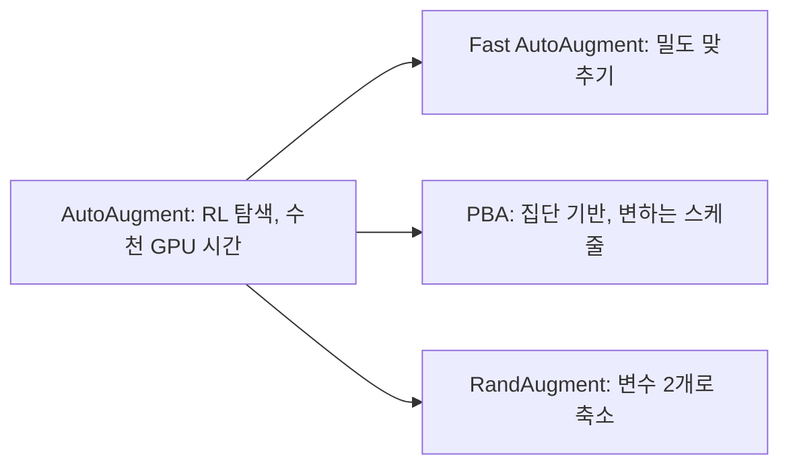
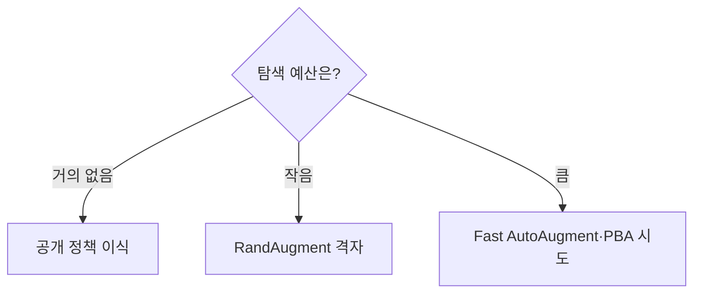

# 효율적 증강 탐색

> AutoAugment의 탐색은 수천 GPU 시간이 들었다. 이를 줄이려는 후속 방법이 **Fast AutoAugment(밀도 맞추기)**, **PBA(Population Based Augmentation, 집단 기반 + 변하는 스케줄)**, **RandAugment(탐색 공간 자체를 축소)**다.

## 쉽게 말하면
수천 가지 요리법을 하나씩 만들어 맛보는 대신 ① 이미 맛있다고 알려진 요리의 맛 분포와 비슷한 것만 골라 보거나(Fast AutoAugment) ② 여러 요리사를 동시에 두고 잘하는 요리사의 비법을 서로 따라 하게 하거나(PBA) ③ 조절 손잡이를 두 개로 줄이는(RandAugment) 방식이다.

## 자세히
- **기준 비용**: Fast AutoAugment 초록은 AutoAugment 탐색이 작은 데이터셋에서도 "수천 GPU 시간"이 든다고 지적한다(열어 확인). AutoAugment는 축소 CIFAR-10에서 정책 약 15,000개를 시험했다([탐색 공간](#autoaugment-search-space)).
- **Fast AutoAugment**(arXiv 1905.00397 초록 확인): "밀도 맞추기(density matching)" 기반의 더 효율적인 탐색으로 정책을 찾으며, 탐색 속도를 "수 자릿수(orders of magnitude)" 높이면서 CIFAR-10·CIFAR-100·SVHN·ImageNet에서 비슷한 성능을 낸다고 주장한다. 초록에는 구체 시간 수치가 없다.
- **PBA**(arXiv 1905.05393 초록 확인): 고정 정책이 아니라 **학습 중 변하는(nonstationary) 정책 스케줄**을 만든다. CIFAR-10·CIFAR-100·SVHN에서 AutoAugment와 맞먹는 성능을 "세 자릿수 적은 전체 연산"으로 달성했다고 주장하고, CIFAR-10 평균 시험 오류 1.46%를 보고한다. GPU 시간 수치는 초록에 없다.
- **RandAugment**(arXiv 1909.13719 초록 확인): 탐색 공간을 줄여 별도 대리 과제 없이 목표 과제에서 직접 조절한다([격자 탐색](#randaugment-grid-search)).
- **정리(해석)**: 세 접근은 "정책 공간을 덜 탐색한다 / 탐색을 학습에 녹인다 / 공간을 줄인다"로 갈린다. 모두 보고된 속도 향상은 **저자 주장**이며 이번에 재현하지 않았다. 숫자("수 자릿수", "세 자릿수")는 초록의 서술이고 비교 조건(하드웨어·데이터 크기)은 본문 확인이 필요하다.
- **선택 지침(제안)**: 직접 탐색 예산이 작으면 RandAugment처럼 변수를 2개로 줄이고, 정책을 이미 공개한 데이터와 비슷하면 [정책 이식](#policy-transfer)을 먼저 시험한다.

## 그림으로 보기

## 예시
- 소규모 팀: 공개 정책 이식 → 기준선 대비 확인 → 이득이 부족하면 RandAugment 격자.
- 교육: 세 방법의 "무엇을 줄였는가"를 표로 채우는 활동.

## 헷갈리는 것과 비교
| 방법 | 줄이는 것 |
|---|---|
| Fast AutoAugment | 탐색 전략(밀도 맞추기) |
| PBA | 탐색과 학습을 합침, 스케줄 형태 정책 |
| RandAugment | 탐색 공간 |
| [AutoAugment](#autoaugment-search-space) | 줄이지 않은 원조 |

## 더 읽을거리
- [Fast AutoAugment](https://arxiv.org/abs/1905.00397) — 밀도 맞추기 탐색(초록 확인).
- [Population Based Augmentation](https://arxiv.org/abs/1905.05393) — 변하는 정책 스케줄, 연산 세 자릿수 절감 주장(초록 확인).
- [RandAugment](https://arxiv.org/abs/1909.13719) — 탐색 공간 축소(초록 확인).
