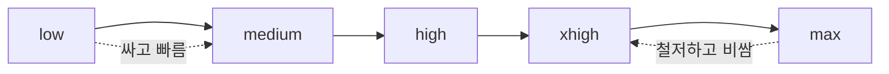
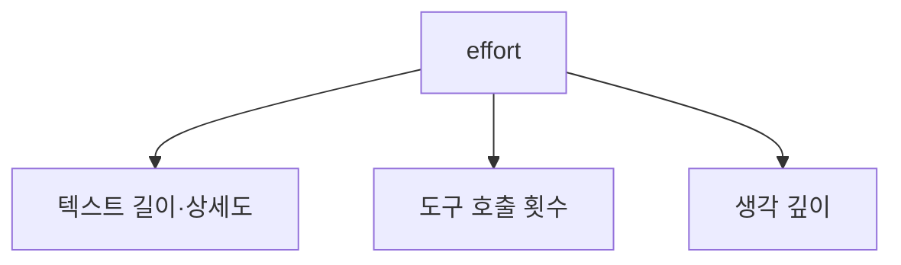

# effort 파라미터

> Claude API에서 응답 전체의 **노력 수준**(텍스트·도구 호출·생각 토큰 모두)을 `low`~`max`로 조절하는 설정. 철저함과 토큰 효율 사이의 균형을 한 모델 안에서 고른다. (공식 문서 열람 2026-11-28)

## 쉽게 말하면
시험에서 "대충 훑어서 빨리 쓰기"와 "검산까지 꼼꼼히 하기" 중 어느 쪽으로 풀지 정하는 다이얼이다. 쉬운 문제에 꼼꼼 모드를 쓰면 시간과 돈만 든다.

## 자세히
- 설정: Messages API는 `output_config.effort`. 값이 없으면 모델 기본값(대부분 `high`, **Claude Opus 5.5와 Haiku 5.5는 `medium`**). 기본값을 명시해도 생략과 동일.
- 5단계: `max`(제약 없음) / `xhigh`(30분 넘는 장기 에이전트·코딩, 토큰 예산 수백만) / `high`(복잡한 추론·어려운 코딩) / `medium`(속도·비용·성능 균형) / `low`(서브에이전트 같은 단순 작업). `xhigh`·`max` 지원 모델은 다르다.
- 효과 범위: 텍스트 응답, **도구 호출과 인자, 생각(활성 시)** 전부. 낮을수록 도구 호출을 합치고 적게 하며 서두 없이 바로 실행한다. **엄격한 토큰 예산이 아니라 행동 신호**다.
- 생각과의 관계: 적응형 생각이 켜진 모델에서는 effort가 생각 깊이를 정하는 권장 수단.
- 모델별 권장(문서): Sonnet 5.5는 `high` 기본, 에이전트·지연 민감 작업은 `medium`부터; Haiku 5.5는 `medium`부터; Fable 5.2는 `high`부터 시작해 평가로 위·아래 조정. `max`는 이득이 작은데 비용·시간이 크게 늘 수 있다.
- 주의: `xhigh`·`max`에선 큰 `max_tokens`(생각+응답 합산 한도) 설정. 이전 모델의 설정을 그대로 가져오지 말고 **자체 평가로 effort 스윕**.
- **캐시**: 한 대화 안에서 최상위 effort를 바꾸면 프롬프트 캐시가 깨질 수 있다. 지원 모델에서는 메시지별 effort(베타)로 캐시를 보존하며 바꾼다.

## 그림으로 보기



## 예시
```python
client.messages.create(
    model="claude-opus-5-5", max_tokens=4096,
    output_config={"effort": "low"},  # 서브에이전트용
    messages=[{"role":"user","content":"이 로그에서 에러 줄만 뽑아 줘"}],
)
```
- 교육: 같은 업무도 "초안은 low, 최종 검토는 high"로 나눠 비용을 줄이는 실습.

## 헷갈리는 것과 비교
| 개념 | 차이 |
|---|---|
| effort | 응답 전체의 노력 수준(소프트 신호) |
| max_tokens | 출력의 하드 한도 |
| [적응형 생각](#adaptive-thinking) | 생각 여부·분량을 모델이 정함, effort가 그 성향을 조절 |

## 더 읽을거리
- [Effort (Claude 문서)](https://platform.claude.com/docs/en/build-with-claude/effort) — 수준·모델별 권장(읽음).
- [Steering thinking](https://platform.claude.com/docs/en/build-with-claude/thinking-steering-and-cost) — 생각 조절과 비용(읽음).
