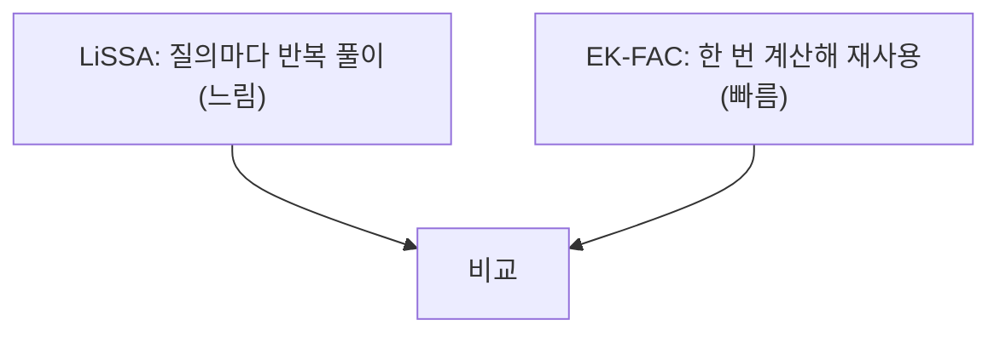

# EK-FAC

> 대형 언어모델에서 영향 함수를 계산하려고 쓴 헤시안 근사법이다. 층별 크로네커 인수 분해(K-FAC)에 고유값 보정을 더해 역헤시안-벡터 곱(IHVP)을 싸고 빠르게 구한다(Grosse 외, 2023).

## 쉽게 말하면
거대한 표를 통째로 다루는 대신 작은 표 두 개의 곱으로 근사하고, 그 작은 표의 대각선만 정밀하게 다시 맞춰 계산을 빠르게 하는 요령이다.

## 자세히
(Grosse 외, Anthropic, arXiv 2308.03296을 하위 에이전트가 원문으로 읽은 노트 기준. 상관계수 정확값은 그림만 있어 미확인.)
- **목표**: LLM 영향 함수의 IHVP. 헤시안을 **감쇠된 가우스-뉴턴 헤시안**(G + λI)⁻¹로 대체. G = E[JᵀH_ŷJ](이 손실에서는 피셔 정보 행렬과 같다).
- **K-FAC**(Martens & Grosse 2015): 층별로 G를 입력 활성 공분산과 의사 기울기 공분산의 **크로네커 곱 A⊗S**로 인수 분해.
- **EK-FAC**(George 외 2018): 크로네커 인수를 고유분해한 뒤 **고유 기저에서 대각선을 샘플별 2차 모멘트로 다시 맞춘다(고유값 보정)**. 역행렬은 기저 회전 후 (λᵢⱼ + 감쇠)로 나누기만 하면 된다.
- **가정·한계**: 층 사이 독립(블록 대각)과 토큰 간 상관 근사.
- **정확도**: PBRF(proximal Bregman response function) 기준으로 EK-FAC과 LiSSA가 둘 다 단순 기울기 내적보다 낫고, EK-FAC은 LiSSA와 경쟁력 있으면서 "몇 자릿수 더 빠르다".
- **비용 절감**: TF-IDF 필터링(질의당 상위 10,000 시퀀스)과 질의 배칭(저차원 압축 기울기: 랭크 32, 52B shutdown 질의에서 전체 랭크와 상관 0.995).

## 그림으로 보기

## 예시
- 52B 모델에서 특정 출력에 영향을 준 훈련 시퀀스 상위 목록 만들기(연구 환경).
- 교육 활용: 근사로 불가능한 계산을 가능하게 만드는 사례.

## 헷갈리는 것과 비교
| 개념 | 차이 |
|---|---|
| EK-FAC | 층별 크로네커+고유값 보정, 한 번 계산 후 재사용 |
| LiSSA | 반복 확률 추정(질의마다 비용) |
| [헤시안-벡터 곱](#hessian-vector-product) | 둘이 공통으로 쓰는 기초 |

## 더 읽을거리
- [Studying LLM Generalization with Influence Functions (arXiv 2308.03296)](https://arxiv.org/abs/2308.03296) — EK-FAC 적용.
