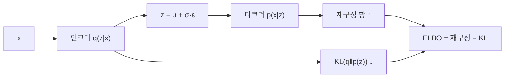

# ELBO(증거 하한)

> ELBO(Evidence Lower BOund)는 계산할 수 없는 로그 우도 log p(x)의 계산 가능한 하한이다. VAE는 ELBO를 최대화하며 학습한다. "재구성 항 − KL 항" 두 부분으로 이뤄진다.

## 쉽게 말하면
시험의 정확한 평균 점수는 모르지만 "최소한 이만큼은 된다"는 보장 점수는 계산할 수 있다고 하자. 보장 점수를 올리면 진짜 점수도 따라 오른다. ELBO가 그 보장 점수다. 진짜와 보장 점수의 차이가 곧 "근사 사후 분포가 진짜 사후와 얼마나 다른가(KL)"다.

## 자세히
- 목표: p(x)=∫p(x|z)p(z)dz는 적분이 어려워 직접 최대화가 안 된다. 그래서 인코더 q_φ(z|x)로 진짜 사후를 근사한다.
- 핵심 식(Lilian Weng 정리):
  `log p(x) − KL(q(z|x) ‖ p(z|x)) = E_q[log p(x|z)] − KL(q(z|x) ‖ p(z))`
  오른쪽이 ELBO. KL ≥ 0이므로 ELBO ≤ log p(x), 즉 하한이다.
- VAE 손실 = −ELBO = **재구성 손실 + KL 항**. 앞은 "입력을 잘 복원하라", 뒤는 "잠재 분포를 사전(보통 표준정규)에 가깝게 하라"([VAE의 KL 항](#vae-kl-term)).
- 기댓값 안의 샘플링은 미분이 안 되므로 [재매개변수화 트릭](#reparameterization-trick) `z = μ + σ ⊙ ε, ε~N(0,I)`을 써서 역전파한다.
- 쓰임: VAE뿐 아니라 확산 모델의 학습 목적도 ELBO(변분 하한)로 유도된다(일반적으로 알려진 사실, 이번 조사에선 직접 확인하지 않음).
- 하한이 느슨하면(근사 사후가 부정확하면) 우도 추정이 낮게 나온다. IWAE처럼 샘플을 여러 개 쓰는 더 빡빡한 하한도 있다.

## 그림으로 보기


## 예시
```python
recon = F.mse_loss(x_hat, x, reduction="sum")
kl = -0.5 * torch.sum(1 + logvar - mu**2 - logvar.exp())
loss = recon + kl        # = -ELBO (가우시안 가정)
```
손실이 내려가면 ELBO가 올라간다.

## 헷갈리는 것과 비교
| 개념 | 차이 |
| --- | --- |
| ELBO | log p(x)의 하한, 최대화 대상 |
| VAE 손실 | ELBO의 부호를 바꾼 것 |
| [KL 발산](#kl-divergence) | ELBO와 진짜 값의 간격을 이루는 요소 |
| [β-VAE](#beta-vae) | KL 항에 가중치 β를 곱한 변형 |

## 더 읽을거리
- [From Autoencoder to Beta-VAE (Lilian Weng)](https://lilianweng.github.io/posts/2018-08-12-vae/) — ELBO 유도·재매개변수화·β-VAE
