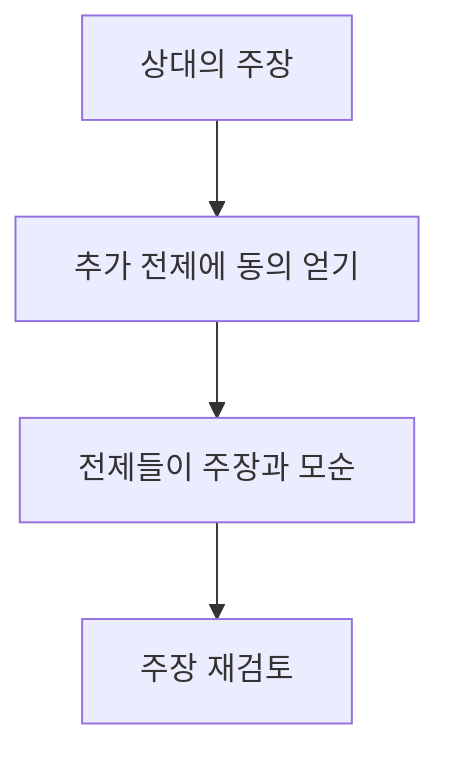
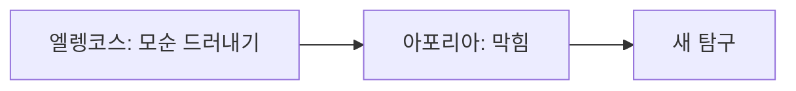

# 엘렝코스(반박 검증)

> **엘렝코스**는 소크라테스식 방법의 **핵심 기법**으로, 상대가 내세운 주장을 **질문으로 시험·반박**해 모순을 드러내는 논증법이다. 그리스어로 "반박·검증·조사"를 뜻한다.

## 쉽게 말하면
"모든 거짓말은 나쁘다"고 말하는 사람에게 "환자를 안심시키려는 거짓말도?"를 묻고, 그 답들을 모아 보면 처음 주장과 어긋난다는 걸 스스로 알게 하는 대화다.

## 자세히
(Wikipedia "Socratic method" 확인 — 단계 목록은 요약본 기반이라 신뢰도 낮음)
- **정의**: elenchus는 "반박·논박의 논증, 반대 심문, 반박 목적의 점검"이라는 그리스어 뜻을 가지며, 소크라테스 방법의 중심 기법이다.
- **Vlastos식 단계**: ① 대화 상대가 주장(테제) 제시 ② 소크라테스가 이를 거짓으로 판단해 반박 대상으로 선택 ③ 추가 전제들을 상대가 받아들이게 함 ④ 그 전제들이 처음 주장의 반대를 함의함에 둘이 동의 ⑤ 소크라테스가 테제는 거짓이고 그 부정이 참이라고 주장. 다만 Frede는 5단계를 반박하며 초기 대화편이 **아포리아**로 끝난다고 본다.
- **활용**(권고): 주장 검증, 토론 연습, 프롬프트 비판. AI에게 "내 주장을 받아들이는 전제를 하나씩 확인한 뒤 모순이 생기는지 보여 줘"라고 시킨다.
- 주의: 상대를 이기려는 도구가 아니라 생각을 점검하는 도구여야 한다.

## 그림으로 보기

## 예시
- 팀 회의: "고객 만족이 최우선" 주장에 "그럼 원가 초과 요구도 수용하나?"로 전제를 확인해 우선순위를 다시 정리.

## 헷갈리는 것과 비교
| 개념 | 차이 |
|---|---|
| 엘렝코스 | 주장을 반박·검증하는 기법 |
| [소크라테스식 질문 유형](#socratic-questioning-types) | 질문 종류 모음 |
| [아포리아](#aporia) | 결론 없이 막힌 상태 |
| [AI 토론](#ai-debate) | 두 AI의 대립 논증 |

## 더 읽을거리
- [Socratic method (Wikipedia)](https://en.wikipedia.org/wiki/Socratic_method)
