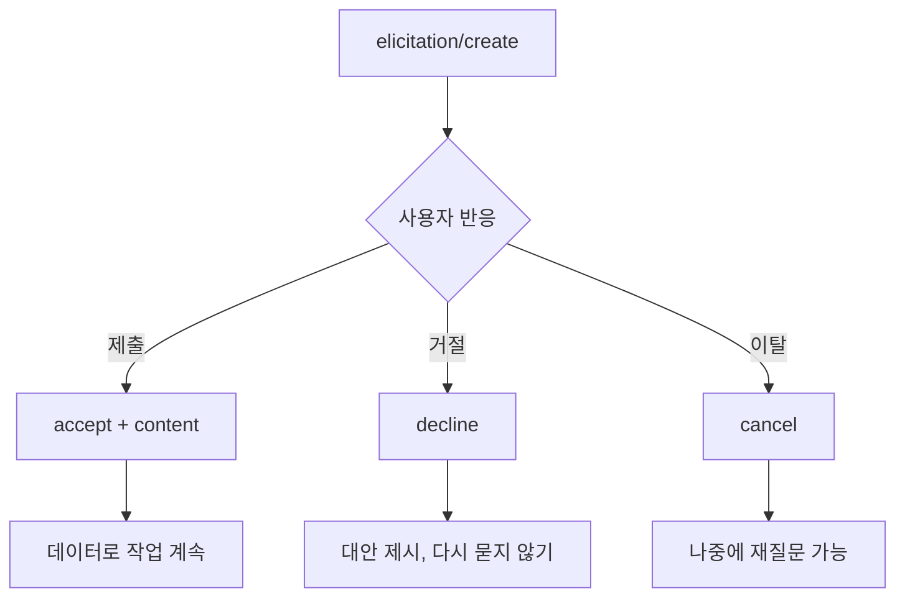

# accept·decline·cancel

> MCP elicitation 요청에 대한 클라이언트의 응답 `action` 세 가지. 사용자가 제출했는지, 명시적으로 거절했는지, 선택 없이 이탈했는지를 서버가 구분하게 해 준다.

## 쉽게 말하면
식당 직원이 "디저트 드릴까요?" 하고 물었을 때 손님 반응은 셋이다. "네, 이걸로요"(accept), "아니요, 괜찮아요"(decline), 대답 없이 자리를 뜨거나 전화를 받으러 나감(cancel). 앞의 둘은 의사 표시지만 마지막은 아직 답이 아니다. 직원은 세 경우를 다르게 대해야 한다. 거절한 손님에게 또 권하면 귀찮고, 자리를 뜬 손님은 돌아오면 다시 물어봐도 된다.

## 자세히
스펙 2025-11-25 기준(확인 2026-11-12). 응답은 `result.action`에 담긴다.
- **accept**: 사용자가 명시적으로 승인·제출. form 모드에서는 `content`에 스키마에 맞는 데이터가 들어간다. URL 모드에서는 `content`가 없고, "열어 보는 데 동의했다"는 뜻일 뿐 **상호작용이 끝났다는 뜻이 아니다**(완료는 서버의 `notifications/elicitation/complete`로 알린다).
- **decline**: 사용자가 명시적으로 거절("Reject", "No"). `content`는 보통 없다.
- **cancel**: 선택 없이 닫음(창 닫기, 바깥 클릭, Esc, 브라우저 로드 실패 등).
- 서버 처리 권장: accept → 데이터 처리, decline → 대안 제시, cancel → 나중에 다시 묻기.
- 세 액션은 form·URL 두 모드 모두에 적용된다.

## 그림으로 보기

## 예시
배포 서버가 `환경: staging|production`을 묻는 경우.
- accept `{"environment":"staging"}` → 스테이징에 배포.
- decline → "배포를 취소했습니다. 대신 드라이런만 할까요?"처럼 대안을 낸다.
- cancel → 작업을 보류하고, 사용자가 돌아오면 다시 묻는다.

## 헷갈리는 것과 비교
| 개념 | 차이 |
|---|---|
| decline | 의사 표시(싫다). 같은 질문을 반복하지 않는 것이 예의 |
| cancel | 의사 표시 없음. 재질문 가능 |
| URL 모드 accept | 동의만 한 것. 실제 입력은 브라우저에서 이뤄지고 서버가 따로 확인 |
| [MCP Elicitation](#mcp-elicitation) | 이 노드의 부모. 요청 전체 구조 |

## 더 읽을거리
- [MCP Elicitation 스펙 2025-11-25](https://modelcontextprotocol.io/specification/2025-11-25/client/elicitation) — Response Actions 절과 URL 모드
