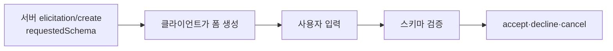
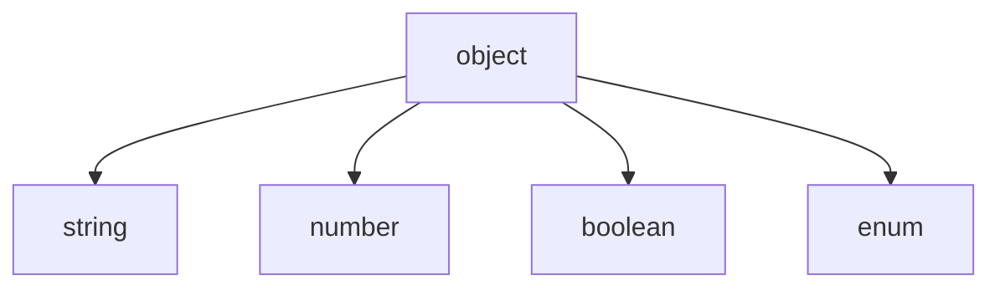

# requestedSchema 제한

> MCP elicitation에서 서버가 사용자에게 받을 값의 모양을 적는 `requestedSchema`는, 클라이언트 구현을 쉽게 하려고 납작한 객체와 원시 타입만 허용한다.

## 쉽게 말하면
종이 설문지에 "이름, 이메일, 나이" 칸만 있으면 누구나 금방 인쇄해 쓴다. 칸 안에 표가 또 있고 표 안에 목록이 있으면 설문 앱 만들기가 어려워진다. 그래서 MCP는 "한 줄짜리 칸"만 허용했다.

## 자세히
MCP Elicitation 명세 2025-06-18 기준(새로 도입, 설계가 바뀔 수 있다고 명시):
- JSON Schema의 **제한된 부분집합**: `type: object` 아래 속성은 모두 원시 타입.
- 허용 4종: string(`minLength`·`maxLength`·`format`: email, uri, date, date-time), number/integer(`minimum`·`maximum`), boolean(`default`), enum(`enum`과 표시용 `enumNames`).
- **중첩 객체, 객체 배열, 고급 JSON Schema 기능은 의도적으로 제외**했다. 이유: 클라이언트가 입력 폼을 쉽게 생성·검증하게 하려는 것.
- 응답은 세 가지 action: `accept`(content 포함), `decline`(명시적 거절), `cancel`(창 닫기 등 무선택).
- 서버는 비밀번호 등 **민감 정보를 요청하면 안 된다(MUST NOT)**. 클라이언트는 요청 서버 표시, 언제든 거절 허용, 속도 제한을 한다(SHOULD).
- 양쪽이 스키마로 내용을 검증한다(SHOULD).

## 그림으로 보기



## 예시
```json
{"type":"object","properties":{
 "email":{"type":"string","format":"email"},
 "age":{"type":"number","minimum":18}},
 "required":["email"]}
```
주소록처럼 "여러 명의 목록"을 받고 싶으면 한 번에 받지 말고 elicitation을 여러 번 보내거나 다른 UI를 쓴다(제한에 따른 설계 요령).

## 헷갈리는 것과 비교
| 개념 | 차이 |
|---|---|
| requestedSchema | 사용자 입력 폼의 모양(납작) |
| 도구 inputSchema | 모델이 넘기는 인자 정의. 더 자유로움 |
| [Sampling](#mcp-sampling) | 사람이 아니라 LLM에게 요청 |

## 더 읽을거리
- [MCP Elicitation 명세](https://modelcontextprotocol.io/specification/2025-06-18/client/elicitation) — 스키마 제한과 응답 action
