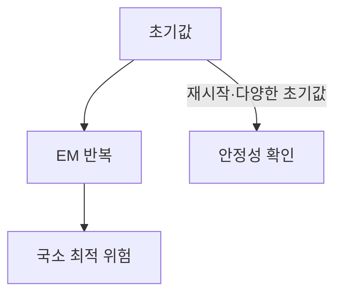

# EM 초기화(다수결)

> Dawid-Skene의 EM은 시작값에 따라 국소 최적에 갇힐 수 있어서, 다수결 결과로 초기화하는 것이 흔한 관행이다. 다만 연구에 따르면 다수결 초기화는 최적에서 멀 수 있고, 반복을 충분히 돌리면 결과가 같아지기도 한다.

## 쉽게 말하면
길 찾기에서 출발점이 엉뚱하면 근처 막다른 길에 들어갈 수 있다. 많은 사람이 고른 길(다수결)에서 출발하면 보통 괜찮지만 가장 좋은 출발점은 아닐 수 있다.

## 자세히
(Zhang 외 JMLR 17 "Spectral Methods meet EM", 서론과 5절 실험을 직접 읽고 확인.)
- **문제**: Dawid-Skene 추정은 비볼록 로그 가능도를 최대화해 이론적 정당화가 어렵고, EM은 **국소 최적에 갇힐 수 있다**.
- **제안 알고리즘(2단계)**: ① 스펙트럴 방법(작업자를 세 그룹으로 나눠 2·3차 모멘트로 혼동 행렬 추정)으로 초기값 ② 그 값으로 EM 정제. 최적 수렴 속도(로그 인자 제외)를 보였다고 주장.
- **실험 관찰(표 2, 혼동 행렬 제곱 오차)**: 스펙트럴 초기화 + **EM 1회**는 거의 최적의 오차를 낸 반면, **다수결 초기화 + EM 1회**는 오차가 한 자릿수 크기 더 컸다(표의 예: 0.143 대 6.618). 그러나 **10회 반복 후에는 두 초기화가 같은 오차로 수렴**했다. 저자도 EM의 견고성을 인정하며 충분조건·필요조건을 후속 과제로 남긴다.
- **다수결 초기화의 약점**: 스패머가 많고 전문가가 적으면 다수결이 거의 무작위 추측이 될 수 있다(Gao & Zhou 2014 인용).
- **실무 지침(제안)**: 다수결로 초기화 후 충분한 반복, 여러 초기값으로 재시작해 안정성 확인, 골드 세트로 최종 검증.
- 위의 표 수치는 논문 합성 데이터 설정 중 하나이며 일반 법칙이 아니다.

## 그림으로 보기

## 예시
- 라벨러 30명 데이터에서 다수결 초기화 EM을 20회 돌리고, 랜덤 초기값 5회와 최종 라벨이 같은지 비교.
- 교육 활용: "출발점이 결과를 바꾼다"를 설명하는 최적화 입문 소재.

## 헷갈리는 것과 비교
| 개념 | 차이 |
|---|---|
| 다수결 초기화 | 간단·널리 사용 |
| 스펙트럴 초기화 | 이론 보장, 구현 복잡 |
| [Dawid-Skene](#dawid-skene) | EM이 쓰이는 모델 |

## 더 읽을거리
- [Spectral Methods Meet EM (JMLR 17, 2016)](https://jmlr2020.csail.mit.edu/papers/volume17/14-511/14-511.pdf) — 초기화 비교(표 2).
