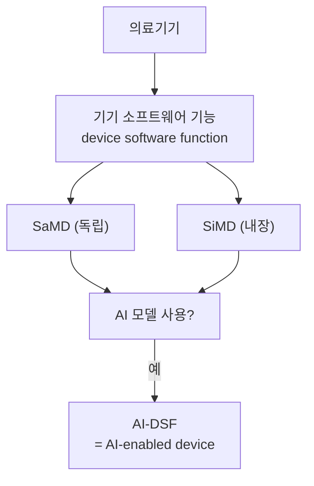
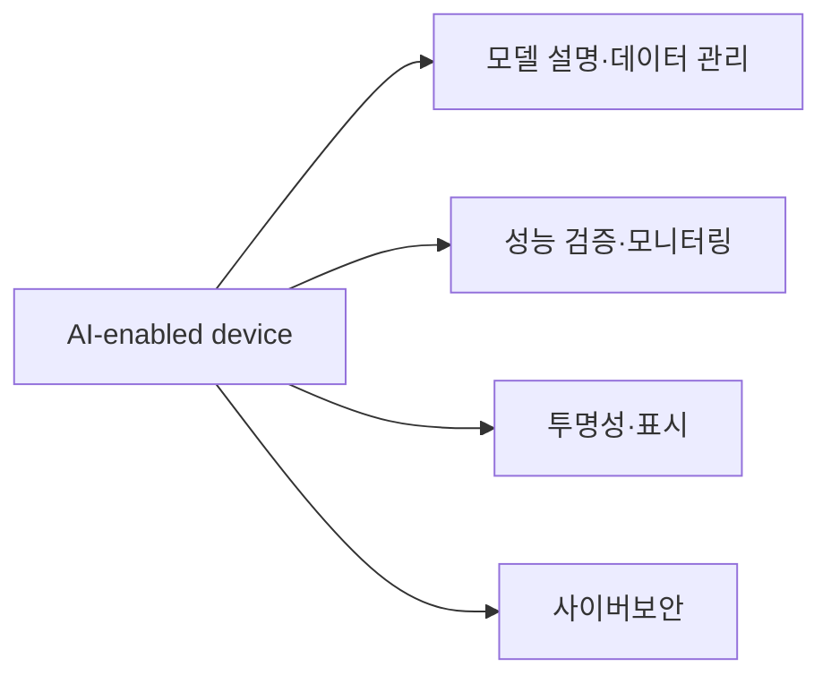

# 내장형 AI

> 의료기기 하드웨어 안에서 돌며 그 기기의 기능을 돕는 AI(예: 초음파 장비의 영상 개선·측정 AI). 별도 소프트웨어(SaMD)냐 기기의 일부(SiMD)냐 하는 분류 논쟁이 있지만, FDA의 2025년 AI 지침은 둘을 가리지 않고 "기기 소프트웨어 기능"으로 함께 다룬다.

## 쉽게 말하면
스마트폰 카메라 안에 들어간 "야간 모드 AI"는 폰의 일부다. 같은 AI를 앱으로 따로 깔면 독립 제품이 된다. 의료기기도 마찬가지다. 규제 질문은 "어디서 도는가"가 아니라 "그 AI가 의료 목적의 기능을 하는가, 얼마나 위험한가"로 모이는 쪽으로 가고 있다.

## 자세히
출처: FDA 초안 지침 "Artificial Intelligence-Enabled Device Software Functions: Lifecycle Management and Marketing Submission Recommendations"(2025-01-07 연방관보 공고, 문서 본문을 직접 읽음). 초안(Draft – Not for Implementation)이며 법적 구속력 없는 권고다. 내 검색에서 2026년 10월 말 기준에도 초안 상태라는 2차 보도가 있으나 FDA 페이지를 직접 확인하진 못했다.
- **핵심 용어**: 의료기기 정의(FD&C Act 201(h))에 맞는 소프트웨어 기능 = **device software function**. 각주에 "SaMD와 SiMD를 모두 포함할 수 있다"고 명시. 즉 내장형이든 독립형이든 같은 틀로 본다.
- **AI-DSF(AI-enabled device software function)**: 하나 이상의 **AI 모델**("새 입력으로 추론·예측을 만드는 수학적 구조")을 써서 의도된 목적을 이루는 기능. 이런 기능이 하나라도 있는 기기가 **AI-enabled device**다. 기기 전체와 기능, 모델 세 층을 구분해 쓴다.
- **적용 대상 제출 유형**: 510(k), De Novo, PMA, HDE, BLA(IDE에도 일부 적용). 복합제품(combination product)의 기기 구성 부분에 AI-DSF가 있으면 대체로 같은 권고가 적용되고, 초기에 담당 심사부서와 상의하길 권한다.
- **510(k) 동등성**: AI 기기도 AI 없는 기존 기기와 의도 용도가 같고 새로운 안전·유효성 질문이 없으면 실질적 동등성을 인정받을 수 있다.
- **제출 문서 목차(실제 목차)**: 품질 시스템, 기기 설명, 사용자 인터페이스·표시, 위험 평가, 데이터 관리, 모델 설명·개발, 검증(성능 검증 포함), 성능 모니터링, 사이버보안, 공개 제출 요약. 부록에 모델 카드 예시가 있다.
- **편향·투명성**: 인종·민족·성별·연령 등 인구집단별로 기기가 비슷하게 이로운지 증거를 모으라는 방향.
- 내장형 AI는 하드웨어 변경과 소프트웨어 업데이트가 엮이므로 변경 관리가 까다롭다. 사전 변경 통제 계획은 [FDA PCCP](#fda-pccp)에서 다룬다.

## 그림으로 보기

## 예시
- 초음파 장비에 내장돼 심장 구획을 자동으로 그려 주는 AI: 내장형. FDA 지침상 AI-DSF로 보고 위 문서 목차대로 제출 서류를 준비한다.
- 같은 알고리즘을 클라우드 서비스로 제공하면 SaMD 성격. 제출 서류의 틀은 비슷하다.

## 헷갈리는 것과 비교
| 개념 | 차이 |
|---|---|
| 내장형 AI | 기기 안에서 도는 AI. 규제 틀은 "device software function" |
| [SiMD](#simd) | 하드웨어 기기에 내장된 소프트웨어 일반 |
| [SaMD](#samd) | 독립적으로 의료 목적을 이루는 소프트웨어 |
| [FDA AI 기기](#fda-ai-devices) | 허가된 AI 기기 현황 |

## 더 읽을거리
- [FDA 초안 지침 PDF (media/184856)](https://www.fda.gov/media/184856/download) — 이 글의 정의·목차 출처(직접 읽음)
- [MoFo 요약: FDA Draft Guidance on AI-Enabled Device Software Functions](https://www.mofo.com/resources/insights/250121-fda-draft-guidance-on-artificial) — 발표일 확인(2025-01-06 공개)
