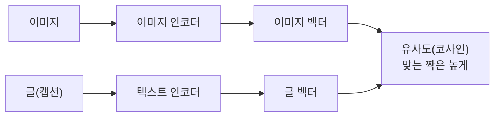
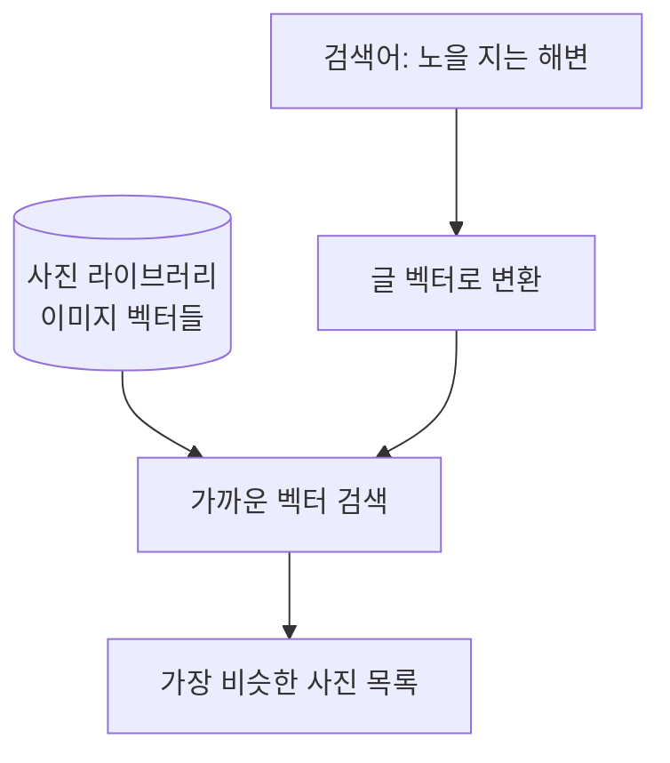

# CLIP과 멀티모달 임베딩

> 이미지와 글을 같은 "의미 공간"의 점으로 바꿔, "고양이 사진"이라는 문장과 실제 고양이 사진이 서로 가까이 놓이게 만든 모델. 글로 사진을 찾고, 사진으로 글을 찾을 수 있다.

## 쉽게 말하면
외국어를 모르는 두 사람이 같은 그림책 속 그림과 설명 카드를 4억 쌍 짝지어 맞히며 배웠다고 하자. 나중에는 설명 카드만 보고도 맞는 그림을 골라낼 수 있다. CLIP은 이미지 인코더와 글 인코더가 "서로 맞는 짝은 가깝게, 틀린 짝은 멀게" 배워 두 세계를 한 지도 위에 올려놓았다.

## 자세히
- **출시**: OpenAI, 2021년(arXiv 2103.00020, Radford 외). "어떤 캡션이 어떤 이미지와 짝인가"를 맞히는 단순한 사전학습으로, 인터넷에서 모은 약 4억 개의 이미지-글 쌍을 사용했다.
- **구조**: 이미지 인코더와 텍스트 인코더가 각자 특징 벡터를 만들고, 같은 차원의 잠재 공간으로 투영한 뒤 내적(코사인 유사도)으로 유사도를 계산한다(Hugging Face 문서). 학습은 배치 안에서 정답 짝의 유사도는 올리고 오답 짝은 내리는 [대조 학습](#contrastive-learning).
- **제로샷 분류**: 따로 학습 없이 "a photo of a cat", "a photo of a dog" 같은 문장을 만들어 이미지와 가장 가까운 문장을 고른다. 논문 주장: ImageNet에서 원조 ResNet-50과 같은 정확도를 ResNet-50이 쓴 128만 장 학습 예제 없이 달성했고, OCR·동작 인식·위치 추정 등 30개 넘는 데이터셋에서 평가했다.
- **쓰임**: 이미지·텍스트 상호 검색, 이미지 생성 모델의 텍스트 조건 인코더(예: [CLIP 텍스트 인코더](#clip-text-encoder)), 멀티모달 LLM의 비전 인코더, 이미지 필터링.
- **한계**: 글 입력 길이 제한(원 모델 77토큰), 세밀한 개수 세기·공간 관계에 약함, 학습 데이터의 편향이 그대로 반영됨. 후속으로 SigLIP 등 개선판이 나왔다.
- **RAG 응용**: 이미지·표·도면을 텍스트와 같은 벡터 DB에 넣어 한 번에 검색하는 멀티모달 RAG의 기반이 된다.

## 그림으로 보기




## 예시
Hugging Face 파이프라인으로 제로샷 분류:
```python
from transformers import pipeline
clip = pipeline("zero-shot-image-classification",
                model="openai/clip-vit-base-patch32")
labels = ["a photo of a cat", "a photo of a dog", "a photo of a car"]
clip("고양이사진.jpg", candidate_labels=labels)
```
업무 예: 쇼핑몰의 상품 사진 수만 장을 CLIP 벡터로 저장해 두면 "베이지색 린넨 셔츠"라고 쳐서 사진을 찾을 수 있다(태그를 사람이 달 필요 없음).

## 헷갈리는 것과 비교
| 개념 | 차이 |
|---|---|
| [임베딩 모델 vs LLM](#embedding-model-vs-llm) | 임베딩 모델은 의미 벡터를 만들 뿐 글을 생성하지 않음 |
| CLIP | 이미지와 글을 한 공간에 놓는 모델. 이미지를 생성하지는 않음 |
| [이미지 생성](#image-generation) | CLIP의 글 인코더를 조건 입력으로 쓰기도 함 |
| [코사인 유사도](#cosine-similarity) | 벡터가 가리키는 방향이 얼마나 같은지 재는 방법 |

## 더 읽을거리
- [Learning Transferable Visual Models From Natural Language Supervision (arXiv 2103.00020)](https://arxiv.org/abs/2103.00020) — CLIP 원 논문
- [CLIP (Hugging Face Transformers 문서)](https://huggingface.co/docs/transformers/model_doc/clip) — 구조 설명과 코드
