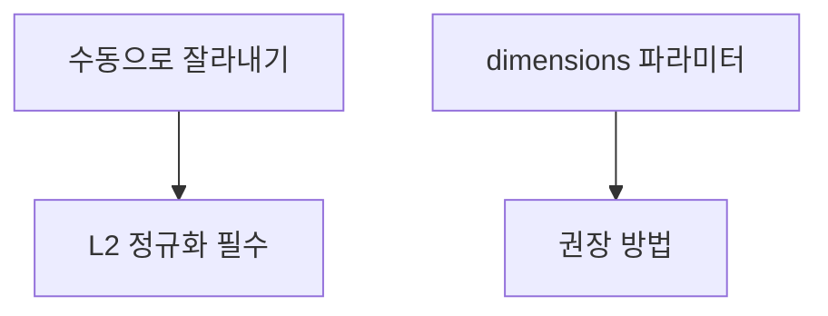

# 임베딩 dimensions 파라미터

> 일부 임베딩 모델(OpenAI text-embedding-3)은 벡터 길이를 `dimensions` 파라미터로 줄일 수 있다. 줄여도 의미 표현이 대체로 유지되며 저장·검색 비용이 줄지만, 직접 자를 때는 정규화를 다시 해야 한다.

## 쉽게 말하면
고해상도 사진을 작은 크기로 줄여도 대충 무슨 사진인지는 알 수 있는 것과 같다. 크기를 줄이면 저장 공간과 검색 시간이 줄고 정밀도는 조금 희생된다.

## 자세히
(OpenAI 임베딩 가이드를 직접 열어 확인. 2026-11-21 기준.)
- **기본 차원**: `text-embedding-3-small` **1536**, `text-embedding-3-large` **3072**.
- **축소**: v3 두 모델은 개념 표현 특성을 잃지 않고 줄일 수 있다. 권장 방법은 임베딩 생성 시 `dimensions`를 지정하는 것.
- **수동 축소 시 정규화**: 직접 자르면 "임베딩의 차원을 정규화"해야 하며 예시는 L2 노름으로 나눈다([임베딩 정규화](#embedding-normalization)).
- **성능-비용**: MTEB에서 256차원 `text-embedding-3-large`가 1536차원 `text-embedding-ada-002`보다 낫다고 서술([MTEB](#mteb-benchmark)). 큰 임베딩일수록 연산·메모리·저장 비용이 크다.
- **실무 예**: 벡터 저장소가 1024차원까지만 지원하면 `text-embedding-3-large`에 `dimensions=1024`를 줄 수 있다.
- **주의**: 가이드는 반환 벡터가 길이 1로 정규화되어 있다거나 코사인 유사도가 내적과 같다는 점을 명시하지 않는다(확인 못 함). 인덱스를 바꾸면 저장 벡터도 다시 생성해야 한다([임베딩 모델 교체 위험](#embedding-model-churn)).

## 그림으로 보기



## 예시
```python
client.embeddings.create(model="text-embedding-3-large", input="안녕", dimensions=1024)
```
- 교육 활용: 차원별로 검색 정확도와 저장 용량을 표로 비교.

## 헷갈리는 것과 비교
| 개념 | 차이 |
|---|---|
| dimensions 파라미터 | 생성 시 길이 지정(권장) |
| 수동 슬라이싱 | 자른 뒤 정규화 필요 |
| 차원 축소(PCA 등) | 별도 후처리 기법 |

## 더 읽을거리
- [OpenAI 임베딩 가이드](https://developers.openai.com/api/docs/guides/embeddings) — dimensions·정규화 설명.
