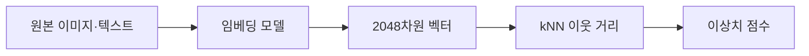
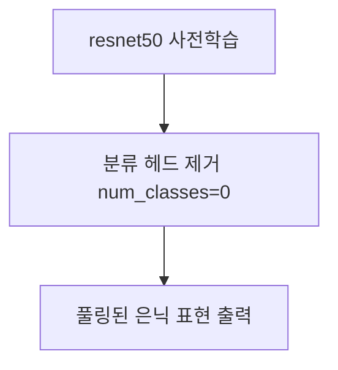

# 이상치 탐지용 임베딩

> 임베딩은 이미지·텍스트 같은 원본 데이터를 숫자 벡터로 바꾼 것이다. 이상치 탐지에서는 이 벡터 사이의 거리를 재기 때문에, 어떤 임베딩 모델을 쓰느냐가 결과를 좌우한다.

## 쉽게 말하면
사진 5,000장을 "얼굴 생김새"가 아니라 "좌표 2,048개짜리 주소"로 바꿔 지도에 찍는 일이다. 비슷한 사진은 가까운 주소에, 이상한 사진은 외딴 주소에 놓인다. 이 지도가 엉터리면 외딴 점이 진짜 이상한 것인지 알 수 없다.

## 자세히
- **cleanlab 튜토리얼의 방식**: timm의 사전학습된 `resnet50`을 `timm.create_model('resnet50', pretrained=True, num_classes=0)`로 불러오고, 분류 헤드를 떼어(`num_classes=0`) 풀링된 은닉층 표현을 출력으로 쓴다. eval 모드로 `torch.no_grad()` 아래에서 50개씩 배치로 통과시키며, 이미지 한 장이 2048차원 벡터가 된다. 학습셋은 (5000, 2048), 테스트셋은 (1000, 2048) 배열이다. 튜토리얼은 텍스트용 임베딩 모델을 지정하지 않고, 다른 데이터 유형으로 응용할 수 있다고만 밝힌다.
- **선택 기준(해석)**: ① 데이터 종류에 맞는 모델(이미지는 비전 모델, 텍스트는 문장 임베딩 모델) ② 학습·서비스에서 같은 모델·같은 전처리 ③ 모델 버전을 기록(버전이 바뀌면 점수 기준선을 다시 계산).
- **임베딩이 못 보는 것(해석)**: 임베딩 모델이 학습 때 구분하지 못한 차이는 거리에도 안 나타난다. 예를 들어 일반 이미지 모델이 만든 임베딩은 의료 영상의 미세한 이상을 구분 못 할 수 있다.
- **거리와 연결**: 임베딩 벡터 위에서 [kNN 이상치 점수](#knn-outlier-score)를 계산하고, 지표는 [코사인 vs 유클리드](#cosine-vs-euclidean-distance)에서 고른다.

## 그림으로 보기

## 예시
- 코드 예(문서): `model = timm.create_model('resnet50', pretrained=True, num_classes=0)` 후 이미지를 배치로 통과시켜 (N, 2048) 배열을 만든다.
- 사내 문서 점검: 문장 임베딩으로 바꾼 뒤 점수가 낮은 문서를 뽑아 빈 문서·다른 언어 문서를 찾는다.
- 교육 활용: 같은 사진 묶음을 서로 다른 임베딩 모델에 넣어 이상치 목록이 달라지는 것을 비교한다.

## 헷갈리는 것과 비교
| 개념 | 차이 |
| --- | --- |
| 임베딩 | 데이터를 벡터로 바꾼 결과 |
| 원본 픽셀·단어 수 | 의미 정보가 약해 이상치 탐지에 부적합 |
| [kNN 이상치 점수](#knn-outlier-score) | 임베딩 위에서 계산하는 점수 |
| [OOD 탐지](#out-of-distribution-detection) | 같은 임베딩으로 서비스 입력 점검 |

## 더 읽을거리
- [cleanlab OOD 튜토리얼](https://docs.cleanlab.ai/stable/tutorials/outliers.html) — resnet50 임베딩 추출 코드
