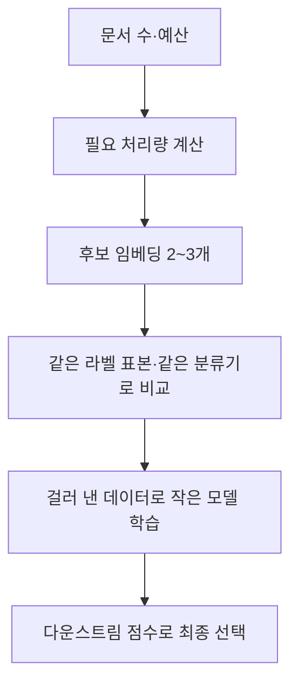
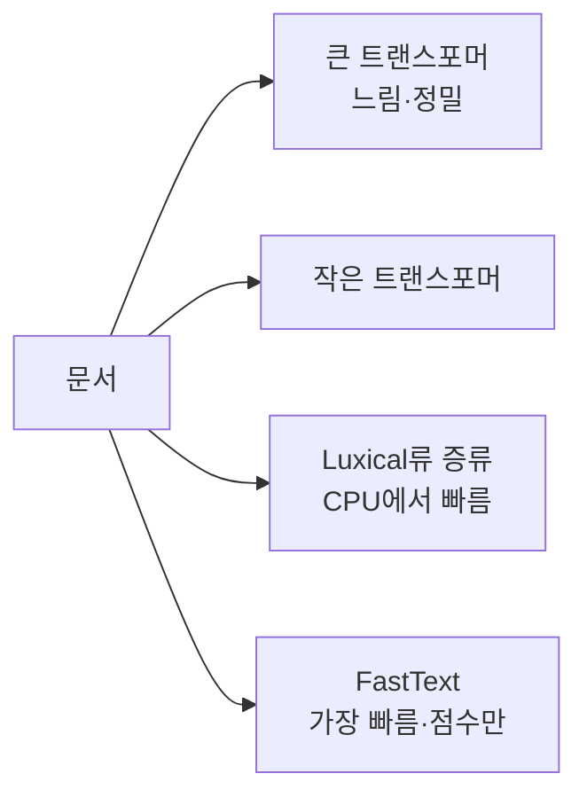

# 임베딩 모델 선택

> 품질 분류기를 만들 때 **어떤 임베딩 모델 위에 분류기를 올릴지** 고르는 일. 정답은 정해져 있지 않고, 채점 속도와 목표 과제의 품질을 함께 재서 정한다.

## 쉽게 말하면
이삿짐을 나르는 데 트럭(큰 모델)을 쓸지 손수레(작은 모델)를 쓸지 정하는 것과 같다. 짐이 수십억 개면 아무리 튼튼해도 느린 트럭은 감당이 안 된다. 반대로 손수레가 중요한 짐을 빠뜨린다면 곤란하다.

## 자세히
- 이 노드의 전제: 임베딩 모델을 얼리고(동결) 그 위에 선형층이나 작은 MLP를 올려 점수를 낸다([동결 임베딩+선형 회귀](#frozen-embedding-regression)). 그래서 임베딩이 담지 못한 정보는 분류기가 복원할 수 없다.
- 실제 사용 예: FineWeb-Edu는 Snowflake-arctic-embed-m, Apple 계열의 CQF 연구는 sBert(차원 384)를 기본으로 썼다. 같은 논문들에서 임베딩 모델끼리 비교한 결과는 확인하지 못했다. CQF 논문(arXiv 2510.00866)은 Arctic-Embed·FastText를 대안으로 언급만 하고 결론이 sBert에서만 확인됐다고 한계를 적는다.
- 속도가 변수: DatologyAI의 Luxical 기술 보고서(arXiv 2512.09015)는 TF-IDF 희소 특징 + 작은 ReLU 망을 큰 교사 모델의 유사도 구조에 증류한 192차원 임베딩(Luxical-One)을 제안한다. 같은 보고서의 측정(FineWeb 문서 10만 개, 저자 측정)에서 Luxical-One은 Apple M4 Max CPU에서 초당 약 6,803문서, MiniLM-L6-v2는 A10G GPU에서 2,357문서·CPU에서 307문서, Qwen3-0.6B 임베딩은 GPU에서 70문서였다. 즉 Qwen 대비 약 97배다. 저자들은 품질이 신경망 기준선과 비슷하다고 주장하지만 이는 해당 보고서의 평가에 한정된다.
- 선택 기준(정리): ① 문서 수와 예산으로 필요한 초당 처리량 계산 ② 소량의 사람 라벨 표본에서 후보 2~3개를 같은 분류기로 비교 ③ 분류기 점수만이 아니라 **걸러 낸 데이터로 작은 모델을 학습**해 본 결과로 판단(CQF 논문도 분류기 지표보다 다운스트림 결과를 보라는 취지) ④ 길이 같은 단순 신호를 품질로 착각하지 않는지 확인(같은 논문에서 OpenOrca 사용 시 문장 길이를 품질 대리로 학습).
- MTEB 점수는 검색·유사도 과제의 종합 점수라서 "품질 분류" 적합도를 보장하지 않는다. Luxical 논문도 MTEB 상위 모델이 웹 규모에서는 너무 비싸다고 지적한다.

## 그림으로 보기

## 예시
| 후보 | 특징(출처 수치) |
|---|---|
| Qwen3-0.6B | GPU 초당 70문서(Luxical 보고서) |
| MiniLM-L6-v2 | GPU 2,357, CPU 307문서/초 |
| Luxical-One | CPU 6,803문서/초 |
- 업무 장면: 사내 문서 2천만 건을 채점해야 하면 하루 처리량부터 계산하고, 라벨 300건으로 후보 두 개를 비교해 정확도 차이가 작으면 빠른 쪽을 쓴다.

## 헷갈리는 것과 비교
| 개념 | 차이 |
|---|---|
| 임베딩 모델 선택 | 분류기 아래 표현 모델을 고름 |
| [동결 임베딩+선형 회귀](#frozen-embedding-regression) | 고른 임베딩 위에 올리는 학습 구조 |
| FastText | 점수만 내는 어휘 기반 분류기. 임베딩 벡터를 주지 않음 |

## 더 읽을거리
- [Luxical: High-Speed Lexical-Dense Text Embeddings (arXiv 2512.09015)](https://arxiv.org/abs/2512.09015) — 처리량 비교(PDF 직접 읽음).
- [Classifier-based quality filtering 분석 (arXiv 2510.00866)](https://arxiv.org/abs/2510.00866) — sBert 기반 CQF의 효과와 한계(직접 읽음).
