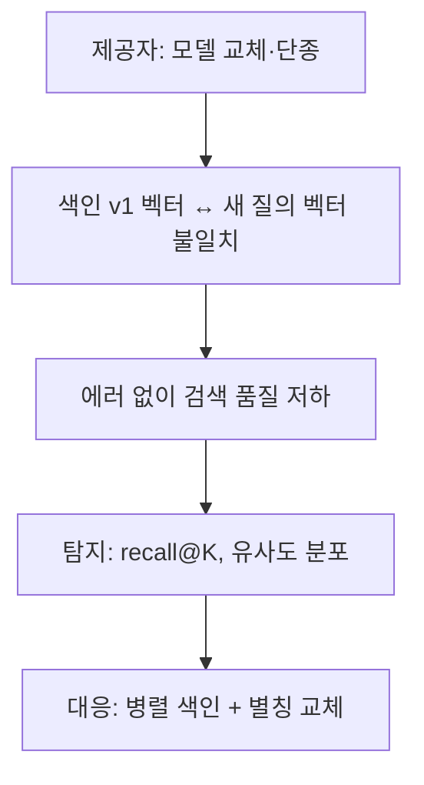

# 임베딩 모델 교체 위험

> 임베딩 API 제공자가 모델을 바꾸거나 단종하면, **기존 색인의 벡터와 새 질의 벡터가 서로 다른 공간에 있게 되어 검색이 조용히 나빠진다.** 에러는 나지 않기 때문에 알아채기 어렵다.

## 쉽게 말하면
같은 지도에서 "서울역 위치"를 표시했는데, 새 지도는 좌표계가 바뀌어 같은 숫자가 다른 곳을 가리킨다. 옛 지도에 찍어 둔 핀들을 새 지도 좌표로 찾으면 엉뚱한 곳이 나온다. 그런데 지도 앱은 아무 경고도 안 한다.

## 자세히
(블로그 「Embedding models in production: versioning and index drift」(tianpan.co, 2026-04-09)를 WebFetch로 직접 확인. 개인 블로그이므로 수치는 "글의 주장"으로 본다.)
- **핵심 문제(글)**: 각 모델은 고유한 벡터 기하를 가져서 **버전이 다른 벡터는 같은 텍스트라도 의미 있게 비교할 수 없다**. 제공자가 엔드포인트 뒤의 모델을 예고 없이 바꿀 수 있고, OpenAI의 text-embedding-ada-002 → text-embedding-3-small 이동은 **전체 재색인**이 필요했다고 소개한다.
- **드리프트 증상(글)**
  - **혼합 벡터 공간**: 점진적·비동기 재색인 중 같은 질의가 새로 색인한 문서에는 잘 되고 옛 문서에는 나빠짐.
  - **조용한 실패**: 검색 인프라가 두 공간 벡터를 비교하는지 알려 주지 않는다.
  - **모델이 안 바뀌어도 코퍼스 드리프트**: 신규 문서·용어 변화로 같은 가중치 모델이 새 코퍼스를 더 못 표현할 수 있다.
- **탐지(글)**: 질의와 상위 K 결과의 **코사인 유사도 분포**(평균 하락·분산 상승)를 추적, 정답 라벨이 있는 held-out 질의로 **recall@K를 주기적으로 측정**, **각 벡터가 어떤 모델·버전에서 나왔는지 기록**.
- **대응(글)**
  - **별칭 기반 버전 관리**: 색인 이름에 모델·날짜(`docs_index_v2_2026-03-01`), 앱은 별칭(`docs_index_current`)만 조회, 병렬 구축 후 원자적 교체. → [블루-그린 재색인](#blue-green-reindex)
  - **지연 재임베딩**: 신규·수정 문서만 새 모델로 병렬 색인에 넣고 두 색인을 질의, 모델 태그로 필터하며 점진 전환.
  - **Drift-Adapter**: 새 질의 임베딩을 옛 공간으로 사상하는 학습 변환. 글은 연구 벤치마크에서 검색 성능의 95~99% 회복을 인용하나, 점진 업그레이드에 적합하고 서빙 스택에 새 장애점을 더한다고 한다(원 논문 미확인).
- **판단 기준(글의 제안)**: 약 200개 질의-문서 쌍의 소형 평가 세트를 정기 실행. 개선이 5% 이하이고 이전이 복잡하면 유지, 단종 임박(예: 90일 유예)이면 이동. 분기마다 자사 데이터로 후보 모델 평가(MTEB만 보지 않기).
- **저장 절감(글)**: Matryoshka 절단(1536→512차원)으로 저장 약 3배 절감, 품질 5~10% 하락 가능 — 자사 데이터로 확인할 것.

## 그림으로 보기

## 예시
- 사내 문서 RAG에서 월요일 이후 검색 정확도가 떨어졌는데 로그에는 오류가 없음 → 임베딩 엔드포인트 모델 변경 확인, recall@10 주간 점검으로 조기 탐지.
- 교육 활동: 벡터에 model_id 필드를 넣는 간단한 스키마를 설계해 보기.

## 헷갈리는 것과 비교
| 개념 | 차이 |
|---|---|
| 모델 교체 위험 | 벡터 공간이 바뀌어 기존 색인 무효 |
| 코퍼스 드리프트 | 문서·용어가 변해 같은 모델 성능 저하 |
| [블루-그린 재색인](#blue-green-reindex) | 교체를 안전하게 수행하는 절차 |
| [청크 내용 해시](#chunk-content-hash) | 바뀐 청크만 다시 임베딩 |

## 더 읽을거리
- [Embedding models in production: versioning and index drift (tianpan.co)](https://tianpan.co/blog/2026/04/09/embedding-models-production-versioning-index-drift) — 드리프트 증상·탐지·버전 관리(직접 확인, 개인 블로그).
- [Migrate to a New Embedding Model with Zero Downtime (Qdrant)](https://qdrant.tech/documentation/tutorials-operations/embedding-model-migration/) — 실제 마이그레이션 절차(직접 확인).
