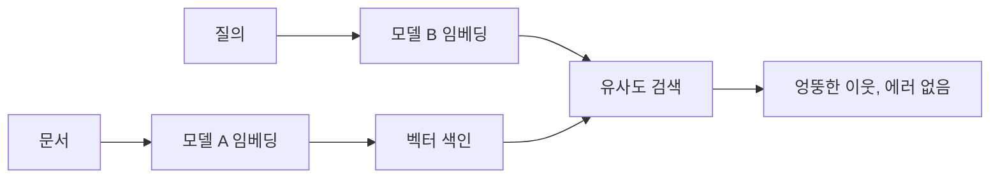
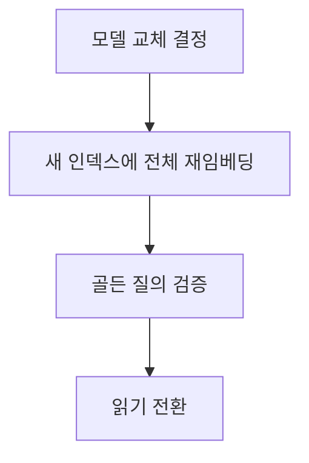

# 임베딩 모델 불일치

> 색인을 만들 때 쓴 임베딩 모델과 **질의를 벡터로 바꿀 때 쓰는 모델이 다른** 상태다. 서로 다른 모델의 벡터 공간은 맞지 않아 유사도 계산이 의미 없고, 오류 없이 엉뚱한 검색 결과가 나온다.

## 쉽게 말하면
한국어 사전으로 찾아 둔 색인에 영어 사전 방식으로 찾으려는 것이다. 숫자 쪽수는 비슷해 보여도 가리키는 위치가 전혀 다르다. 프로그램은 "쪽수 12"를 받아들이니 에러도 없다.

## 자세히
- **왜 안 맞나(Zilliz FAQ, 직접 확인)**: 모델마다 자기 벡터 공간·차원·이웃 구조가 있어 v1 벡터와 v2 벡터의 코사인 유사도는 의미가 없다. 하나의 ANN 인덱스(HNSW·IVF)에 섞으면 엉뚱한 영역의 이웃이 나오고, 옛 벡터를 새 모델용으로 바꾸는 변환은 없어 코퍼스를 다시 임베딩해야 한다. 이전은 블루-그린(새 컬럼 → 백그라운드 재임베딩 → 검증 → 전환)으로 무중단 가능([RAG 인덱스 버전](#rag-index-versioning)).
- **조용히 실패하는 경우(tianpan.co 글, 직접 확인)**: 차원이 같은 모델로 바뀌면 DB가 새 쿼리 벡터를 그대로 받아 오류 없이 "쓰레기 결과"가 나온다. 제공자가 엔드포인트 뒤 모델을 바꾸면 내 쪽 배포 없이도 발생할 수 있다. 벡터마다 모델 버전을 저장하고 API 응답의 모델 버전을 기록하라고 권한다.
- **OpenAI 임베딩 문서(developers.openai.com, 직접 확인, 확인 시점)**: text-embedding-3-small 기본 1536차원·MTEB 62.3%, text-embedding-3-large 3072차원·64.6%, ada-002 61.0%. 최대 입력 8192토큰. v3 모델은 `dimensions` 파라미터로 뒤쪽 값을 잘라 줄일 수 있고(문서는 수동으로 자르면 다시 정규화해야 한다고 설명), 같은 모델 안에서 차원을 바꾸는 것도 별개 공간이므로 섞지 말아야 한다는 점은 이 글의 해석이다. 문서는 서로 다른 모델 임베딩을 비교할 수 있는지 말하지 않으며 "가정하지 말고 확인하라"고 안내한다.
- **다른 증상과의 구분**: 낡은 정보는 [조용한 버전 드리프트](#silent-version-drift), 삭제 미반영은 [좀비 문서](#zombie-documents). 불일치는 **질의 쪽과 색인 쪽 모델이 다른** 문제라 문서 내용이 맞아도 검색이 틀린다.
- **예방 체크(제안)**: ① 색인 메타데이터에 모델 이름·차원 기록 ② 질의 경로의 모델과 비교하는 시작 시 검사 ③ 골든 질의 회귀 테스트 ④ 모델 교체는 항상 전체 재색인 절차로.

## 그림으로 보기

## 예시
- 신규 문서만 새 모델로 임베딩해 같은 인덱스에 추가: 옛 문서와 새 문서가 섞여 검색이 불안정.
- 교육 소재: 같은 문장을 서로 다른 임베딩 모델로 바꿔 보고 두 벡터를 비교하면 왜 의미가 없는지 보여 주는 데모.

## 헷갈리는 것과 비교
| 개념 | 차이 |
|---|---|
| 임베딩 모델 불일치 | 질의·색인의 모델이 다름 |
| 차원 불일치 | 길이가 달라 오류가 남(차라리 쉬운 경우) |
| [조용한 버전 드리프트](#silent-version-drift) | 문서 버전이 공존 |
| [좀비 문서](#zombie-documents) | 삭제 미반영 |

## 더 읽을거리
- [Zilliz: Change embedding model without re-indexing](https://zilliz.com/ai-faq/change-embedding-model-without-reindexing) — 섞을 수 없는 이유(직접 확인).
- [Embedding Model Churn (tianpan.co)](https://tianpan.co/blog/2026/05/07/embedding-model-churn-vector-index-invalidation) — 동일 차원 조용한 실패(직접 확인).
- [OpenAI Embeddings guide](https://developers.openai.com/api/docs/guides/embeddings) — 모델·차원·정규화(직접 확인).
