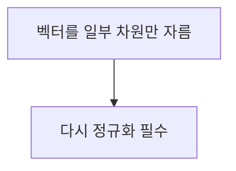

# 임베딩 정규화

> 임베딩 벡터를 길이 1로 맞추는 처리다. 정규화하면 벡터 방향만 남아 코사인 유사도 비교가 안정되고, 벡터를 자르거나 줄일 때도 필요하다.

## 쉽게 말하면
사람들의 키(길이)는 무시하고 어느 방향을 보고 있는지만 비교하려고 모두 같은 길이의 화살표로 맞추는 것이다.

## 자세히
(sentence-transformers 문서와 OpenAI 임베딩 가이드를 직접 열어 확인. 수학적 설명 일부는 제안.)
- **sentence-transformers**: `encode()`의 `normalize_embeddings`는 "반환 벡터를 길이 1로 정규화할지" 여부다. `similarity()`는 `similarity_fn_name`에 따라 두 임베딩 모음 사이 유사도 행렬을 계산하며, 이 이름은 설정하지 않으면 처음 호출할 때 자동으로 **"cosine"** 으로 정해진다. 문서 페이지는 "정규화하면 내적이 코사인과 같다"는 말을 직접 쓰지는 않는다.
- **OpenAI 가이드**: 직접 차원을 자르면 "임베딩의 차원을 정규화"해야 하며 예시는 L2 노름으로 나눈다([dimensions 파라미터](#embedding-dimensions-parameter)). 가이드는 반환 벡터가 이미 길이 1이라는 점을 명시하지 않는다.
- **수학(제안, 일반 사실)**: 길이가 1인 두 벡터에서는 내적 = 코사인 유사도이므로 빠른 내적 검색 인덱스를 써도 코사인과 같은 순위를 얻는다. 길이가 다르면 내적과 코사인 순위가 달라질 수 있다.
- **운영(제안)**: 색인 시와 질의 시 정규화 규칙을 같게 하고, 모델·유사도 함수·정규화 여부를 색인 메타데이터에 기록한다([임베딩 모델 교체 위험](#embedding-model-churn)).

## 그림으로 보기



## 예시
```python
emb = model.encode(texts, normalize_embeddings=True)
```
- 교육 활용: 길이가 다른 두 벡터의 내적과 코사인 순위가 갈리는 작은 예를 직접 계산.

## 헷갈리는 것과 비교
| 개념 | 차이 |
|---|---|
| 정규화 | 길이를 1로 |
| 코사인 유사도 | 방향 유사도 |
| 내적 | 길이 영향을 받음(정규화 시 코사인과 같음) |

## 더 읽을거리
- [SentenceTransformer 문서](https://sbert.net/docs/package_reference/sentence_transformer/SentenceTransformer.html) — normalize_embeddings·similarity.
- [OpenAI 임베딩 가이드](https://developers.openai.com/api/docs/guides/embeddings) — 수동 축소와 정규화.
