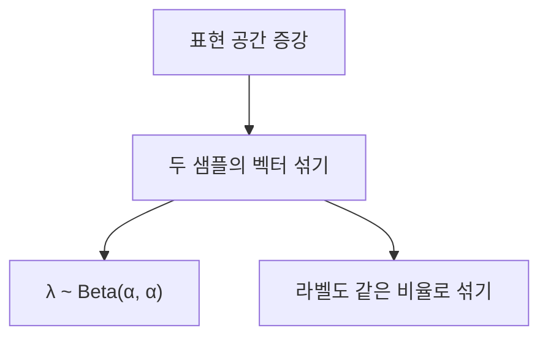

# 임베딩 공간 증강

> 텍스트 자체를 바꾸는 대신, **단어·문장·은닉층의 벡터(표현)를 직접 섞거나 변형해** 학습 샘플을 늘리는 증강이다. 사람이 읽을 수 있는 문장이 생기지는 않지만 도메인 지식 없이 쓸 수 있다.

## 쉽게 말하면
사진 속 사람을 가위로 오려 붙이는 대신, 사진을 숫자 격자로 바꾼 뒤 두 격자를 섞는 것과 같다. 섞인 결과는 눈으로 볼 수 없지만 모델에게는 "두 예시의 중간 지점"이라는 새 연습 문제가 된다.

## 자세히
- 왜 쓰나: 단어 치환·삽입·삭제 같은 텍스트 증강은 언어 지식이 필요하고 의미가 바뀔 위험이 있다. 표현 공간 보간은 연속적이라 과적합을 줄이고 도메인에 상관없이 쓸 수 있다(Guo et al. 2019는 "domain independent, human knowledge 불필요, 추가 계산 적음"이라고 주장).
- 섞는 위치에 따른 분류(논문 기준):
  - **입력 임베딩 층** — [wordMixup](#wordmixup): 단어 위치별 임베딩을 λ:1−λ로 보간.
  - **인코더 출력(문장 벡터)** — [senMixup](#senmixup): 소프트맥스 직전 벡터를 보간.
  - **중간 은닉층** — TMix(Chen et al., ACL 2020, arXiv 2004.12239): 12층 BERT의 m번째 층 은닉 상태를 보간한 뒤 위층으로 계속 전달. 논문은 층 집합 {7, 9, 12} 중 배치마다 하나를 무작위로 골랐다.
- 층 선택 실험(AG News, 클래스당 라벨 10개, TMix 논문 Table 3): 믹스업 없음 69.5%, {0,1,2} 69.3%, {3,4} 70.4%, {6,7,9} 71.9%, **{7,9,12} 74.1%**, {6,7,9,12} 72.2%. 구문·의미 정보가 풍부한 층에서 섞을 때 이득이 크고, 얕은 층만 섞으면 효과가 없거나 오히려 낮다.
- λ는 Beta(α, α) 분포에서 뽑는다. 라벨도 같은 비율로 섞고 KL 발산으로 학습(TMix).
- MixText는 TMix에 라벨 추정(label guessing, 증강으로 라벨 없는 데이터의 낮은 엔트로피 라벨 생성)을 합쳐 준지도 학습으로 확장한다([준지도 학습](#semi-supervised-learning)).
- 한계: 섞은 결과를 사람이 읽거나 검수할 수 없고, 임베딩을 고정하면 효과가 불안정할 수 있다(wordMixup 논문 SST-2 고정 임베딩 사례). 분류 과제 중심으로 검증되었다.

## 그림으로 보기

## 예시
- 라벨 10개/클래스뿐인 뉴스 분류에서 BERT 7·9·12층을 섞어 정확도 69.5% → 74.1%(TMix 논문).
- 교육: "데이터를 늘리는 방법은 텍스트를 바꾸는 것만이 아니다"라는 확장 사례.

## 헷갈리는 것과 비교
| 개념 | 차이 |
|---|---|
| 임베딩 공간 증강 | 벡터를 섞거나 변형, 읽을 수 있는 텍스트 없음 |
| [TF-IDF 단어 치환](#tfidf-word-replacement) | 실제 단어를 바꿔 읽을 수 있는 문장 생성 |
| [텍스트용 Mixup](#mixup-for-text) | 이 접근의 대표 계열 |

## 더 읽을거리
- [MixText (arXiv 2004.12239)](https://arxiv.org/abs/2004.12239) — TMix·층 선택 실험(PDF 텍스트로 읽음).
- [Augmenting Data with Mixup for Sentence Classification (arXiv 1905.08941)](https://arxiv.org/abs/1905.08941) — wordMixup·senMixup 원 논문.
