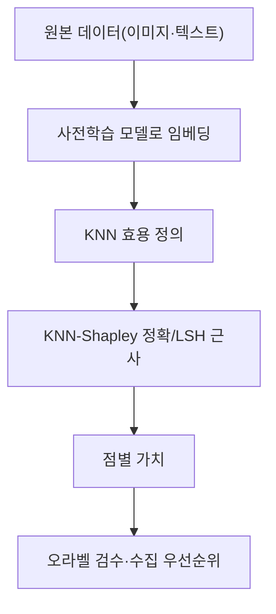
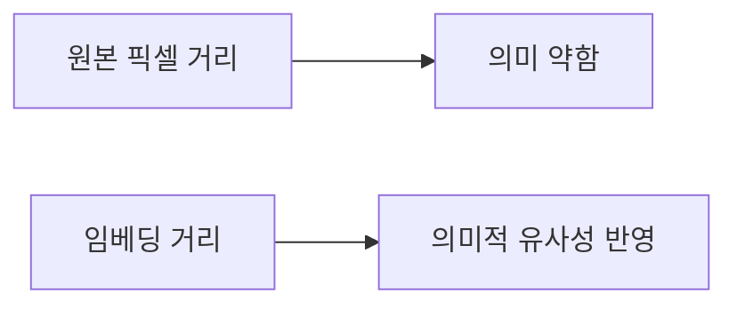

# 임베딩 공간에서의 가치 평가

> 이미지·텍스트를 **사전학습 모델로 임베딩(고차원 특징 벡터)** 으로 바꾼 뒤, 그 공간에서 **KNN을 대리 모델**로 삼아 데이터 가치를 계산하는 방법. 신경망을 수없이 재학습하지 않고도 수백만 점의 가치를 구할 수 있다.

## 쉽게 말하면
수천만 장의 사진을 일일이 평가하기 어려우니, 먼저 모든 사진을 "비슷한 것끼리 가까이 놓이는 지도"(임베딩)에 올려 둔다. 그다음 "지도에서 가까운 이웃이 정답을 얼마나 돕는가"로 각 사진의 가치를 센다.

## 자세히
(Jia 외, arXiv 1908.08619 본문 확인)
- **절차**: ① 사전학습 신경망으로 **특징 추출**(분류층만 제외) ② 추출한 특징으로 KNN 효용 정의([KNN 효용](#knn-utility)) ③ 정확 KNN-Shapley(O(N log N)) 또는 [LSH 근사](#lsh-approximate-knn-shapley)로 모든 학습 점의 값을 계산.
- **논문의 특징 추출 설정(저자 보고)**: 개/고양이 ImageNet 데이터는 Inception v3(최상위층 제외) **2,048차원**, MNIST는 **1,024차원**, CIFAR-10은 ResNet-50 **2,048차원**, ImageNet(100만 장 이상)도 ResNet-50 2,048차원, Yahoo Flickr 약 9,920만 장 중 **1,000만 개 부분집합(Yahoo10m)** 에서도 실험했다.
- **KNN이 대리 모델로 쓸 만한가(논문 그림 8, 저자 보고)**: 딥 특징 위에서 KNN은 로지스틱 회귀와 **비슷한 예측력**을 보였다.
  | 데이터셋 | 1NN | 2NN | 5NN | 로지스틱 회귀 |
  |---|---|---|---|---|
  | CIFAR-10 | 81% | 83% | 80% | 87% |
  | ImageNet | 77% | 73% | 84% | 82% |
  | Yahoo10m | 90% | 96% | 98% | 96% |
  데이터셋·K에 따라 앞서기도 뒤지기도 한다(CIFAR-10은 로지스틱이 4~7%p 높고 Yahoo10m은 5NN이 2%p 높음).
- **왜 임베딩 공간인가**: 원본 픽셀 거리는 의미가 약하다. 논문의 개 vs 물고기 사례에서 Inception 영향은 픽셀 거리와 상관이 약했다(영향 함수 실험, 1703.04730). 의미적 유사성은 임베딩 공간에서 잡힌다.
- **응용**: ① 오라벨 후보 탐색(가까운 이웃과 라벨이 반대인 점은 음수 값, [노이즈 라벨 탐지](#data-valuation-for-label-noise)) ② 데이터 수집 우선순위(가치 높은 점과 비슷한 새 데이터) ③ 거대한 웹 데이터 정제.
- **주의(권장)**
  1. 임베딩 모델이 **도메인에 맞아야** 한다(의료 영상에 ImageNet 특징은 부적합할 수 있음).
  2. KNN 값은 **임베딩·거리·K에 종속**이므로 최종 모델이 다를 때 가치가 이전되는지 소규모로 검증([대리 모델 가치 평가](#surrogate-model-valuation)).
  3. 임베딩 학습에 쓴 데이터와 평가 데이터가 겹치면 누수.
  4. 낮은 값 점은 삭제 말고 검토([삭제하지 않기](#valuation-vs-deletion)).
- **한계**: 대리 모델 가정(KNN이 실제 모델과 비슷하게 행동), 임베딩 편향이 가치에 전이.

## 그림으로 보기



## 예시
```python
emb = encoder(images)                    # (N, 2048) 임베딩
order = np.argsort(np.linalg.norm(emb - emb_test, axis=1))   # 테스트 점에 가까운 순
phi = knn_shapley(order, corr, K=5)      # 앞 글의 재귀식
bad = [i for i, v in phi.items() if v < 0]   # 음수 값: 검수 후보
```
- 사내 문서 20만 건을 문장 임베딩으로 바꾸고 질의 100개 기준 KNN 가치를 평균해 중복·오라벨 의심 문서를 추린다.

## 헷갈리는 것과 비교
| 개념 | 설명 |
|---|---|
| 임베딩 공간 | 의미가 가까울수록 가까운 벡터 공간 |
| 대리 모델 | 실제 모델 대신 쓰는 단순 모델(KNN) |
| KNN-Shapley | KNN 효용의 효율적 샤플리 |
| 신경망 직접 샤플리 | 재학습 비용이 매우 큼 |

## 더 읽을거리
- [Efficient Task-Specific Data Valuation for Nearest Neighbor Algorithms (arXiv 1908.08619)](https://arxiv.org/abs/1908.08619) — 딥 특징 위 KNN 평가와 대규모 실험(PDF 본문 확인).
- [Influence Functions (arXiv 1703.04730)](https://arxiv.org/abs/1703.04730) — 픽셀 거리와 영향의 약한 상관 관찰(PDF 본문 확인).
