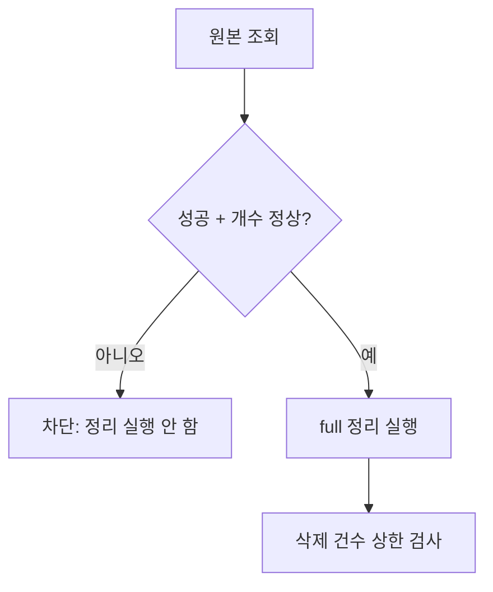
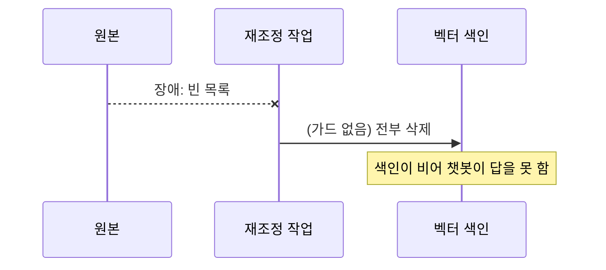

# 빈 목록 삭제 방지

> 원본 조회가 **실패해서 빈 목록이 돌아왔는데**, 그것을 "원본에서 전부 삭제됐다"로 받아들여 **벡터 색인의 문서를 전부 지워 버리는 사고를 막는 가드**다. 전체 대조(full) 정리 방식에서 특히 필요하다.

## 쉽게 말하면
재고 실사 직원이 창고 문이 잠겨 들어가지 못했는데 "창고에 물건이 하나도 없음"이라고 보고하면, 장부에서 재고를 전부 지워 버리는 것과 같다. "확인 못 함"과 "없음"은 다르다는 것을 구분해야 한다.

## 자세히
(이 세션에서 `langchain-core` **1.8.4**를 가상환경에 설치하고 `index()`를 인메모리 벡터 저장소·`InMemoryRecordManager`·가짜 임베딩으로 **직접 실행**했다. 가드 코드는 이 노드가 만든 단순 예시이며 LangChain이 제공하는 기능이 아니다. 앞서 확인한 LangChain 참조 문서도 full 모드에서 "로더가 전체 데이터셋을 반환해야 한다"고 경고한다.)
- **재현(실행 결과)**: 문서 5개를 색인한 뒤 **빈 목록으로 한 번 더** `index([], …)`를 실행했다.
  | cleanup 모드 | 빈 목록 실행 결과 | 저장된 문서 수(전→후) |
  |---|---|---|
  | `full` | **num_deleted: 5** | 5 → **0** |
  | `scoped_full` | num_deleted: 0 | 5 → 5 |
  | `incremental` | num_deleted: 0 | 5 → 5 |
  | `None` | num_deleted: 0 | 5 → 5 |
  → **`full`만** 빈 입력을 "전부 삭제"로 처리해 색인을 비웠다. `scoped_full`·`incremental`은 이번에 본 소스 ID가 없으니 삭제 범위가 비어 아무것도 지우지 않았다. (이번 버전·이번 설정에서의 관찰이다.)
- **원인(해석)**: full은 "이번에 받은 목록에 없는 것 = 원본에서 사라진 것"이라는 규칙이라, API 장애·권한 오류·네트워크 실패로 얻은 빈 목록과 진짜 빈 원본을 구분하지 못한다.
- **가드 패턴(이 노드가 만들어 시험)**
  ```python
  def safe_full_index(loaded, rm, vs, min_ratio=0.5):
      current = len(vs.store)
      if not loaded:
          raise RuntimeError("loader returned 0 documents; refusing full cleanup")
      if current and len(loaded) < current * min_ratio:
          raise RuntimeError("loaded far fewer docs than indexed; refusing")
      return index(loaded, rm, vs, cleanup="full", source_id_key="source")
  ```
  10개가 색인된 상태에서 시험한 결과: **빈 목록 → 차단**, **3/10(50% 미만) → 차단**, **9/10 → 통과(1개 삭제, 9개 유지)**.
- **추가 안전장치(제안)**: 삭제 건수의 **상한·비율 경보**, 정리 전 **스냅샷/백업**, 원본 조회 성공 여부를 별도로 확인(HTTP 상태·행 수), 삭제는 사람 승인 단계를 둠, `scoped_full`·`incremental`로 범위를 좁히기. → [색인 정리 모드](#index-cleanup-modes)
- **한계**: 인메모리 저장소와 가짜 임베딩으로 한 시험이다. 실제 벡터 DB와 대용량에서의 삭제 처리 시간·복구는 확인하지 않았다.

## 그림으로 보기



## 예시
- 드라이브 API가 일시 장애로 0건을 반환했는데 야간 full 동기화가 색인을 비움 → 로더가 0건이면 실행을 중단하고 알림.
- 교육 활동: 10개 문서에서 3개만 로드되는 시나리오를 만들어 가드가 막는지 확인.

## 헷갈리는 것과 비교
| 개념 | 차이 |
|---|---|
| 빈 목록 삭제 방지 | 조회 실패를 삭제로 오인하지 않는 가드 |
| [색인 정리 모드](#index-cleanup-modes) | full/scoped_full/incremental의 삭제 범위 |
| [RAG 재조정 작업](#rag-reconciliation-job) | 이 가드가 필요한 대조 작업 |
| [Tombstone 삭제](#tombstone-deletion) | 삭제를 표시만 하는 방식(복구 여지) |

## 더 읽을거리
- [langchain_core indexing `index()` 참조](https://reference.langchain.com/python/langchain_core/indexing/api/index) — full 모드는 로더가 전체 데이터를 반환해야 한다는 경고(직접 확인). 표의 결과는 이 노드의 직접 실행이다.
