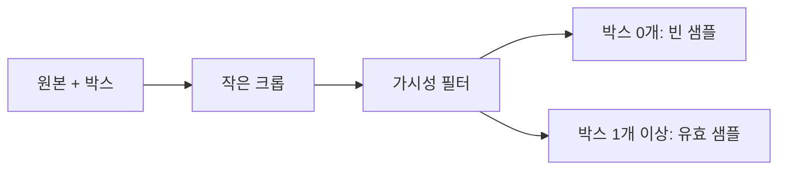
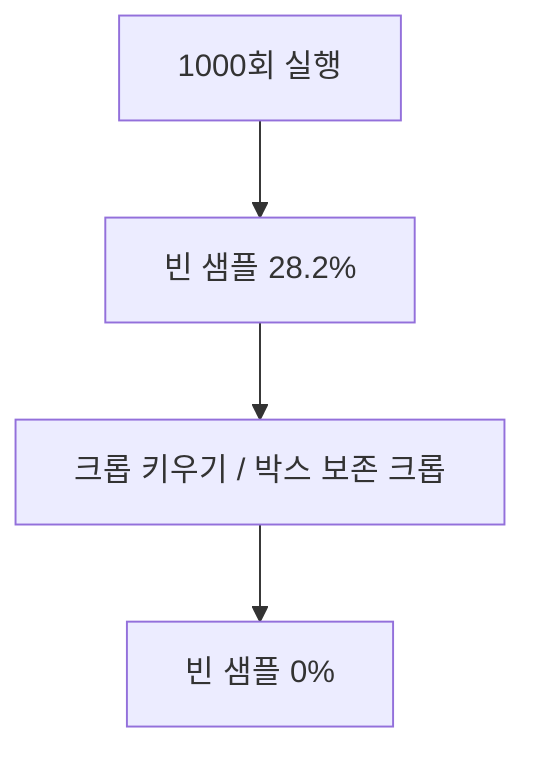

# 빈 샘플 비율

> 증강 뒤 **정답(박스·마스크)이 하나도 남지 않은 학습 샘플의 비율**이다. 크롭이 작거나 필터 기준이 엄격하면 이 비율이 높아져, 학습 신호가 줄거나 모델이 "아무것도 없다"에 치우친다.

## 쉽게 말하면
단체 사진을 자꾸 작게 오려 쓰면 어떤 조각에는 사람이 한 명도 안 나온다. 그런 조각이 28%나 되면 "사람 찾기" 연습의 4분의 1 이상이 빈 화면 연습이 된다.

## 자세히
- 직접 실행(Albumentations 2.0.8, 640×480 이미지, 박스 4개 `[50,50,120,120]`, `[300,200,380,300]`, `[500,380,600,460]`, `[20,400,70,450]`, `RandomCrop` + `HorizontalFlip(0.5)`, `min_visibility=0.3`, 시드 고정, 1,000회):
  | 크롭 | 샘플당 남은 박스 분포 | **빈 샘플 비율** | 클래스별 생존율(0·1·2·3) |
  |---|---|---|---|
  | 224×224 | 0개 282 / 1개 701 / 2개 17 | **28.2%** | 0.08 / 0.55 / 0.07 / 0.04 |
  | 320×320 | 1개 652 / 2개 347 / 3개 1 | **0.0%** | 0.16 / 0.98 / 0.14 / 0.07 |
- 읽는 법: 224 크롭에서 샘플의 28%가 정답이 없다. 또한 클래스 3(구석의 작은 박스)은 4%만 살아남아 **희귀 클래스가 더 심하게 사라졌다.** 320에서는 빈 샘플이 없지만 클래스 3 생존율이 7%뿐이라 클래스 불균형은 남는다. 박스 위치가 이미지 가장자리에 몰려 있으면 가운데 크롭이 불리하다.
- 점검 방법: 증강 파이프라인을 1,000회 돌려 ① 빈 샘플 비율 ② 샘플당 박스 수 분포 ③ 클래스별 생존율을 센다([증강 통계 스크립트](#augmentation-stats-script)). 합리적 상한은 과제에 따라 다르며(배경 샘플이 필요한 탐지도 있음) 정해진 숫자는 없다(제안: 의도한 값을 먼저 정하고 비교).
- 대응: 크롭을 키운다 · 박스를 보존하는 크롭([erosion_rate](#erosion-rate-bbox-crop))을 쓴다 · `min_visibility`를 낮춘다 · 빈 샘플은 재시도(리샘플)하거나 일정 비율만 허용한다.
- 한계: 이 합성 데이터는 박스 4개뿐이며 실제 데이터는 분포가 다르다. 수치는 방법을 보여 주는 예시다.

## 그림으로 보기



## 예시
```python
empty = sum(len(t(image=img,bboxes=boxes,l=labels)['bboxes'])==0 for _ in range(1000))/1000
```
- 교육: "증강도 데이터 분포를 바꾼다 — 숫자로 세어 보자"는 점검 습관.

## 헷갈리는 것과 비교
| 개념 | 차이 |
|---|---|
| 빈 샘플 | 증강 때문에 정답이 사라진 샘플 |
| 음성(배경) 샘플 | 처음부터 정답이 없는 의도된 샘플 |
| [크롭과 라벨 일치](#crop-label-consistency) | 남은 박스와 라벨 대응 확인 |

## 더 읽을거리
- [Albumentations 문서](https://albumentations.ai/docs/) — `BboxParams(min_visibility)` 설명.
- 직접 실행: 1,000회 시행 통계.
