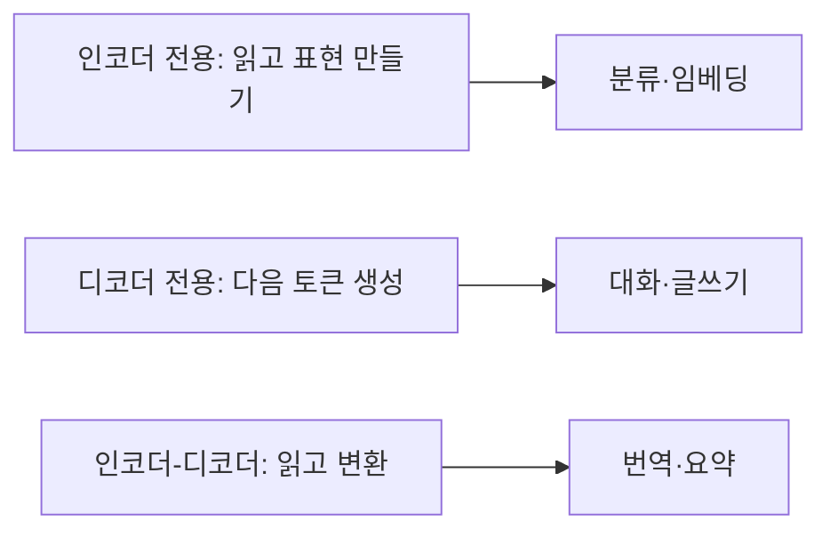
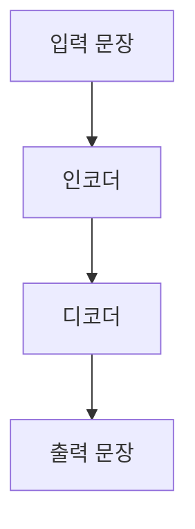

# 인코더·디코더 모델 종류

> 트랜스포머 계열 모델은 **인코더 전용(BERT류), 디코더 전용(GPT류), 인코더-디코더(번역·T5류)** 로 나뉜다. 지금 챗봇형 LLM은 대부분 디코더 전용이다.

## 쉽게 말하면
인코더는 문장을 **읽고 이해하는** 독자, 디코더는 다음 말을 **이어서 쓰는** 작가, 인코더-디코더는 읽고 나서 **다른 글로 옮겨 쓰는** 번역가다.

## 자세히
- **트랜스포머 원형**(arXiv 1706.03762): 인코더-디코더 구조의 시퀀스 변환 모델로 기계번역에서 성능을 보였다.
- **BERT**(Devlin 외, arXiv 1810.04805 초록 확인): 모든 층에서 **좌우 문맥을 함께 조건**으로 삼아 라벨 없는 텍스트에서 깊은 양방향 표현을 사전학습한다. 출력층 하나만 추가해 질의응답·추론 과제로 미세조정한다. 보고 결과: GLUE **80.5%**(+7.7), MultiNLI **86.7%**(+4.6), SQuAD v1.1 F1 **93.2**(+1.5), SQuAD v2.0 F1 **83.1**(+5.1). (마스크 언어 모델 학습법은 초록 요약에 없음.)
- **세 유형 요약**(일반 지식)
  | 유형 | 대표 | 잘하는 것 |
  |---|---|---|
  | 인코더 전용 | BERT | 분류·검색 임베딩·개체명 인식 |
  | 디코더 전용 | GPT·Claude류 | 텍스트 생성·대화 |
  | 인코더-디코더 | T5, 번역 모델 | 번역·요약 같은 변환 |
- 선택 기준(권고): 이해·분류가 목적이면 작은 인코더 모델로 충분한 경우가 많고, 대화·생성은 디코더 전용 LLM, 입력을 다른 형식으로 바꾸는 고정된 변환은 인코더-디코더도 후보.

## 그림으로 보기

## 예시
- 고객 문의를 10개 범주로 분류: BERT류 인코더 미세조정.
- 보고서 초안 작성: 디코더 전용 LLM.
- 한영 번역 전용 서비스: 인코더-디코더 구조의 번역 모델.

## 헷갈리는 것과 비교
| 개념 | 차이 |
|---|---|
| 양방향(BERT) | 좌우 문맥을 모두 봄 |
| 자기회귀(GPT) | 왼쪽 문맥만 보고 다음 토큰 예측 |
| [위치 인코딩](#positional-encoding) | 세 유형 모두 필요 |
| [어텐션](#transformer-attention) | 공통 부품 |

## 더 읽을거리
- [BERT](https://arxiv.org/abs/1810.04805)
- [Attention Is All You Need](https://arxiv.org/abs/1706.03762)
