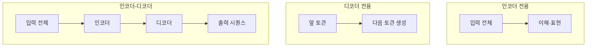

# 인코더·디코더 모델

> 트랜스포머는 입력을 이해해 표현으로 만드는 인코더 구조, 글을 이어서 생성하는 디코더 구조, 둘을 합친 구조로 나뉘며 용도가 다르다.

## 쉽게 말하면
인코더는 "읽고 요약 메모를 만드는 사람", 디코더는 "앞 내용을 보며 다음 문장을 써 내려가는 작가", 인코더-디코더는 "원문을 읽은 사람이 번역문을 쓰는 번역가"다.

## 자세히
Hugging Face LLM 코스(2026-11 확인):
| 유형 | 어텐션 | 예 | 용도 |
|---|---|---|---|
| 인코더 전용(BERT류, auto-encoding) | 앞뒤 모든 단어 참조 | BERT | 문장 분류, 개체명 인식 |
| 디코더 전용(GPT류, auto-regressive) | 이전·현재 단어만 | GPT, GPT-2, GPT-3 | 텍스트 생성 |
| 인코더-디코더(T5류, seq2seq) | 인코더는 전체 입력, 디코더는 생성한 것 + 인코더 출력 | T5 | 번역, 요약 |
- 인코더는 입력을 임베딩이라는 압축된 수치 표현으로 바꾸며 [MLM](#masked-language-modeling)으로 사전학습되는 경우가 많다(HF 용어집).
- 현재 대부분의 대화형 LLM은 디코더 전용 구조다(일반 관찰, 업계 동향 — 수치 근거는 이번에 확인하지 않음).

## 그림으로 보기

## 예시
- 고객 리뷰 감정 분류 → BERT류 인코더.
- 챗봇·코드 생성 → 디코더 전용 LLM.
- 영한 번역·긴 글 요약 → T5류 인코더-디코더(요즘은 디코더 LLM도 많이 사용).

## 헷갈리는 것과 비교
| 개념 | 차이 |
|---|---|
| 인코더 | 이해·표현 추출 |
| 디코더 | 생성 |
| [양방향 어텐션](#bidirectional-attention) | 인코더의 핵심 특성 |
| [트랜스포머 구조](#transformer-architecture) | 세 유형의 공통 뿌리 |

## 더 읽을거리
- [How do Transformers work? (HF LLM Course)](https://huggingface.co/learn/llm-course/chapter1/4) — 세 구조 비교.
