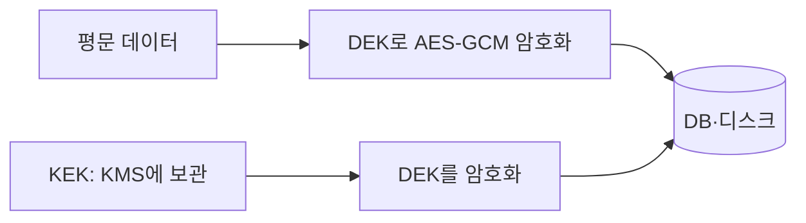

# 저장 데이터 암호화

> 저장 데이터 암호화(encryption at rest)는 디스크·DB·백업에 놓인 데이터를 암호화해, 저장소가 유출돼도 키 없이는 읽지 못하게 하는 보호다.

## 쉽게 말하면
금고에 서류를 넣어 두는 일이다. 도둑이 금고째 가져가도 열쇠가 없으면 못 연다. 그래서 열쇠를 금고 위에 얹어 두면 의미가 없다.

## 자세히
OWASP Cryptographic Storage Cheat Sheet 기준:
- **알고리즘**: 대칭 암호는 AES, 키 128비트 이상(256비트 권장), **인증된 모드(GCM 또는 CCM)** 우선. ECB는 특수한 경우 외 피한다. 자체 알고리즘을 만들지 않는다.
- **키 생성**: CSPRNG로 무작위 생성. 흔한 단어에서 파생하지 않는다.
- **키와 데이터 분리**: DB에 데이터가 있으면 키는 다른 곳에 둔다.
- **봉투 암호화**: DEK(데이터 키)로 데이터를 암호화하고 KEK(키 암호화 키)로 DEK를 암호화. KEK는 따로 보관.
- **키 회전**: 유출·사용 기간 만료 시. 키 ID를 항목에 붙여 두면 옛 키로 풀 수 있다. 회전 절차를 미리 만들어 시험한다.
- **키 보관**: HSM·클라우드 KMS·시크릿 관리 서비스. 코드·Git에 넣지 않는다. OWASP는 환경 변수도 `/proc/self/environ` 등으로 새므로 피하라고 한다.
- **심층 방어**: 암호화가 뚫려도 접근 제어가 지켜야 하며, 민감 데이터는 애초에 덜 저장한다.
- LangGraph: `EncryptedSerializer.from_pycryptodome_aes()`로 체크포인트를 AES 암호화하며 키는 `LANGGRAPH_AES_KEY` 환경 변수 또는 `key` 인자로 준다([serde](#langgraph-serde)). 개발 편의에는 좋지만 위 OWASP 지침에 비추어 운영에서는 KMS 같은 시크릿 서비스에서 주입하는 편이 낫다(해석).

## 그림으로 보기

## 예시
- 체크포인트에 개인정보가 들어간다면 serde에 EncryptedSerializer를 끼우고 키는 시크릿 매니저에서 읽는다.
- 키를 `.env`에 두고 저장소에 올리지 않았는지, 백업에도 키가 같이 있지 않은지 점검한다.

## 헷갈리는 것과 비교
| 개념 | 차이 |
| --- | --- |
| 저장 시 암호화 | 디스크·DB 안의 데이터 보호 |
| 전송 중 암호화(TLS) | 네트워크 구간 보호 |
| [접근 제어](#access-control) | 누가 읽을 수 있나(암호화와 병행) |

## 더 읽을거리
- [OWASP Cryptographic Storage Cheat Sheet](https://cheatsheetseries.owasp.org/cheatsheets/Cryptographic_Storage_Cheat_Sheet.html) — 알고리즘·키 관리 지침
