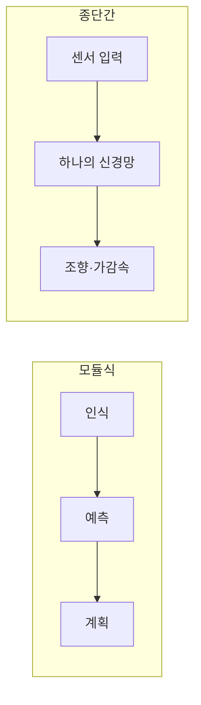
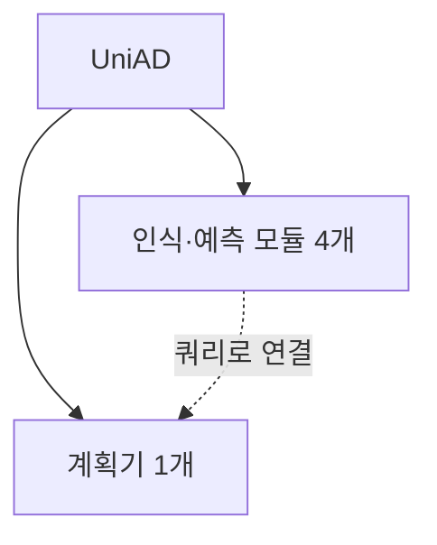

# 종단간 자율주행

> 센서 입력(카메라 영상 등)에서 조향·가감속 같은 **출력까지 하나의 학습된 신경망**이 이어서 처리하는 방식. 인식·예측·계획을 따로 만든 모듈식 스택과 대비된다.

## 쉽게 말하면
모듈식은 "보는 사람 → 예측하는 사람 → 길 정하는 사람"이 릴레이로 일하는 팀이고, 종단간은 한 사람이 눈으로 보고 곧바로 손발을 움직이는 운전자다. 릴레이는 중간에서 정보가 새고, 한 사람 방식은 속을 들여다보기 어렵다.

## 자세히
- 모듈식의 문제(UniAD 저자 주장): 모듈을 따로 만들면 **오차가 단계마다 쌓이고** 과제 간 협조가 부족할 수 있다. 반대로 모두를 한꺼번에 학습하면 과제끼리 방해하는 **negative transfer**가 생길 수 있다.
- **UniAD**(Hu 외, CVPR 2023, arXiv 2212.10156): 인식·예측 트랜스포머 디코더 모듈 4개와 계획기 1개를 한 네트워크로 묶고, **쿼리**를 모듈 간 인터페이스로 써서 계획 중심으로 함께 최적화. nuScenes 평가에서 기존 최고 대비 전 항목 우수 주장. 후속 UniAD 2.0 README에는 평균 충돌률 0.29%, 움직임 예측 minADE 0.79m가 적혀 있다(개방 루프 벤치마크 수치이므로 실도로 안전과는 다르다).
- 수상 표기: CVPR 측은 "Best Paper 후보"로 적고 일부 저장소는 수상작으로 쓴다. 공식 수상 목록은 확인하지 못했으므로 후보로만 적는다.
- 장점: 정보 손실 감소, 데이터로 성능 확장. 한계: 해석 어려움, 드문 상황 검증([롱테일 문제](#long-tail-problem)), 안전 검증 방법이 모듈식보다 까다롭다.

## 그림으로 보기

## 예시
- 영상 프레임을 넣으면 다음 몇 초의 주행 궤적이 나오는 모델.
- 교육: 업무 자동화에서 "단계별 도구 연결 vs 한 에이전트에 일임" 선택 비유.

## 헷갈리는 것과 비교
| 개념 | 차이 |
|---|---|
| 모듈식 | 단계별 개발·점검 쉬움, 오차 누적 |
| 종단간 | 통째로 학습, 속 파악 어려움 |
| [모방 학습](#imitation-learning) | 종단간 정책을 학습하는 대표 방법 중 하나 |

## 더 읽을거리
- [UniAD 논문 (arXiv 2212.10156)](https://arxiv.org/abs/2212.10156) — 구조 설명(검색 요약으로 확인).
- [CVPR 2023 논문 페이지](https://openaccess.thecvf.com/content/CVPR2023/html/Hu_Planning-Oriented_Autonomous_Driving_CVPR_2023_paper.html) — 원문 링크.
