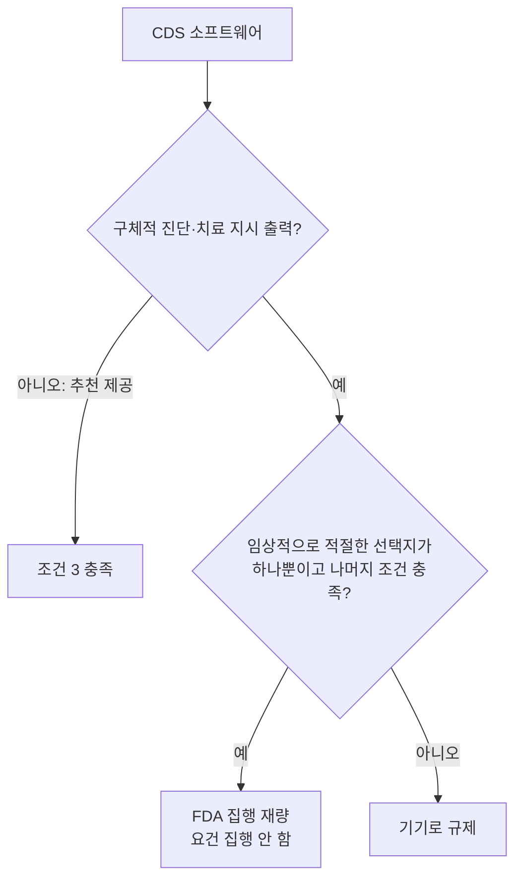

# 집행 재량

> FDA가 특정 소프트웨어나 상황에 대해 "법적 요건을 **집행하지 않을 의도**"라고 공개적으로 밝히는 방식. 법이 바뀌는 것이 아니라 FDA가 감독 자원을 어디에 쓸지에 대한 입장 표명이다.

## 쉽게 말하면
교통법규상 위반이지만 경찰이 "이런 경우는 단속하지 않겠다"고 공표한 것과 같다. 규칙이 사라진 것은 아니어서, 공표된 조건을 벗어나면 단속 대상이 될 수 있다.

## 자세히
출처: FDA CDS 지침(2026-01-29 발행, PDF 원문 직접 읽음, 비구속 권고) III·V절.
- **정의(지침)**: "FDA does not intend to enforce requirements under the FD&C Act" — 지침은 집행 재량을 이렇게 풀이한다.
- **CDS 지침에서의 쓰임(조건 3)**: 소프트웨어가 구체적인 예방·진단·치료 **출력이나 지시**를 내면 조건 3("추천 제공")을 충족하지 못한다. 그런데 **임상적으로 적절한 선택지가 하나뿐**이고 나머지 모든 조건(520(o)(1)(E))을 충족하면 FDA는 그런 기능에 집행 재량을 행사하겠다고 밝힌다.
- **지침의 예**: 환자의 체중, 현재·과거 흡연 상태, 혈압, BNP 체외진단 검사 결과로 미래 심혈관 사건 위험을 예측해 의료진이 참고하게 하는 소프트웨어. 단, **같은 기능이라도 진단 추천과 확립된 관련성이 없는 변이 유전체 데이터를 입력에 쓰면** 이 예에 해당하지 않고 FDA가 감독을 집중하는 기기 소프트웨어가 된다.
- **한계**: 영상·신호를 분석하는 기능은 조건 1에서 막혀 기기이며, 시간이 촉박한 결정을 지원하는 구체적 진단 출력은 조건 3·4 미충족 기기 예로 제시된다(예: 웨어러블 신호로 심장마비를 감시).
- **성격**: 집행 재량은 법적 면제가 아니다. 입장은 지침 개정으로 바뀔 수 있고(이 지침도 2026-01-06 발행본을 대체한 판이다), 사용자에게 법적 권리를 부여하지 않는다는 점은 일반적 설명이며 이 지침 문구로 확인한 것은 아니다.

## 그림으로 보기

## 예시
- 체중·흡연·혈압·BNP로 심혈관 위험을 계산해 의료진에게 보여 주는 도구 → 지침이 집행 재량 예로 제시.
- 같은 도구에 진단과 관련성이 확립되지 않은 변이 유전체 데이터를 입력으로 추가 → 집행 재량 밖, 기기 감독 대상.

## 헷갈리는 것과 비교
| 개념 | 차이 |
|---|---|
| 집행 재량 | 규제는 그대로, FDA가 집행하지 않겠다는 입장 |
| 법적 제외(520(o)(1)(E)) | 조건 충족 시 기기 정의에서 제외, 법률 규정 |
| 510(k) 면제 | 일부 기기가 시판 전 신고를 면제받는 제도 |
| [CDS 예외 4조건](#cds-exemption) | 상위 노드 |

## 더 읽을거리
- [Clinical Decision Support Software (FDA 지침 PDF, 2026-01-29)](https://www.fda.gov/media/109618/download) — 조건 3 집행 재량 문구와 예(내려받아 확인)
