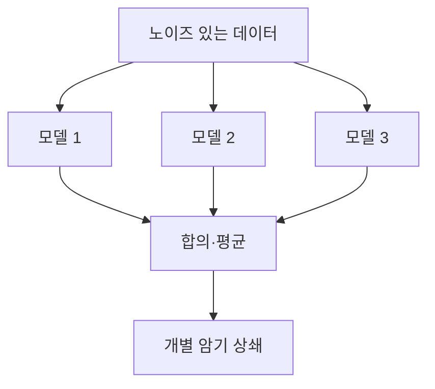
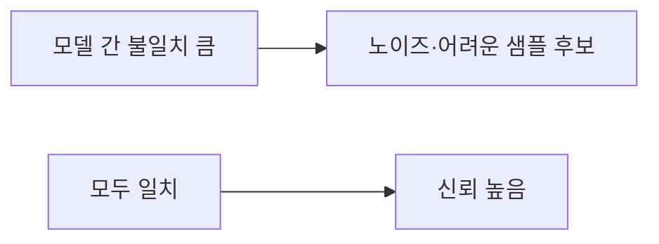

# 앙상블의 노이즈 내성

> 앙상블은 여러 모델의 예측을 모아 최종 답을 정하는 방식이다. 노이즈 라벨이 있을 때는 모델마다 외운 오류가 다르기 때문에 평균·합의가 개별 모델의 암기를 상쇄할 수 있고, 모델 간 불일치 자체가 노이즈 신호로도 쓰인다.

## 쉽게 말하면
학생 여러 명이 각자 문제집을 외워 올 때, 문제집마다 오타가 달랐다면 다수결로 답을 정하면 각자의 오타가 서로 지워진다. 또 학생들 답이 갈리는 문제는 "문제 자체가 수상하다"는 단서가 된다.

## 자세히
- **합의 기반 접근들(arXiv 검색 결과 요약, 초록 일부만 확인)**: 
  - *Under-trained deep ensembles*(arXiv 2009.11128): 극심한 라벨 노이즈에서 앙상블 구성원을 짧게만 학습시키고 그 합의로 더 깨끗한 라벨을 만들어 새 모델을 학습한다(Ensemble Power Distillation). 공격적인 조기 종료 형태다.
  - *Robust Training with Ensemble Consensus*(arXiv 1910.09792): 섭동을 주면 노이즈 샘플의 손실이 일관되게 작지 않다는 점을 이용해 노이즈를 걸러낸다.
  - *The Dynamic of Consensus in Deep Networks*(arXiv 2210.00583): 노이즈 샘플은 정상 샘플을 대부분 배운 뒤 늦게 학습된다는 관찰로 노이즈 수준을 추정하고 필터링한다.
  - 위 셋은 검색 요약만 읽었고 수치는 확인하지 못했다.
- **직접 초록을 확인한 논문(United We Stand, arXiv 2310.11077)**: 학습 중 특정 중간 에폭의 모델들을 묶는 에폭 앙상블이다. 과적합이 생기면 분류기 간 불일치(분산)가 커진다는 이론 예측이 실험에서도 나타나고, 여러 에폭에서 가장 일관되게 예측된 클래스를 최종 답으로 쓴다. 초기 종료와 달리 과적합 단계의 유용한 정보도 보존하며 이미지·텍스트 분류에서 일반 앙상블의 과적합 손실을 없애고 조기 종료를 자주 앞선다고 보고한다. 이 초록은 노이즈 라벨을 언급하지 않는다.
- **공통 아이디어(해석)**: 노이즈 암기는 학습 후반에 일어나고, 여러 모델의 불일치·합의가 그것을 드러낸다. [조기 종료](#early-stopping-noise)와 함께 쓰면 효과를 더한다.
- **비용(해석)**: 모델 수만큼 학습·추론 비용이 늘어난다.

## 그림으로 보기

## 예시
- 시드가 다른 모델 5개로 샘플별 예측 분산을 구해, 분산이 큰 샘플부터 사람이 검수한다.
- 교육 활용: 학습자 5명이 같은 데이터에 서로 다른 라벨 오류를 섞어 모델을 학습해 보고 평균 예측의 정확도를 비교한다.

## 헷갈리는 것과 비교
| 개념 | 차이 |
| --- | --- |
| 앙상블 | 여러 모델 결합으로 노이즈 영향 완화 |
| [조기 종료](#early-stopping-noise) | 한 모델을 일찍 멈춤 |
| [모델 다양화 교차 확인](#model-diversity-cross-check) | 라벨 오류 후보를 여러 모델로 확인 |
| [노이즈 라벨 암기](#memorization-of-noisy-labels) | 앙상블이 완화하려는 문제 |

## 더 읽을거리
- [United We Stand (arXiv 2310.11077)](https://arxiv.org/abs/2310.11077) — 에폭 앙상블, 초록 확인
- [Under-trained deep ensembles (arXiv 2009.11128)](https://arxiv.org/abs/2009.11128v2) — 극심한 노이즈에서 짧게 학습한 앙상블(검색 요약)
- [Robust Training with Ensemble Consensus (arXiv 1910.09792)](https://arxiv.org/abs/1910.09792) — 손실 일관성으로 노이즈 구분(검색 요약)
