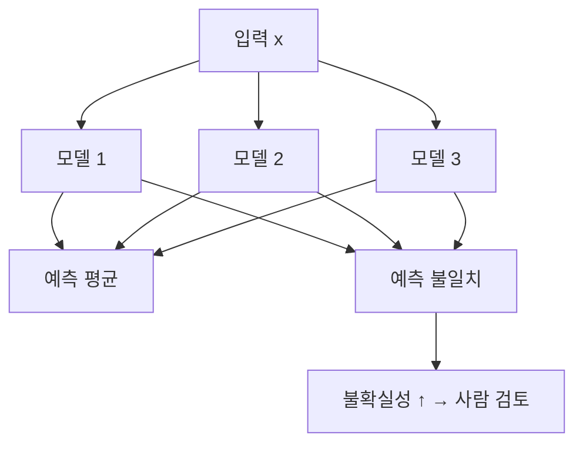

# 앙상블과 불확실성

> 같은 문제를 여러 모델(또는 여러 번 샘플링한 같은 모델)이 풀게 하고 답이 얼마나 갈리는지로 "모델이 얼마나 모르는지"를 추정하는 방법이다. 답이 일치하면 확실, 갈리면 불확실하다. 딥 앙상블이 대표적이다.

## 쉽게 말하면
의사 한 명이 "확실합니다"라고 해도 과신일 수 있다. 서로 따로 교육받은 의사 다섯 명에게 물어 모두 같은 진단이면 믿고, 의견이 갈리면 추가 검사를 한다. 의견이 갈리는 정도가 곧 불확실성이다.

## 자세히
- **딥 앙상블**(Lakshminarayanan·Pritzel·Blundell, 2017, arXiv 1612.01474): 같은 구조의 네트워크를 서로 다른 무작위 초기화로 여러 개 학습해 예측을 평균한다. 표준 학습 파이프라인을 거의 바꾸지 않아 단순하고 확장성이 좋다. 저자들은 MC-dropout과 같거나 더 낫다고 보고했다.
- **MC dropout**(Gal·Ghahramani): 추론 때도 dropout을 켠 채 여러 번 돌려 분포를 얻는다. 모델 하나로 되지만 이후 연구(Ovadia 외 2019 등)에서는 분포 밖(OOD) 입력에서 딥 앙상블이 대체로 앞섰다고 정리된다(검색 요약 기준, 원문 미확인).
- 불확실성 분해: 전체 불확실성 = **우연적(aleatoric, 데이터 자체의 잡음)** + **인식적(epistemic, 모델이 몰라서)**. 앙상블 구성원 간 불일치(예: 상호정보량)가 인식적 불확실성에 가깝다.
- 비용: 모델 N개를 학습·보관·추론해야 해 비용이 N배다. 그래서 LLM에서는 같은 모델을 여러 번 샘플링해 답의 일치율을 보는 방식([자기 일관성 기반 확신도](#self-consistency-confidence))이 현실적이다.
- 보정: 앙상블 평균은 단일 모델보다 [과신](#overconfidence)이 덜한 경향이 있다(일반적 관찰). 그래도 [신뢰도 곡선](#reliability-diagram)으로 확인한다.
- 한계: 원 논문 실험은 비교적 작은 모델·데이터였다는 비판이 있다.

## 그림으로 보기


## 예시
의료 영상 분류기 5개의 확률이 (0.9, 0.88, 0.91, 0.2, 0.85)처럼 갈리면 평균은 높아도 불일치가 커 "추가 검토" 처리한다.
```python
probs = torch.stack([m(x).softmax(-1) for m in models])
mean = probs.mean(0); disagreement = probs.var(0).sum(-1)
```

## 헷갈리는 것과 비교
| 개념 | 차이 |
| --- | --- |
| 딥 앙상블 | 모델 여러 개, 비용 N배, 성능 좋음 |
| MC dropout | 모델 하나, dropout 켠 채 반복 |
| [LLM 자기 일관성](#self-consistency-confidence) | 같은 LLM을 여러 번 샘플링 |
| [온도 스케일링](#temperature-scaling) | 모델 하나의 확률을 사후 보정 |

## 더 읽을거리
- [Simple and Scalable Predictive Uncertainty Estimation using Deep Ensembles (arXiv 1612.01474)](https://arxiv.org/abs/1612.01474) — 딥 앙상블 원 논문(검색으로 확인, 본문 미열람)
