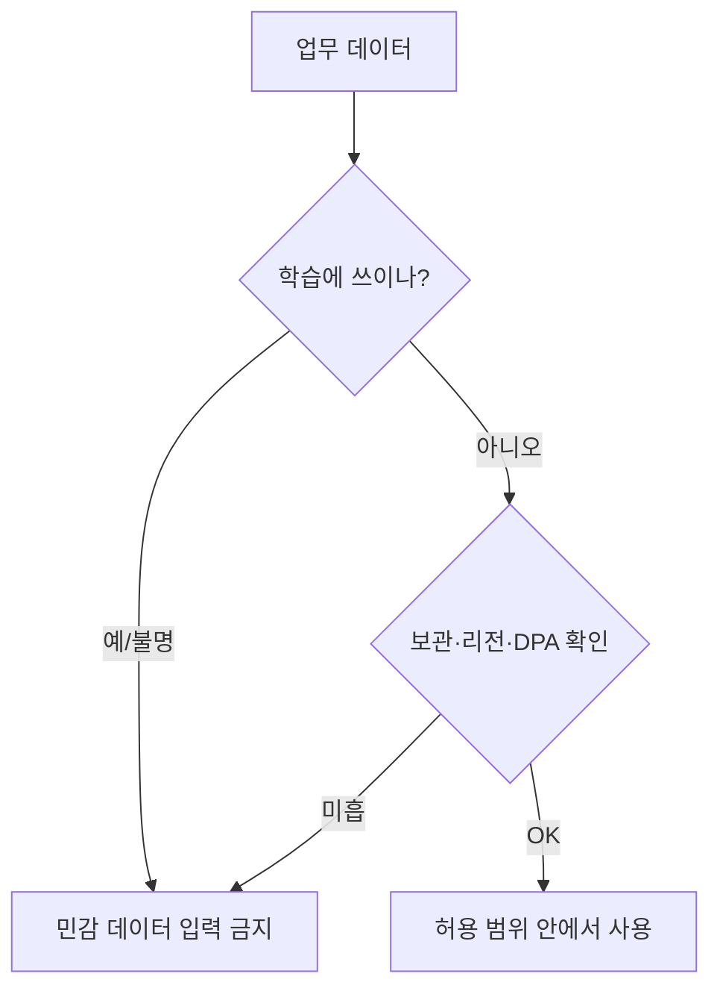

# 기업용 AI 약관 읽기

> AI 서비스를 회사 업무에 쓰기 전, 약관·DPA에서 "내 데이터를 학습에 쓰나, 얼마나 보관하나, 결과물 권리는 누구 것인가, 어디서 처리하나"를 확인하는 체크리스트.

## 쉽게 말하면
이삿짐센터에 짐을 맡기기 전 "내 물건을 열어 보나요? 창고에 얼마나 두나요? 파손되면 책임은요?"를 계약서에서 확인하는 일이다. 무료 앱과 기업용 계약은 같은 서비스라도 답이 다를 수 있다.

## 자세히
**Anthropic 상용 약관(Commercial Terms, 2026-11 열람)에서 확인된 것**
- 학습: 고객 콘텐츠(입력+출력)로 "Anthropic은 서비스에서 모델을 학습하지 않을 수 있다"(B절). 소비자용 약관과 구분해서 본다.
- 권리: 고객이 입력에 대한 권리를 유지하고 출력의 소유자이며, Anthropic이 출력에 갖는 권리를 고객에게 양도한다(약관 준수 조건).
- 비밀유지: 고객 콘텐츠는 고객의 기밀정보로 취급, 계약 이행 목적에만 사용, 알 필요가 있는 인력에만 공유(E.1).
- 처리: 데이터 처리는 DPA(Data Processing Addendum)를 따른다(C절). 보관 기간·세부 처리는 이 페이지에 없고 DPA와 제품별 데이터 보관 문서에서 확인해야 한다.

**체크리스트**
1. 학습 사용 여부(기본값 vs 옵트인/아웃)와 플랜별 차이
2. 보관 기간, 삭제 요청 절차, 제로 보관 옵션 유무
3. 출력물 저작권·IP 면책(indemnity) 조항
4. 처리 지역(리전)·하위 처리자(sub-processor) 목록
5. 보안 인증(SOC 2, ISO 27001 등)과 로그·감사 기능
6. 개인정보·민감정보를 넣어도 되는 범위, DPA 체결 여부
- 약관은 개정되므로 날짜를 기록하고, 확인 못 한 항목은 "미확인"으로 남긴다.

## 그림으로 보기

## 예시
도입 보고 한 줄: "Anthropic API(상용 약관 2026-11 확인): 학습 불가, 출력 소유권 고객, DPA 적용. 보관 기간·리전은 DPA/문서에서 별도 확인 필요."

## 헷갈리는 것과 비교
| 개념 | 차이 |
| --- | --- |
| 약관(ToS) | 서비스 이용 전반 계약 |
| DPA | 개인정보 처리 위탁 조건을 정한 부속 계약 |
| 보관(retention) vs 학습 | 저장되는 것과 모델 개선에 쓰이는 것은 별개 질문 |
| [개인정보·저작권](#privacy-copyright) | 상위 주제. 여기는 계약 문서 읽는 법 |

## 더 읽을거리
- [Anthropic Commercial Terms](https://www.anthropic.com/legal/commercial-terms) — 학습·출력 권리·비밀유지·DPA 참조
