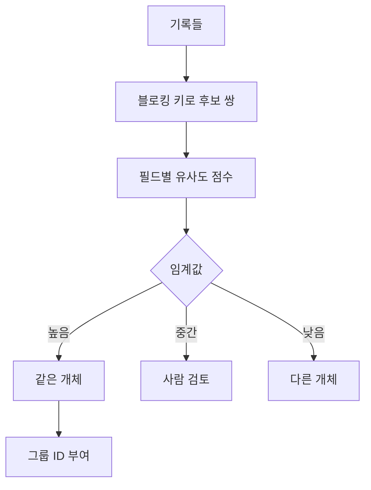
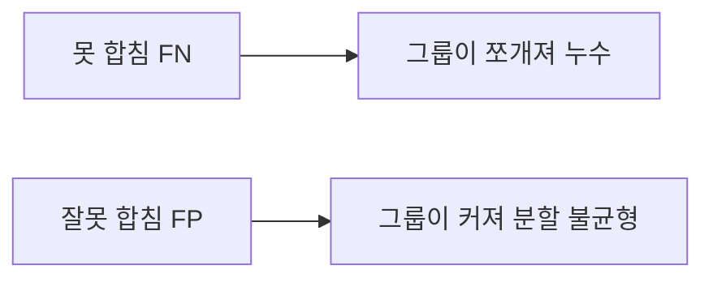

# 엔티티 해소

> 엔티티 해소(레코드 연결)는 서로 다른 ID나 표기로 흩어진 기록들이 같은 사람·기업·문서인지 판별해 하나로 묶는 기법이다. 그룹 단위 분할에서는 같은 개체의 기록이 서로 다른 그룹에 들어가는 누수를 막는 선행 단계다.

## 쉽게 말하면
도서관 대출 기록에 "김철수", "Kim Chulsoo", "철수 김"이 따로 있는데 사실 한 사람이다. 기록들을 훑어 "이름이 비슷하고 생일과 동네가 같으니 같은 사람이다"라고 판단해 한 명으로 합치는 일이다. 반대로 생일이 하루 다른 동명이인은 합치면 안 된다.

## 자세히
- **방식(Wikipedia 레코드 연결 문서, 열람)**: ① 결정론적 연결 — 규칙으로 식별자가 정확히(또는 임계값 이상) 같으면 연결. 신뢰할 공통 식별자가 있으면 잘 맞지만 결측·변형이 있으면 규칙이 계속 늘어난다. ② 확률적(Fellegi-Sunter) 연결 — 필드마다 일치·불일치의 증거 가중치를 더해 위쪽 임계값 이상이면 일치, 아래쪽 미만이면 불일치, 가운데는 사람이 검토한다. 드문 성씨의 일치는 증거가 크다. 필드가 서로 독립이라는 가정이 깨질 수 있다.
- **블로킹(같은 문서)**: 모든 쌍을 비교할 수 없으므로 "생년월일이 같다" 같은 블로킹 키가 일치하는 쌍만 비교한다. 키가 어긋난 진짜 일치는 놓치므로 키를 바꿔 여러 번 돌린다.
- **직접 해 본 장난감 실험(기록 7개, 정답 연결 4쌍)**: 이름(어순 정렬·하이픈 제거 후 유사도 60%) + 생년월일 일치 25% + 도시 일치 15%로 점수를 만들었다. 임계값 0.8에서는 맞는 4쌍을 모두 찾고 오탐이 0이었다. 임계값 0.9로 높이자 맞는 쌍 2개를 놓쳤다(FN 2). 이름과 도시가 같고 생일이 하루 다른 동명이인 후보는 점수 0.75로 임계값 0.8 아래였다. 기록이 7개뿐인 장난감이라 임계값 수치는 일반화할 수 없다.
- **교차검증과의 연결(해석)**: 해소 오류는 두 방향으로 누수를 만든다. 같은 개체를 못 합치면(FN) 그룹이 쪼개져 누수가 생기고, 다른 개체를 합치면(FP) 그룹이 커져 분할이 불균형해진다. 누수 방지가 목적이면 FP보다 FN을 줄이는 쪽(느슨한 임계값)이 안전하다. 연결 결과는 [연결 성분 그룹핑](#connected-components-grouping)으로 그룹이 된다.
- **전처리**: 이름 표기·공백·대소문자는 먼저 [ID 정규화](#id-normalization)로 정리한다.

## 그림으로 보기

## 예시
- 병원 두 곳의 환자 목록을 합칠 때 이름·생년월일·성별로 후보 쌍을 만들고, 점수가 애매한 쌍은 사람이 확인한 뒤 환자 단위 그룹 분할을 한다.
- 교육 활용: 표기가 다른 10개 기록으로 임계값을 바꿔 가며 놓침과 오탐 수를 세어 본다.

## 헷갈리는 것과 비교
| 개념 | 차이 |
| --- | --- |
| 엔티티 해소 | 같은 개체인지 판별 |
| [ID 정규화](#id-normalization) | 표기를 통일(해소의 전처리) |
| 중복 제거 | 같은 행 삭제 |
| [연결 성분 그룹핑](#connected-components-grouping) | 해소 결과를 그룹으로 만듦 |

## 더 읽을거리
- [Wikipedia: Record linkage](https://en.wikipedia.org/wiki/Record_linkage) — 결정론적·확률적 연결, 블로킹, 함정
