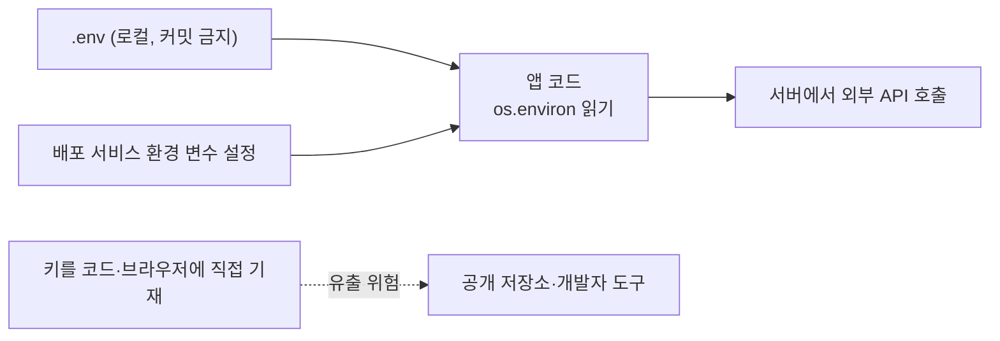

# 환경 변수와 API 키

> 비밀번호·API 키를 **코드에 적지 않고 실행 환경(환경 변수)으로 주입**하는 기본기. 바이브코딩에서는 AI가 편의상 키를 코드에 그대로 박아 넣거나 브라우저로 나가는 코드에 섞는 일이 흔해서, **사람이 점검해야 하는 첫 번째 항목**이다.

## 쉽게 말하면
식당 레시피(코드)는 직원 누구나 볼 수 있지만 금고 비밀번호(키)는 사장 주머니에만 있어야 한다. AI 요리사에게 "금고에서 재료 가져와"라고 시키면 레시피 종이에 비밀번호를 적어 버리는 경우가 있다. 그 레시피를 인터넷에 올리는 순간 금고가 열린다.

## 자세히
- **원칙**(Twelve-Factor App, Config 항목): 배포마다 달라지는 설정과 자격 증명은 코드와 **엄격히 분리**해 환경 변수에 둔다. 점검법: "이 코드베이스를 지금 공개해도 자격 증명이 새지 않는가?"
- **유출은 빠르다**(GitHub 문서): 공개 저장소에서는 비밀 스캔이 자동으로 돌며 알림이 생기고, 파트너 업체의 키 패턴이면 업체에 직접 통보되어 폐기될 수 있다. 권고는 **즉시 해당 키를 교체(회전)** 하는 것이다. 히스토리에서 지우는 작업은 시간이 들고 키를 폐기한 뒤에는 불필요한 경우가 많다고 한다. 키를 올렸다 지웠다고 안전해지지 않는다.
- **바이브코딩에서 자주 나는 실수**(정리):
  1. AI가 만든 예제에 `api_key="sk-..."`가 박혀 있고 그대로 커밋.
  2. 프론트엔드(브라우저) 코드에 비밀 키를 넣음 → 누구나 개발자 도구로 볼 수 있다. 비밀 키는 **서버 쪽**에서만 쓴다.
  3. `.env`를 `.gitignore`에 안 넣음.
  4. 채팅창에 키를 붙여 넣어 AI·로그에 남음.
- **올바른 흐름**: `.env`(로컬, 커밋 금지) → 코드는 `os.environ["KEY"]` 읽기 → 저장소에는 값 없는 `.env.example` → 배포 서비스 설정 화면에 환경 변수 등록.
- 한계: 환경 변수도 서버 접근자에게는 보인다. 규모가 커지면 비밀 관리 서비스를 쓴다.

## 그림으로 보기


## 예시
```python
# run.py — python-dotenv로 로컬 .env 읽기 (직접 실행 확인)
from dotenv import load_dotenv
import os
load_dotenv()
api_key = os.environ["OPENAI_API_KEY"]   # 없으면 KeyError로 빨리 실패
```
```
# .gitignore 에 추가
.env
```
- AI에게 요청할 때: "API 키는 환경 변수 `OPENAI_API_KEY`에서 읽고, 코드에 키를 쓰지 마. `.env.example`도 만들어 줘."

## 헷갈리는 것과 비교
| 개념 | 차이 |
|---|---|
| 환경 변수 | 코드 밖에서 주입하는 설정 |
| `.env` 파일 | 로컬 개발용 환경 변수 모음(커밋 금지) |
| [환경 변수와 비밀 관리](#secrets-env) | 같은 주제의 원칙 중심 설명 |
| [유출 대응](#secret-leak-response) | 유출된 뒤 회전·점검 절차 |

## 더 읽을거리
- [The Twelve-Factor App: Config](https://12factor.net/config) — 설정과 코드 분리 원칙.
- [GitHub Docs: About secret scanning](https://docs.github.com/en/code-security/secret-scanning/introduction/about-secret-scanning) — 비밀 스캔과 유출 시 권고.
