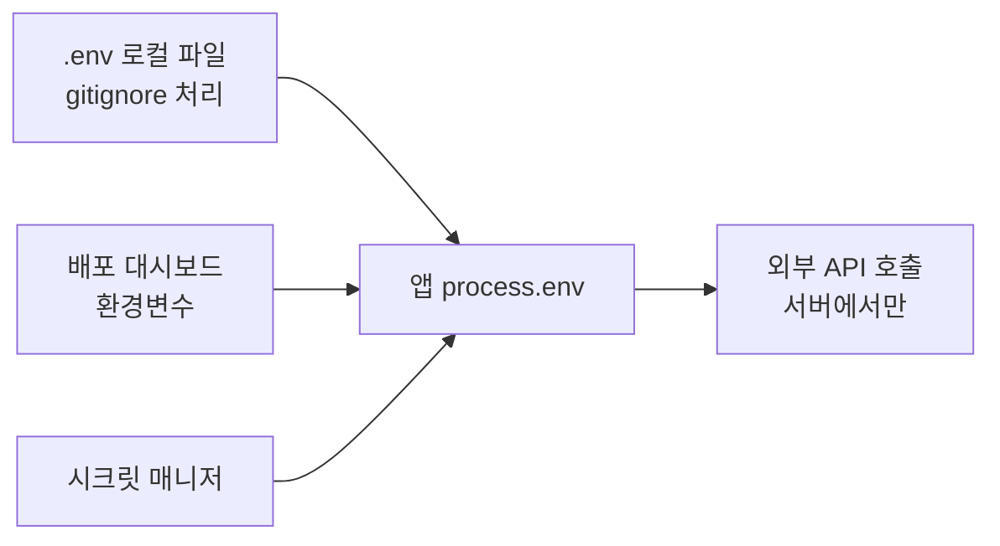
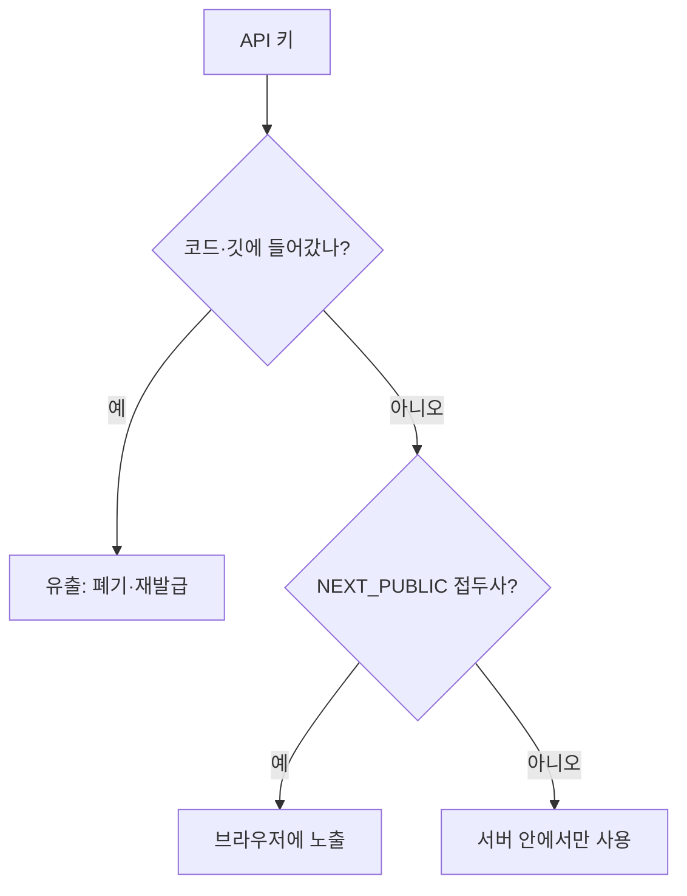

# 환경변수와 비밀키 관리

> 환경변수는 코드 바깥에서 프로그램에 넘기는 `이름=값` 설정이다. API 키·DB 비밀번호 같은 **비밀값은 코드와 깃 저장소에 넣지 않고** 환경변수나 시크릿 매니저로 주입한다.

## 쉽게 말하면
식당 **레시피(코드)**는 공개해도 되지만 **금고 비밀번호(키)**는 레시피 노트에 적으면 안 된다. 금고 번호는 사장 주머니(배포 환경)에 따로 두고, 가게마다(개발·운영) 다른 번호를 쓴다. 노트를 복사해 나눠도 금고는 안전하다.

## 자세히
- **12-Factor 원칙**(12factor.net): 설정은 코드와 엄격히 분리한다. 판별법은 "지금 이 코드를 오픈소스로 공개해도 자격 증명이 새지 않는가?". 환경변수는 코드를 고치지 않고 배포마다 값을 바꿀 수 있고, 설정 파일보다 실수로 커밋될 가능성이 낮다.
- **로컬 개발**: 프로젝트 루트의 `.env` 파일에 `OPENAI_API_KEY=...`처럼 적고 **`.gitignore`에 `.env`를 반드시 추가**한다. 저장소에는 값이 빈 `.env.example`만 올려 필요한 변수 목록을 알려 준다.
- **배포**: Vercel·Netlify·Railway 등의 대시보드 Environment Variables에 등록한다. 운영·프리뷰·개발 값을 따로 둔다.
- **프론트엔드 함정**: `NEXT_PUBLIC_`·`VITE_` 접두사가 붙은 변수는 **브라우저 번들에 그대로 들어가 누구나 볼 수 있다**. 비밀키(서비스 롤 키, LLM API 키)는 서버 코드에서만 읽고, 프론트는 서버 API를 호출한다.
- **더 안전하게**: 규모가 커지면 시크릿 매니저(AWS Secrets Manager, Vault 등)로 접근 로그·자동 교체를 얻는다.
- **유출 시**: 지웠다고 끝이 아니다. 깃 이력에 남으므로 **즉시 키를 폐기·재발급**한다([키 유출 대응](#secret-leak-response)).
- **AI 코딩 주의**: AI가 예제 코드에 키를 하드코딩하거나 `.env`를 컨텍스트로 읽어 로그에 찍을 수 있다. 키를 채팅에 붙여넣지 않는다.

## 그림으로 보기



## 예시
```bash
# .gitignore
.env
# .env.example (커밋 가능)
OPENAI_API_KEY=
DATABASE_URL=
```
```js
const key = process.env.OPENAI_API_KEY; // 서버 코드에서만
```
프롬프트 예: "키는 하드코딩하지 말고 process.env에서 읽고, .env.example과 .gitignore도 만들어 줘."

## 헷갈리는 것과 비교
| 개념 | 차이 |
|---|---|
| 환경변수 | 실행 환경이 주입하는 값, 비밀·설정 모두 가능 |
| .env 파일 | 환경변수를 로컬에서 편하게 채우는 파일, 커밋 금지 |
| 시크릿 매니저 | 접근 통제·로그·교체를 갖춘 전용 저장소 |
| 공개 키(publishable key) | 노출돼도 되도록 설계된 키. 비밀키와 구분 |
| [OAuth와 소셜 로그인](#oauth-sso) | client secret은 서버 환경변수에 둔다 |

## 더 읽을거리
- [The Twelve-Factor App: Config](https://12factor.net/config) — 설정을 코드에서 분리하는 원칙의 원문.
