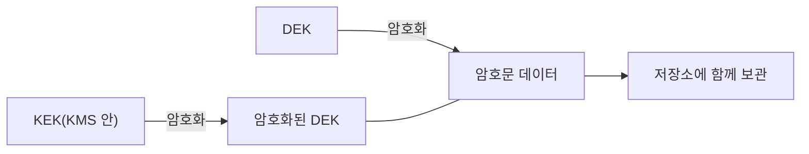

# 봉투 암호화(DEK·KEK)

> 데이터는 "데이터 키(DEK)"로 암호화하고, 그 데이터 키를 다시 "키 암호화 키(KEK)"로 암호화해 함께 보관하는 방식. 클라우드 저장소·KMS의 기본 구조다.

## 쉽게 말하면
금고 열쇠(DEK)를 서랍에 그냥 두면 안 되니 열쇠를 작은 상자에 넣고, 그 상자의 열쇠(KEK)는 은행 보관함에 맡기는 것이다. 금고 안 물건은 그대로 둔 채 상자 자물쇠만 바꾸면 열쇠 교체가 끝난다.

## 자세히
AWS KMS 문서 기준:
- 정의: 평문 데이터를 데이터 키로 암호화한 뒤, 그 데이터 키를 다른 키로 다시 암호화하는 방법. 이를 여러 단계로 쌓을 수 있고, 최상위에는 평문으로 남는 **루트 키**가 하나 있다. KMS 키는 FIPS 140-3 Security Level 3 검증 HSM 밖으로 암호화 없이 나가지 않는다.
- 봉투(envelope) = `(encKey, ciphertext)`: ciphertext = Encrypt(msgKey, message), encKey = Encrypt(k, msgKey)를 한 구조로 묶는다. 받는 쪽은 k로 키를 먼저 풀고 데이터를 푼다.
- 장점 ① 암호화된 데이터 키는 데이터 옆에 안전하게 보관 ② 큰 데이터를 다시 암호화하지 않고 **데이터 키만 재암호화**로 여러 키·키 교체 대응 ③ 빠른 대칭 알고리즘과 키 관리가 쉬운 공개키 알고리즘의 장점 결합.
- KMS API: `GenerateDataKey`(평문 키+암호화된 키 반환), `Decrypt`, `ReEncrypt`. 클라이언트 쪽은 AWS Encryption SDK가 있다.
- AI 관련: 모델 가중치·학습 데이터·벡터 DB를 저장 시 암호화([encryption-at-rest](#encryption-at-rest))할 때 이 구조를 쓴다.

## 그림으로 보기

## 예시
S3 객체를 올릴 때: KMS에 `GenerateDataKey` 요청 → 받은 평문 DEK로 파일 암호화 → 평문 DEK 폐기 → 암호화된 DEK를 파일 옆에 저장. 복호화는 KMS `Decrypt`로 DEK를 복원한 뒤 수행.

## 헷갈리는 것과 비교
| 개념 | 차이 |
| --- | --- |
| DEK | 실제 데이터를 암호화하는 키 |
| KEK·루트 키 | 키를 보호하는 키, KMS 안에 보관 |
| [저장 시 암호화](#encryption-at-rest) | 목표, 봉투 암호화는 그 구현 방식 |

## 더 읽을거리
- [AWS KMS cryptography essentials](https://docs.aws.amazon.com/kms/latest/developerguide/kms-cryptography.html) — 봉투 암호화 정의·장점·API
