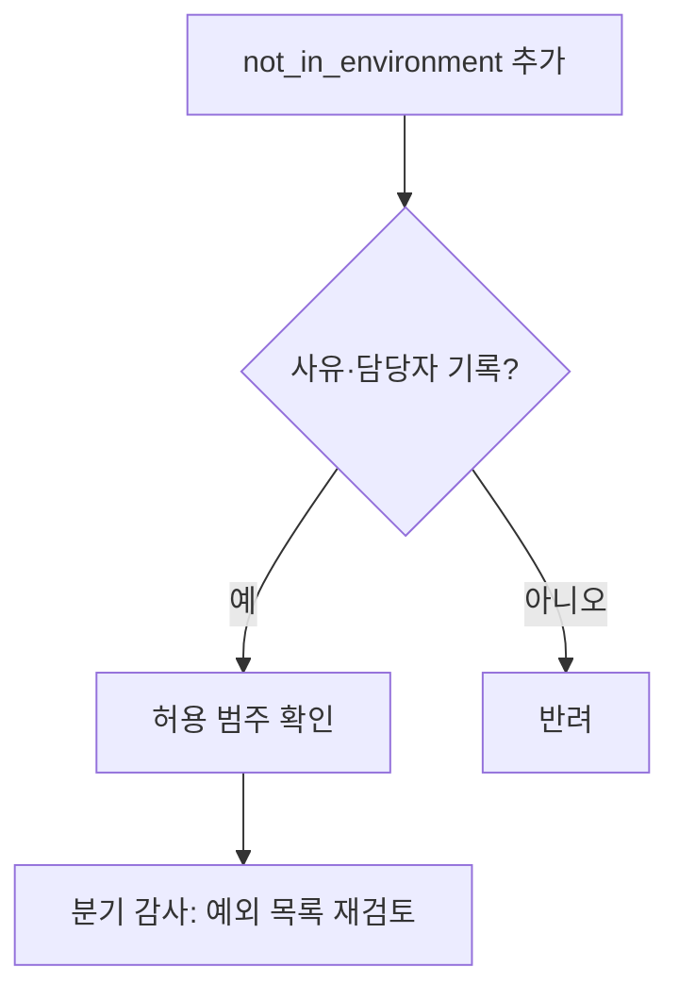
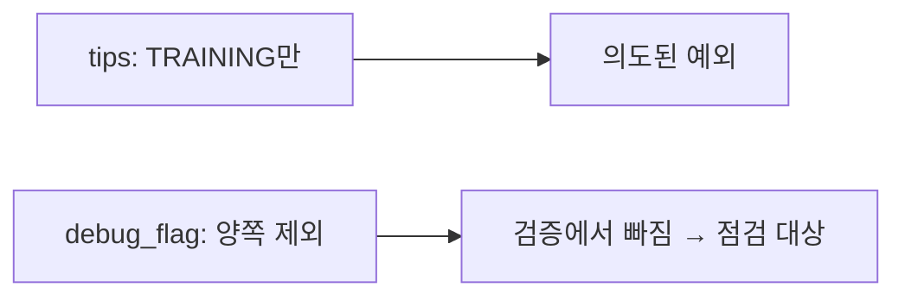

# 환경 예외 관리

> 스키마 환경(TRAINING/SERVING)에서 "이 환경에서는 이 열이 없어도 된다"는 **예외가 쌓여 진짜 누락을 가리지 않도록** 관리하는 규칙이다. 예외는 필요하지만 목록이 늘수록 검증이 느슨해진다.

## 쉽게 말하면
"이 구역은 출입증 없이 들어가도 됨" 표지가 하나둘 늘다 보면 어느새 어디든 출입증 없이 들어갈 수 있게 된다. 예외마다 이유와 담당자와 유효 기간을 적어 두고 주기적으로 정리해야 경비가 의미를 유지한다.

## 자세히
(TFDV의 `schema.proto` 코멘트와 시작 가이드의 스키마 환경 절을 직접 읽었다. 예외 관리 규칙은 문서가 정한 절차가 아니라 이 지도의 제안이다. 아래 간단한 규칙 모델은 직접 작성해 실행했다.)
- **환경 규칙(schema.proto)**: 특징의 `in_environment`(필드 20)와 `not_in_environment`(필드 19)는 **서로소**여야 하고, 특징이 어떤 환경에 속하는 조건은 "그 환경이 `in_environment` 또는 스키마의 `default_environment`에 있고, `not_in_environment`에는 없음"이다.
- **직접 만든 규칙 모델의 실행 결과**: `default_environment=[TRAINING, SERVING]`일 때 `tips`(`not_in=[SERVING]`)는 TRAINING에서만 속하고, `fare`(예외 없음)는 양쪽, `debug_flag`(`not_in=[SERVING, TRAINING]`)는 **어느 환경에도 속하지 않아 검증에서 사실상 빠진다**. 이 모델로 "SERVING에서 제외된 특징" 목록을 뽑으면 `['tips','debug_flag']`이다. 예외 목록 감사를 코드로 자동화할 수 있다는 시연이다.
- **왜 위험한가(해석)**: `not_in_environment`에 올라가면 해당 환경의 데이터에서 그 특징이 없어도, 있어도 이상으로 잡히지 않는다. 서빙에서 **꼭 있어야 하는 특징**을 실수로 제외하면 진짜 누락을 못 잡는다. 앞선 [라벨 열 처리](#label-column-handling)에서 본 것처럼 예외는 **학습 전용 열**처럼 이유가 분명한 경우에만 허용해야 한다.
- **관리 규칙(제안)**
  1. **사유 기록**: 예외마다 이유(예: "라벨, 서빙에는 정답이 없음")와 담당자·승인일을 남긴다.
  2. **허용 범주**: 라벨·학습 전용 중간 산출물·디버그 열 등으로 한정한다.
  3. **정기 감사**: 분기마다 "환경에서 제외된 특징 목록"을 뽑아 사유가 유효한지 확인한다(위 규칙 모델처럼 자동 추출).
  4. **변경 이력**: 스키마 변경은 버전 관리하고 예외 추가는 리뷰를 거친다([스키마 변경 이력](#schema-version-log)).
  5. **라벨 유입 감시**: 서빙 환경에서 제외한 라벨이 서빙 데이터에 나타나면 누수 신호이므로 별도 경보를 둔다.
- **한계**: 환경 이름 `TRAINING`/`SERVING` 외의 환경을 어떻게 쓰는지는 읽은 자료에 없다.

## 그림으로 보기



## 예시
```python
excluded = [name for name, f in features.items()
            if "SERVING" in f.get("not_in", [])]   # 감사용 목록
```
- 교육 소재: 예외 목록에서 사유 없는 항목을 찾아 지우거나 정당화해 보기.

## 헷갈리는 것과 비교
| 개념 | 차이 |
|---|---|
| 환경 예외 관리 | 예외 목록의 사유·감사·정리 규칙 |
| [스키마 환경](#schema-environments) | 환경별 스키마 차이를 표현하는 메커니즘 |
| [라벨 열 처리](#label-column-handling) | 예외를 쓰는 대표 사례 |
| [스키마 침식](#schema-erosion) | 예외가 쌓여 스키마가 느슨해지는 현상 |

## 더 읽을거리
- [schema.proto (TensorFlow Metadata)](https://raw.githubusercontent.com/tensorflow/metadata/master/tensorflow_metadata/proto/v0/schema.proto) — in/not_in_environment 규칙(직접 읽음).
- [Get started with TensorFlow Data Validation — Schema Environments](https://www.tensorflow.org/tfx/data_validation/get_started) — 환경 지정 예(직접 읽음).
