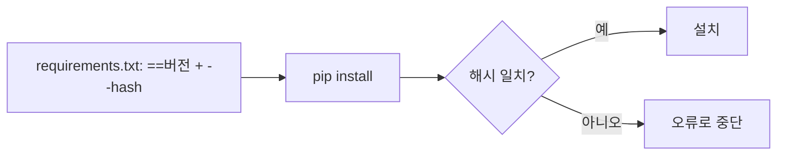
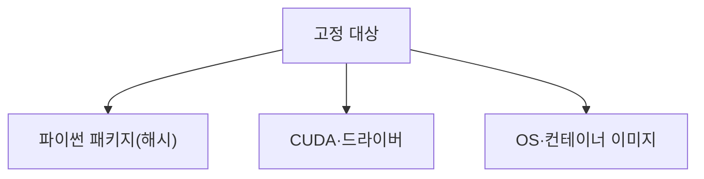

# 환경 고정

> 실험이나 서비스에 쓰는 라이브러리 버전(과 가능하면 해시)을 정확히 고정해 어디서 설치해도 같은 환경이 되게 하는 방법이다. pip의 해시 검사 모드가 한 가지 수단이다.

## 쉽게 말하면
레시피에 "밀가루 적당히" 대신 "00사 강력분 1kg, 제조번호 ○○"라고 적는 것이다. 같은 재료로 같은 요리를 다시 만들 수 있다.

## 자세히
(pip 공식 문서 "Secure installs"의 해시 검사 모드를 직접 열어 확인.)
- **켜는 법**: requirements.txt의 요구 사항에 `--hash` 옵션을 붙이면(하나만 붙여도 전체에 적용) 켜진다. 또는 명령줄에 `--require-hashes`. 문서는 이를 "전부 아니면 전무(all-or-nothing)"라 부른다.
- **조건**: 모든 요구 사항이 `==`, URL, 파일 경로 중 하나로 **고정**되어야 하고, **의존성까지 모두 해시를 가져야** 한다. 목록에 없는 의존성이 있으면 오류. URL 조각의 `#md5=...`도 인정되지만 sha256을 권장.
- **알고리즘**: sha256 권장, `hashlib`가 지원하는 더 강한 알고리즘 허용, md5·sha1·sha224는 제외.
- **여러 해시**: 플랫폼별 바이너리 빌드나 바이너리·소스 배포물이 여럿이면 한 패키지에 해시를 여러 개 적을 수 있다.
- **해시 얻기**: `--require-hashes`가 가져온 패키지의 해시를 출력해 파일 작성을 돕고, 다른 아카이브는 `pip hash` 명령으로 추가.
- **참고**: pip 26.2부터 `--no-require-hashes`로 자동 강제를 끌 수 있어 해시 있는 요구 사항과 로컬 디렉터리·VCS URL을 함께 쓸 수 있다. 자기 프로젝트는 `pip install --no-deps`로 설치.
- **한계(제안)**: 파이썬 패키지만 고정한다. CUDA·드라이버·OS·하드웨어도 함께 기록하거나 컨테이너로 고정해야 한다([GPU 비결정성](#nondeterministic-gpu-training)).

## 그림으로 보기



## 예시
```
numpy==2.2.0 --hash=sha256:<해시>
```
- 교육 활용: 버전 고정이 없을 때 6개월 뒤 설치가 깨지는 사례를 토론.

## 헷갈리는 것과 비교
| 개념 | 차이 |
|---|---|
| 버전 고정(==) | 버전만 고정 |
| 해시 검사 | 내용까지 고정·변조 방지 |
| 컨테이너 | OS·시스템 라이브러리까지 고정 |

## 더 읽을거리
- [pip: Secure installs](https://pip.pypa.io/en/stable/topics/secure-installs/) — 해시 검사 모드.
