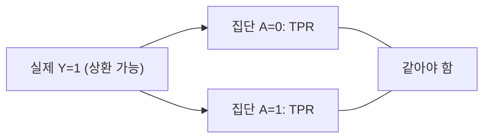
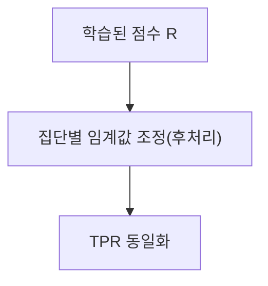

# Equality of Opportunity

> 실제로 "긍정 결과를 받을 자격이 있는"(Y=1) 사람들 중에서 집단과 관계없이 모델이 긍정 예측을 내는 비율(참양성률, TPR)이 같아야 한다는 공정성 기준이다(Hardt·Price·Srebro 2016).

## 쉽게 말하면
대출을 갚을 사람이라면 어느 집단 출신이든 대출 승인을 받을 확률이 같아야 한다는 뜻이다. 갚을 능력이 있는 사람들 사이의 기회 균등이다.

## 자세히
(Hardt 외 arXiv 1610.02413 전문을 하위 에이전트가 읽은 노트 기준.)
- **정의(Def 2.2, 이진 예측 Ŷ·보호 속성 A·결과 Y)**: Pr{Ŷ=1 | A=0, Y=1} = Pr{Ŷ=1 | A=1, Y=1}. 즉 **집단 간 TPR 동일**. [Equalized Odds](#equalized-odds)의 약한 완화로, 유리한 결과(Y=1)에만 적용하며 보통 효용을 더 많이 남긴다.
- **달성 방법(후처리)**: 이미 학습된 점수 R과 속성 A만으로 만든 "파생 예측기" Ỹ를 쓴다(재학습 없음). 점수 임계값이면 집단마다 ROC 곡선 위에서 TPR이 같아지도록 임계값(필요하면 무작위 혼합)을 정한다.
- **FICO 사례(7절)**: 2003년 TransUnion 점수 301,536건(300–850), 연체 정의는 이후 18–24개월에 한 계좌라도 90일 이상 미납, 인종 4집단(아시아·백인 비히스패닉·히스패닉·흑인). 컷오프 620은 약 18% 연체율, 대출 손실은 오분류 비용비 82/18. 최대 이익 대비 이익(82% 비연체 임계값): 인종 무시(race-blind) 99.3%, **기회 균등 92.8%**, equalized odds 80.2%, 인구 통계 동등성 69.8%. 논문 표현: 기회 균등의 비용이 인구 통계 동등성 비용의 4분의 1 미만.
- **한계(제안)**: 라벨 Y 자체가 편향되어 있으면(과거 대출 결정에 따른 선택 편향) 기준의 의미가 약해진다. 후처리는 집단별 임계값을 쓰므로 법적 허용 여부를 확인해야 한다.

## 그림으로 보기

## 예시
- 채용 추천에서 "합격 자격이 있는 지원자" 중 남녀의 추천 비율을 같게 맞추는 점검.
- 교육 활용: FICO 사례의 이익 비교 표로 공정성 기준 선택의 비용을 토론.

## 헷갈리는 것과 비교
| 개념 | 차이 |
|---|---|
| Equality of opportunity | Y=1일 때만 TPR 동일 |
| [Equalized odds](#equalized-odds) | TPR과 FPR 모두 동일 |
| 인구 통계 동등성 | 전체 긍정 예측 비율 동일(Y 무시) |

## 더 읽을거리
- [Equality of Opportunity in Supervised Learning (arXiv 1610.02413)](https://arxiv.org/abs/1610.02413) — 정의·FICO 실험.
