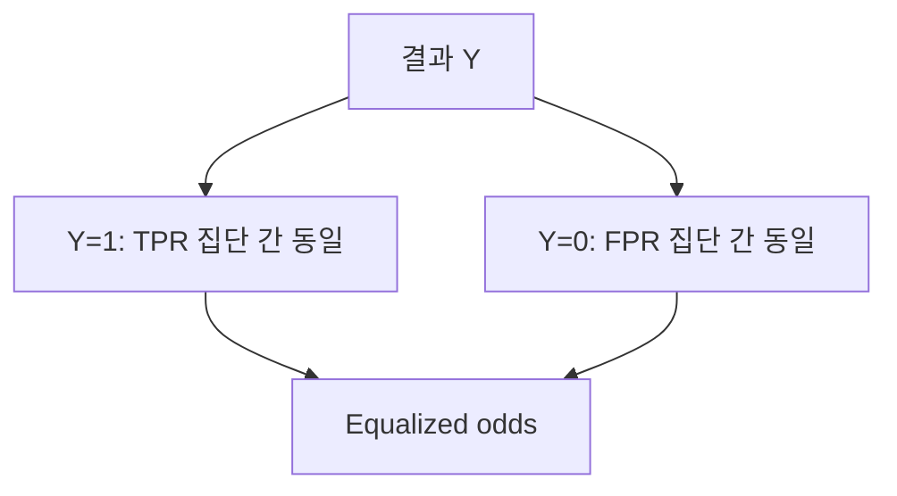
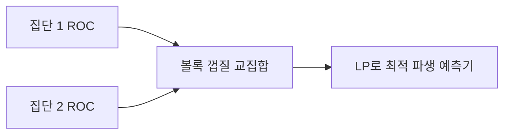

# Equalized Odds

> 실제 결과(Y)가 같은 사람들 안에서는 예측(Ŷ)이 집단(A)과 무관해야 한다는 기준이다. 이진 분류에서는 집단 간 참양성률(TPR)과 거짓양성률(FPR)이 모두 같아야 한다.

## 쉽게 말하면
갚을 사람은 어느 집단이든 승인 확률이 같고, 못 갚을 사람이 잘못 승인될 확률도 어느 집단이든 같아야 한다. 한쪽 오류만 맞추는 것이 아니라 두 오류를 모두 맞춘다.

## 자세히
(Hardt 외 arXiv 1610.02413 전문을 하위 에이전트가 읽은 노트 기준.)
- **정의(Def 2.1)**: Ŷ가 Y가 주어졌을 때 A와 독립. 이진: Pr{Ŷ=1|A=0,Y=y} = Pr{Ŷ=1|A=1,Y=y}, y∈{0,1}. y=1이면 **TPR 동일**, y=0이면 **FPR 동일**. Ŷ=Y(완벽한 예측)는 항상 만족한다. 다수 집단에서만 정확한 모델에 벌을 준다는 점에서 인구 통계 동등성과 다르다.
- **점수 기반**: R이 Y가 주어질 때 A와 독립이면 임계값 I{R>t}도 만족. 집단별 ROC 곡선이 선택한 지점에서 일치해야 한다.
- **달성(4절)**: 후처리 파생 예측기 Ỹ(R, A). 최적 해는 **변수 4개의 선형계획법**(식 4.3, 명제 4.4). 가능 영역은 집단별 ROC 볼록 껍질의 **교집합**이고 성능은 가장 나쁜 집단의 ROC에 의해 제한된다.
- **FICO 비용**: 최대 이익 대비 equalized odds 80.2%(인종 무시 99.3%, 기회 균등 92.8%, 인구 통계 동등성 69.8%).
- **한계(제안)**: 모든 집단의 ROC가 일치해야 하므로 성능이 낮은 집단 쪽으로 평준화되는 비용이 있다. 라벨 편향 문제가 남는다.

## 그림으로 보기

## 예시
- 범죄 위험 예측에서 재범하지 않은 사람의 오탐률(FPR)이 집단 간 같은지 점검.
- 교육 활용: TPR·FPR을 두 칸 표로 그리고 집단별로 비교하는 실습.

## 헷갈리는 것과 비교
| 개념 | 차이 |
|---|---|
| Equalized odds | TPR과 FPR 모두 |
| [Equality of opportunity](#equality-of-opportunity) | TPR만 |
| 예측 동등성(calibration) | 점수 의미가 집단별로 같음(다른 기준) |

## 더 읽을거리
- [Equality of Opportunity in Supervised Learning (arXiv 1610.02413)](https://arxiv.org/abs/1610.02413) — 정의·LP·FICO.
