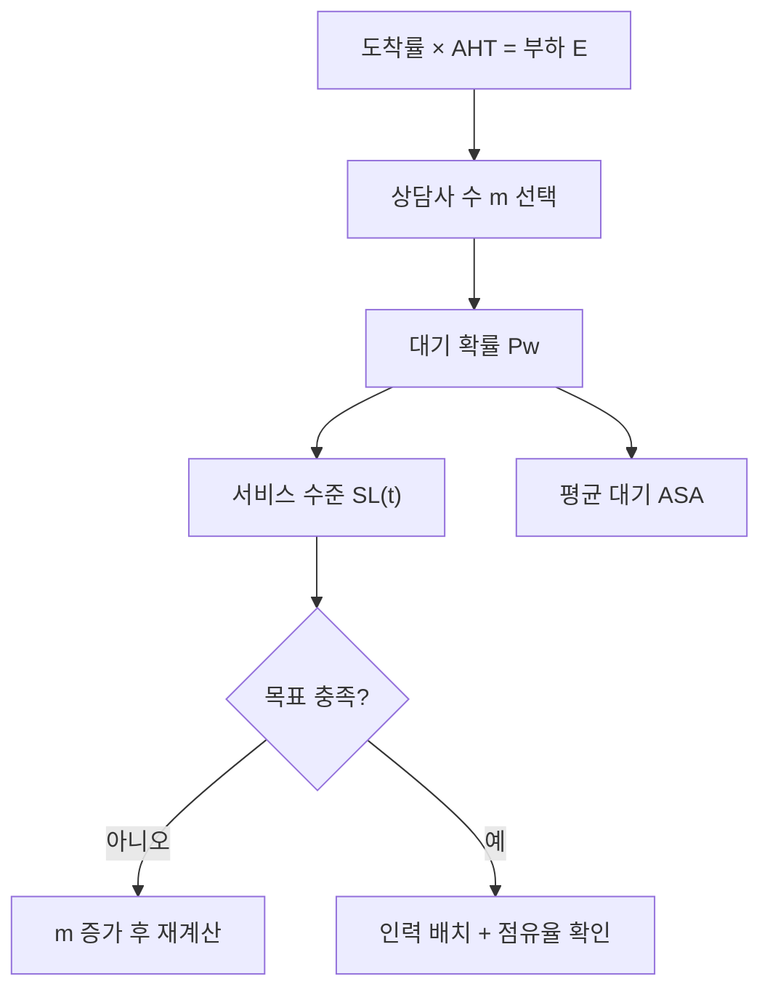

# Erlang C 모델

> 상담 센터 인력 산정에 쓰는 고전적 대기열 모델(M/M/c). **도착 부하(얼랭)와 상담사 수**로 "전화가 대기열에 들어갈 확률"과 평균 대기 시간, 서비스 수준(예: 20초 안에 80% 응답)을 계산한다. 고객이 중간에 끊지 않는다고 가정한다.

## 쉽게 말하면
계산대가 m개 있는 마트에서 손님이 평균 몇 명 도착하고 한 명 계산에 몇 분 걸리는지 알면, 줄이 생길 확률과 평균 줄 서는 시간을 수식으로 계산할 수 있다. 상담 센터는 계산대 대신 상담사다.

## 자세히
출처: Wikipedia "Erlang (unit)" 중 Erlang C 확률식과 가정(본문 확인)과 **직접 계산**(2026-11-18). 서비스 수준식과 평균 대기식은 M/M/c 대기열의 표준 결과이며 해당 페이지에는 적혀 있지 않다.
- **입력**: 부하 `E = 도착률 × 평균 처리 시간`(얼랭, 동시에 바쁜 평균 상담사 수), 상담사 수 m. E < m이어야 안정적(점유율 E/m < 1).
- **대기 확률**: `Pw = [(E^m/m!)·m/(m−E)] / [Σ_{i<m} E^i/i! + (E^m/m!)·m/(m−E)]`(문서).
- **평균 대기(표준 결과)**: 대기자 평균 `AHT/(m−E)`, 전체 평균(ASA) `Pw·AHT/(m−E)`. **서비스 수준**: `SL(t) = 1 − Pw·exp(−(m−E)·t/AHT)`.
- **가정(문서)**: 포아송 도착, 지수 분포 통화 시간(M/M/c), 대기열 무한, 대기 중 이탈 없음. 이탈을 무시하므로 "실제 필요한 것보다 더 많은 상담사"를 예측하는 경향이 있다(문서).
- **직접 계산 예**: 시간당 120통, 건당 300초 → E=10. 서비스 수준 "20초 안에 응답"의 상담사 수별 결과:

| 상담사 m | 점유율 | 대기 확률 | 20초 서비스 수준 | 평균 대기(전체) |
|---|---|---|---|---|
| 11 | 90.9% | 68.2% | 36.2% | 204.6초 |
| 12 | 83.3% | 44.9% | 60.7% | 67.4초 |
| 13 | 76.9% | 28.5% | 76.6% | 28.5초 |
| 14 | 71.4% | 17.4% | 86.7% | 13.1초 |
| 15 | 66.7% | 10.2% | 92.7% | 6.1초 |

  목표 80/20(20초 안에 80%)이면 최소 14명이 필요(점유율 약 71%). 부하와 같은 10명으로는 대기열이 끝없이 늘어난다.
- **AI 도입과의 연결(제안)**: AI가 쉬운 건을 처리해 사람에게 오는 평균 처리 시간(AHT)이 길어지고 건수는 줄어든다([AHT와 셀프서비스](#average-handle-time)). E가 어떻게 바뀌는지 다시 계산해 인력을 조정한다.
- **한계**: 도착이 시간대별로 변동, 통화 시간 꼬리가 길다, 이탈·재시도, 스킬 라우팅, 채팅 동시 처리는 모델에 없다. 모델은 출발점이며 시뮬레이션·실제 데이터로 보정한다.

## 그림으로 보기


## 예시
```python
from math import factorial, exp
def erlang_c(E, m):
    top = (E**m / factorial(m)) * m / (m - E)
    return top / (sum(E**i / factorial(i) for i in range(m)) + top)
def service_level(E, m, aht, t):
    return 1 - erlang_c(E, m) * exp(-(m - E) * t / aht)
service_level(10, 14, 300, 20)   # 약 0.867
```
교육 활용: 컨택센터 관리자가 AHT가 10% 줄거나 늘 때 필요한 상담사 수가 어떻게 바뀌는지 계산해 보는 실습.

## 헷갈리는 것과 비교
| 개념 | 차이 |
|---|---|
| Erlang C | 이탈 없는 대기열 모델 |
| Erlang B | 대기열 없이 끊기는(손실) 모델 |
| Erlang A | 이탈을 포함한 확장 모델 |
| [대기 시간 추정의 한계](#wait-time-estimation-limits) | 높은 점유율에서 추정이 불안정한 이유 |

## 더 읽을거리
- [Wikipedia: Erlang (unit)](https://en.wikipedia.org/wiki/Erlang_(unit)) — Erlang C 확률식과 가정, 이탈 무시의 한계
