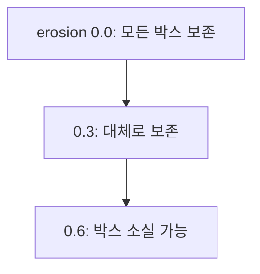

# erosion_rate 설정

> 박스 보존 크롭(`BBoxSafeRandomCrop`·`RandomSizedBBoxSafeCrop`)에서 **"모든 박스를 감싸는 영역(합집합)을 얼마나 줄여서 크롭 후보로 삼을지"** 정하는 값이다. 0이면 모든 박스를 반드시 보존하고, 키울수록 크롭이 자유로워지지만 박스가 잘리거나 사라질 수 있다.

## 쉽게 말하면
사진에서 사람들이 모여 있는 영역에 노란 테이프로 사각형을 쳤다고 하자. erosion_rate 0은 테이프 바깥으로만 자를 수 있다는 뜻이고, 값을 키우면 테이프 안쪽까지 파고들어 자를 수 있다. 다양한 구도는 늘지만 사람이 잘릴 수 있다.

## 자세히
- 공식 docstring(Albumentations 2.0.8): ① 박스들의 합집합을 계산 ② erosion_rate만큼 이 합집합을 줄임 ③ 이미지 좌표 범위로 자름 ④ 그 영역 안에서 크롭 좌표를 무작위로 뽑음. `erosion_rate=0.0`이면 **모든 박스가 크롭에 보존**된다. 박스가 없으면 erosion_rate에 따라 크롭 높이를 정하고 가로세로 비를 유지한다.
- 직접 실험(640×480 이미지, 박스 2개 `[100,100,200,200]`, `[400,300,500,400]` → 합집합 400×300, 시드 300개):
  | erosion_rate | 크롭 너비 범위 | 크롭 높이 범위 | 보존된 박스 수 |
  |---|---|---|---|
  | 0.0 | 408~631 | 303~469 | 항상 2개(최소 2) |
  | 0.3 | 291~627 | 215~463 | 평균 2.0, 최소 2 |
  | 0.6 | 176~622 | 127~458 | 평균 1.81, **최소 0** |
  - 해석: 0에서는 최소 크롭이 합집합(400×300)보다 커서 안전하고, 값이 커질수록 작은 크롭이 가능해지다가 0.6에서는 박스가 사라지는 경우가 생겼다. (이 표의 수치는 이 실험 설정에서만 의미가 있다.)
- `RandomSizedBBoxSafeCrop(height, width, erosion_rate)`: 같은 방식으로 자른 뒤 **지정한 크기로 리사이즈**한다. 실험에서 출력이 항상 (224, 224)였고 erosion_rate 0.0·0.4 모두 박스 2개가 유지됐다(0.4는 이번 시드 200개에서 문제 없었으나 보장은 아님).
- 고르는 법(제안): 모든 객체가 필요하면 0, 작은 물체가 많고 구도 다양성이 필요하면 0.2~0.3에서 시작해 [그려 보기 점검](#draw-bbox-sanity-check)과 박스 소실 비율을 함께 본다.

## 그림으로 보기



## 예시
```python
A.Compose([A.BBoxSafeRandomCrop(erosion_rate=0.2, p=1)],
  bbox_params=A.BboxParams(format='pascal_voc', label_fields=['l']))
```
- 교육: "안전과 다양성은 맞바꿈 관계"라는 설정값 설명 사례.

## 헷갈리는 것과 비교
| 개념 | 차이 |
|---|---|
| erosion_rate | 박스 합집합 축소 비율 |
| [min_visibility](#min-visibility-filter) | 잘린 뒤 남은 박스를 남길지 정하는 기준 |
| [RandomSizedBBoxSafeCrop](#random-sized-bbox-safe-crop) | 크롭 후 크기를 지정해 리사이즈 |

## 더 읽을거리
- [Albumentations 문서](https://albumentations.ai/docs/api-reference/) — `BBoxSafeRandomCrop` docstring 확인(설치 버전에서 읽음).
- 직접 실행: Albumentations 2.0.8 300 시드 실험.
