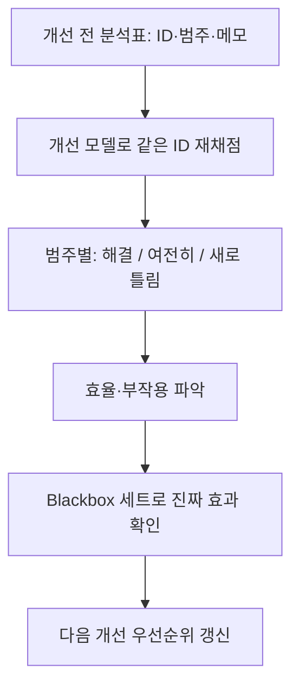
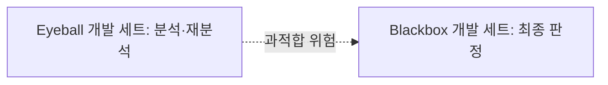

# 오류 분석 재분석

> 개선을 적용한 뒤에는 **처음 분석한 예시 ID를 그대로 다시 채점**해 어떤 범주가 얼마나 줄었는지, 새로 생긴 오류는 없는지 확인한다. 전체 점수 변화만 보면 어디가 좋아졌고 어디가 나빠졌는지 모른다.

## 쉽게 말하면
다이어트 전후에 체중만 재면 근육이 빠졌는지 지방이 빠졌는지 모른다. 같은 사람의 같은 검사 항목을 다시 재야 변화의 정체가 보인다. 오류 분석도 "같은 문제들"을 개선 전후로 다시 보는 것이다.

## 자세히
- **절차(권장)**
  1. 개선 전 분석표에서 **예시 ID·범주·메모**를 보존한다(원본은 수정하지 않음).
  2. 개선 모델로 같은 개발 세트를 다시 돌린다.
  3. **같은 예시 ID**에 대해 맞힘/틀림을 새 열로 추가한다.
  4. 범주별로 집계: ① 해결됨(전엔 틀렸고 이젠 맞음) ② 여전히 틀림 ③ **새로 틀림(퇴행)**.
  5. 새로 틀린 예시는 새 분석 행으로 추가해 범주를 붙인다.
- **개선 효과 요약표 서식**
  | 범주 | 전 오류 수 | 해결 | 여전히 | 새로 생김 |
  |---|---|---|---|---|
  | 흐림 | 61 | 20 | 41 | 3 |
  | 큰 고양이 | 43 | 30 | 13 | 5 |
  | 라벨 오류 | 6 | 0 | 6 | 0 |
  (가상 수치) 흐림 개선이 61건 중 20건(약 33%)만 해결했다면 "효율 33%"를 다음 계획의 기대치로 쓴다([상한 vs 효율](#improvement-efficiency-vs-ceiling)). 새로 생긴 3건·5건은 부작용이다.
- **눈으로 본 데이터에 대한 과적합(Ng, Machine Learning Yearning 초안 17장, 본문 확인)**: 오류 분석을 하려고 개발 세트를 직접 들여다보면 그 부분에 **더 빨리 과적합**한다. 그래서 개발 세트를 **Eyeball 개발 세트**(눈으로 볼 것; 예: 5,000개 중 10%인 500개로 오류가 약 100개)와 **Blackbox 개발 세트**(나머지 4,500개; 자동 평가·하이퍼파라미터 선택용, 눈으로 보지 않음)로 나눈다. Eyeball 성능이 Blackbox보다 훨씬 빨리 오르면 Eyeball에 과적합한 것이므로 새 Eyeball 세트를 만들거나 새 데이터를 확보한다.
  → 재분석은 **Eyeball 세트의 같은 ID**로 하되, 개선 효과의 **진짜 판정은 Blackbox 세트의 점수**로 한다.
- **재분석에서 얻는 판단**: 범주가 줄었는지, 효율이 예상보다 낮은지, 새 범주가 부상했는지(큰 범주를 고치면 이전에 가려졌던 작은 범주가 상대적으로 커짐), 라벨 오류 비중이 커졌는지([라벨 오류 비중](#label-error-share-of-errors)).
- **주기**: 큰 개선(모델·데이터·프롬프트 변경)마다 한 번. 분석 자체가 오래 걸리면 범주 정의를 고정하고 자동 체크(규칙·LLM)와 일부 사람 검증을 섞는다.
- **함정**: 개선을 보고 범주 정의를 바꾸면 전후 비교가 깨진다. 정의 변경 시 이전 표도 새 정의로 재체크한다([정의 한 줄](#category-definition-one-liner)).

## 그림으로 보기



## 예시
```python
before = pd.read_csv("analysis_v1.csv")           # id, category flags, wrong_v1
after  = pd.DataFrame({"id": ids, "wrong_v2": new_wrong})
m = before.merge(after, on="id")
for c in ["blurry", "great_cat"]:
    sub = m[m[c] == 1]
    print(c, "해결:", ((sub.wrong_v1 == 1) & (sub.wrong_v2 == 0)).sum(),
          "여전:", ((sub.wrong_v1 == 1) & (sub.wrong_v2 == 1)).sum())
print("새로 틀림:", ((m.wrong_v1 == 0) & (m.wrong_v2 == 1)).sum())
```

## 헷갈리는 것과 비교
| 개념 | 설명 |
|---|---|
| 재분석 | 같은 ID로 전후 비교 |
| 새 분석 | 새 오류 표본으로 다시 범주화 |
| Eyeball 세트 | 분석용 눈으로 보는 세트 |
| Blackbox 세트 | 자동 평가·선택용, 눈으로 안 봄 |

## 더 읽을거리
- [Andrew Ng, Machine Learning Yearning(초안 PDF) 17장](https://home-wordpress.deeplearning.ai/wp-content/uploads/2022/03/andrew-ng-machine-learning-yearning.pdf) — Eyeball·Blackbox 개발 세트(본문 열어 확인; 전후 비교표는 이 글의 권장안).
