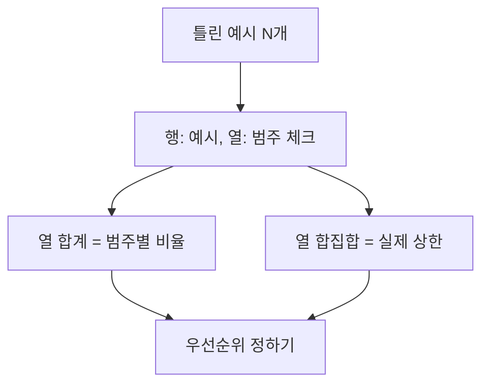
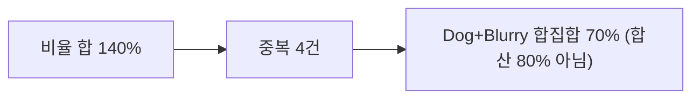

# 오류 분석 스프레드시트

> 모델이 틀린 예시를 행으로, 오류 원인 범주를 열로 놓고 **해당하면 표시**하는 표다. 범주별 비율과 중복을 한눈에 계산해 무엇부터 고칠지 정한다.

## 쉽게 말하면
틀린 시험 문제 목록에 "단위 실수 / 계산 실수 / 문제 오독" 같은 열을 만들어 해당 칸에 체크하는 오답 노트다. 체크 수를 세면 어떤 실수가 가장 흔한지 보인다.

## 자세히
- **구조(제안, 실무에서 쓰이는 관행)**: 행 = 틀린 개발 세트 예시(보통 100개 안팎), 열 = `id`, 메모(자유 서술), 범주별 체크 열(개·큰 고양이·흐림·라벨 오류 등). 한 예시가 **여러 범주에 동시에 체크**될 수 있다.
- **직접 계산(장난감 표: 틀린 예시 10개, 범주 Dog·GreatCat·Blurry·Mislabeled, pandas로 집계)**
  - 범주별 비율: Dog 20%, GreatCat 40%, Blurry 60%, Mislabeled 20%. **합 140%**(중복 때문).
  - 두 범주 이상에 속한 오류 4개, 어느 범주에도 안 속한 오류 0개.
  - Dog와 Blurry를 모두 고친다고 할 때의 **합집합 상한은 70%**인데 비율을 단순히 더하면 80%로 과대평가된다. 중복 때문에 **범주 비율의 합은 상한이 아니다**([범주별 상한](#error-category-ceiling)). 상한은 해당 범주 열의 합집합으로 계산한다.
- **운영 팁(제안)**
  1. 처음에는 범주를 미리 정하지 말고 **메모 열에 오류 사유를 적고** 반복되는 패턴을 범주로 만든다.
  2. 새 범주가 생기면 열을 추가하고 이전 예시를 다시 훑는다(반복 과정).
  3. **라벨 오류 열**을 항상 둔다([개발 세트 라벨 오류 수정 기준](#mislabeled-dev-set-threshold)).
  4. 범주 정의는 한 줄로 적어 두고(체크 기준 통일) 두 사람이 같은 20개를 표시해 [일치도](#inter-annotator-agreement)를 확인.
  5. 비율에는 표본 수를 함께 적고 [신뢰구간](#category-share-confidence-interval)으로 불확실성을 표시.
  6. 분석 후 예시 ID와 범주를 파일로 보관해 개선 뒤 같은 예시로 재분석.
- **도구**: 스프레드시트나 CSV + pandas로 충분하다. 열 합계, `COUNTIF`로 비율, `OR` 합집합으로 상한 계산.
- 장난감 표라 비율의 불확실성은 매우 크다(10개). 실제로는 100개 이상.

## 그림으로 보기



## 예시
| id | 메모 | Dog | GreatCat | Blurry | Mislabeled |
|---|---|---|---|---|---|
| 2 | 흐리고 사자 | | x | x | |
| 5 | 정답지가 틀림 | | | | x |
| 7 | 강아지 + 흐림 | x | | x | |
```python
import pandas as pd
df = pd.read_csv("errors.csv"); cats = ["Dog", "GreatCat", "Blurry", "Mislabeled"]
m = df[cats].notna().astype(int)
print(m.mean())                              # 범주별 비율
print((m[["Dog", "Blurry"]].sum(axis=1) > 0).mean())   # 합집합 상한
```
- 교육: 오답 노트로 약점 유형을 찾는 학습법과 같은 구조.

## 헷갈리는 것과 비교
| 개념 | 차이 |
|---|---|
| 오류 분석 스프레드시트 | 예시×범주 체크 표 |
| 혼동 행렬 | 클래스 간 예측/정답 조합 |
| [범주별 개선 상한](#error-category-ceiling) | 이 표에서 계산하는 결과 |
| [경계 사례 로그](#edge-case-log-template) | 라벨링 규칙 결정 기록 |

## 더 읽을거리
- [Machine Learning Yearning 오류 분석 초안(비공식 사본)](https://orefa.github.io/machine-learning-yearning-book/draft/Ng_MLY13-53-58.pdf) — 부분별 오류 분석 장(열어 확인, 스프레드시트 장은 다른 장).
- [pandas 문서: DataFrame.mean](https://pandas.pydata.org/docs/reference/api/pandas.DataFrame.mean.html) — 열별 비율 계산(미열람).
